# Digital Signal Processing (DSP) — Complete 5-Module Exam Preparation Guide
## B.Tech EXTC Semester V | SVKM's D. J. Sanghvi College of Engineering

> **Quick Navigation:**
> * [Module 1: DFT & Fast Fourier Transforms (FFT)](#part-1-discrete-fourier-transform-dft--fast-fourier-transform-fft)
> * [Module 2: Analysis of Linear Time-Invariant (LTI) Systems](#module-2-analysis-of-linear-time-invariant-lti-systems)
> * [Module 3: FIR Digital Filters & Realization](#part-2-characteristics-design--realization-of-fir-digital-filters)
> * [Module 4: IIR Digital Filters & Realization (Highest Yield)](#part-3-iir-digital-filters--realization-highest-yield--priority)
> * [Module 5: Finite Word Length Effects in Digital Filters](#module-5-finite-word-length-effects-in-digital-filters)
> * [Appendix: 10 Core DFT Properties Explained with Numerical Examples](#appendix-10-core-dft-properties-explained-with-step-by-step-examples)

---

# DSP Exam-Only Preparation Guide: Modules 1, 3 & 4

---

## Part 1: Discrete Fourier Transform (DFT) & Fast Fourier Transform (FFT)

```
                            Discrete Fourier Transform (DFT)
                                          │
        ┌─────────────────────────────────┼─────────────────────────────────┐
        ▼                                 ▼                                 ▼
 Radix-2 FFT (DIT / DIF)       Block Filtering Methods           Circular Shift & Properties
  • Bit-reversal input/output   • Overlap-Add: sum overlaps       • Time-shift: phase factor W_N^(km)
  • N/2 log2(N) complex mults   • Overlap-Save: discard M-1       • Circular convolution via DFT
```

---

### Topic 1.1: Fast Fourier Transforms (FFT) — Radix-2 DIT & DIF Algorithms

#### Core Formulas & Butterfly Equations
* **Twiddle Factor**: $W_N^k = e^{-j \frac{2\pi k}{N}} = \cos\left(\frac{2\pi k}{N}\right) - j \sin\left(\frac{2\pi k}{N}\right)$
* **Computational Complexity**:
  * Direct DFT: $N^2$ complex multiplications, $N(N-1)$ complex additions.
  * Radix-2 FFT: $\frac{N}{2}\log_2 N$ complex multiplications, $N\log_2 N$ complex additions.
  * For $N=8$: FFT requires $\frac{8}{2}(3) = 12$ complex multiplications vs. $8^2 = 64$ for direct DFT (an 81.25% reduction).
* **Decimation-in-Time (DIT)**: Bit-reversed input, normal order output.
  * Butterfly: $X_m(p) = X_{m-1}(p) + W_N^r X_{m-1}(q)$, $\quad X_m(q) = X_{m-1}(p) - W_N^r X_{m-1}(q)$
* **Decimation-in-Frequency (DIF)**: Normal order input, bit-reversed output.
  * Butterfly: $X_m(p) = X_{m-1}(p) + X_{m-1}(q)$, $\quad X_m(q) = [X_{m-1}(p) - X_{m-1}(q)] W_N^r$

---

#### Question 1.1.1 (Dec 2025 — Final Exam)
> **Question:** Find the 8-point DFT of $x(n) = \{1, 2, 3, 4, 5, 0, 0, 0\}$ by Radix-2 DIT-FFT or DIF-FFT algorithm.  
> **Exam:** Final Examination (2025–2026), Dec 2025 | **Marks:** 8 Marks  
> **Official Solution Link:** [ANS-Sem-V-EXTC-Digital Signal Processing.pdf](./ANS-Sem-V-EXTC-Digital%20Signal%20Processing.pdf#page=1)

**Step-by-Step Mathematical Solution (Radix-2 DIT-FFT):**

1. **Bit Reversal of Input Sequence ($N=8$):**
   * $n = 0 \ (000_2) \to 000_2 = 0 \implies x(0) = 1$
   * $n = 1 \ (001_2) \to 100_2 = 4 \implies x(4) = 5$
   * $n = 2 \ (010_2) \to 010_2 = 2 \implies x(2) = 3$
   * $n = 3 \ (011_2) \to 110_2 = 6 \implies x(6) = 0$
   * $n = 4 \ (100_2) \to 001_2 = 1 \implies x(1) = 2$
   * $n = 5 \ (101_2) \to 101_2 = 5 \implies x(5) = 0$
   * $n = 6 \ (110_2) \to 011_2 = 3 \implies x(3) = 4$
   * $n = 7 \ (111_2) \to 111_2 = 7 \implies x(7) = 0$

2. **Stage 1 Computations ($W_8^0 = 1$):**
   * $v_0 = x(0) + W_8^0 x(4) = 1 + 5 = 6$
   * $v_1 = x(0) - W_8^0 x(4) = 1 - 5 = -4$
   * $v_2 = x(2) + W_8^0 x(6) = 3 + 0 = 3$
   * $v_3 = x(2) - W_8^0 x(6) = 3 - 0 = 3$
   * $v_4 = x(1) + W_8^0 x(5) = 2 + 0 = 2$
   * $v_5 = x(1) - W_8^0 x(5) = 2 - 0 = 2$
   * $v_6 = x(3) + W_8^0 x(7) = 4 + 0 = 4$
   * $v_7 = x(3) - W_8^0 x(7) = 4 - 0 = 4$

3. **Stage 2 Computations ($W_8^0 = 1, W_8^2 = -j$):**
   * $u_0 = v_0 + W_8^0 v_2 = 6 + 3 = 9$
   * $u_1 = v_1 + W_8^2 v_3 = -4 + (-j)(3) = -4 - 3j$
   * $u_2 = v_0 - W_8^0 v_2 = 6 - 3 = 3$
   * $u_3 = v_1 - W_8^2 v_3 = -4 - (-j)(3) = -4 + 3j$
   * $u_4 = v_4 + W_8^0 v_6 = 2 + 4 = 6$
   * $u_5 = v_5 + W_8^2 v_7 = 2 + (-j)(4) = 2 - 4j$
   * $u_6 = v_4 - W_8^0 v_6 = 2 - 4 = -2$
   * $u_7 = v_5 - W_8^2 v_7 = 2 - (-j)(4) = 2 + 4j$

4. **Stage 3 Computations ($W_8^0 = 1, W_8^1 = \frac{1-j}{\sqrt{2}} \approx 0.7071 - 0.7071j, W_8^2 = -j, W_8^3 = \frac{-1-j}{\sqrt{2}} \approx -0.7071 - 0.7071j$):**
   * $X(0) = u_0 + W_8^0 u_4 = 9 + 6 = 15$
   * $X(1) = u_1 + W_8^1 u_5 = (-4 - 3j) + (0.7071 - 0.7071j)(2 - 4j)$
     $$(0.7071 - 0.7071j)(2 - 4j) = 0.7071 [2 - 4j - 2j - 4] = 0.7071(-2 - 6j) = -1.4142 - 4.2426j$$
     $$X(1) = (-4 - 3j) + (-1.4142 - 4.2426j) = -5.4142 - 7.2426j$$
   * $X(2) = u_2 + W_8^2 u_6 = 3 + (-j)(-2) = 3 + 2j$
   * $X(3) = u_3 + W_8^3 u_7 = (-4 + 3j) + (-0.7071 - 0.7071j)(2 + 4j)$
     $$(-0.7071 - 0.7071j)(2 + 4j) = -0.7071 [2 + 4j + 2j - 4] = -0.7071(-2 + 6j) = 1.4142 - 4.2426j$$
     $$X(3) = (-4 + 3j) + (1.4142 - 4.2426j) = -2.5858 - 1.2426j$$
   * $X(4) = u_0 - W_8^0 u_4 = 9 - 6 = 3$
   * $X(5) = u_1 - W_8^1 u_5 = (-4 - 3j) - (-1.4142 - 4.2426j) = -2.5858 + 1.2426j = X^*(3)$
   * $X(6) = u_2 - W_8^2 u_6 = 3 - 2j = X^*(2)$
   * $X(7) = u_3 - W_8^3 u_7 = (-4 + 3j) - (1.4142 - 4.2426j) = -5.4142 + 7.2426j = X^*(1)$

**Final Answer:**
$$X(k) = \{15, \ -5.414 - 7.243j, \ 3 + 2j, \ -2.586 - 1.243j, \ 3, \ -2.586 + 1.243j, \ 3 - 2j, \ -5.414 + 7.243j\}$$

---

#### Question 1.1.2 (March 2026 — Re-Exam)
> **Question:** Find the 8-point DFT of $x(n) = \{1, 0, 2, 0, 3, 0, 4, 0\}$ by Radix-2 DIF-FFT algorithm.  
> **Exam:** Re-Examination (2025–2026), March 2026 | **Marks:** 8 Marks  
> **Official Solution Link:** [ANS_Re-Exam_Digital Signal Processing_2025-2026.pdf](./Sem-V%20QP%20Misc/sem%205%20last%20year%20reexam/Digital%20Signal%20Processing/ANS_Re-Exam_Digital%20Signal%20Processing%28DJS23ECPC501%29_Semester%20V_2025-2026.pdf#page=1)

**Step-by-Step Mathematical Solution (Radix-2 DIF-FFT):**

1. **Input in Normal Order ($N=8$):**
   $$x(n) = [x(0), x(1), x(2), x(3), x(4), x(5), x(6), x(7)] = [1, 0, 2, 0, 3, 0, 4, 0]$$

2. **Stage 1 (Pairing elements spaced by $N/2 = 4$):**
   * Upper half: $a_n = x(n) + x(n+4)$
     * $a_0 = x(0) + x(4) = 1 + 3 = 4$
     * $a_1 = x(1) + x(5) = 0 + 0 = 0$
     * $a_2 = x(2) + x(6) = 2 + 4 = 6$
     * $a_3 = x(3) + x(7) = 0 + 0 = 0$
   * Lower half: $b_n = [x(n) - x(n+4)] W_8^n$
     * $b_0 = [x(0) - x(4)] W_8^0 = (1 - 3)(1) = -2$
     * $b_1 = [x(1) - x(5)] W_8^1 = (0 - 0) W_8^1 = 0$
     * $b_2 = [x(2) - x(6)] W_8^2 = (2 - 4)(-j) = 2j$
     * $b_3 = [x(3) - x(7)] W_8^3 = (0 - 0) W_8^3 = 0$

3. **Stage 2 (Pairing elements spaced by $N/4 = 2$):**
   * Top branch (from $a_n$):
     * $c_0 = a_0 + a_2 = 4 + 6 = 10$
     * $c_1 = a_1 + a_3 = 0 + 0 = 0$
     * $c_2 = [a_0 - a_2] W_8^0 = (4 - 6)(1) = -2$
     * $c_3 = [a_1 - a_3] W_8^2 = (0 - 0)(-j) = 0$
   * Bottom branch (from $b_n$):
     * $d_0 = b_0 + b_2 = -2 + 2j$
     * $d_1 = b_1 + b_3 = 0 + 0 = 0$
     * $d_2 = [b_0 - b_2] W_8^0 = (-2 - 2j)(1) = -2 - 2j$
     * $d_3 = [b_1 - b_3] W_8^2 = (0 - 0)(-j) = 0$

4. **Stage 3 (Pairing adjacent elements spaced by 1):**
   * From $c_n$:
     * $X(0) = c_0 + c_1 = 10 + 0 = 10$
     * $X(4) = c_0 - c_1 = 10 - 0 = 10$
     * $X(2) = c_2 + c_3 = -2 + 0 = -2$
     * $X(6) = c_2 - c_3 = -2 - 0 = -2$
   * From $d_n$:
     * $X(1) = d_0 + d_1 = -2 + 2j$
     * $X(5) = d_0 - d_1 = -2 + 2j$
     * $X(3) = d_2 + d_3 = -2 - 2j$
     * $X(7) = d_2 - d_3 = -2 - 2j$

5. **Bit-Reversal Permutation to Natural Frequency Order:**
   * $X(0) = 10$
   * $X(1) = -2 + 2j$
   * $X(2) = -2$
   * $X(3) = -2 - 2j$
   * $X(4) = 10$
   * $X(5) = -2 + 2j$
   * $X(6) = -2$
   * $X(7) = -2 - 2j$

**Final Answer:**
$$X(k) = \{10, \ -2 + 2j, \ -2, \ -2 - 2j, \ 10, \ -2 + 2j, \ -2, \ -2 - 2j\}$$

---

#### Question 1.1.3 (TT1 — Term Test I)
> **Question:** Compute the 4-point DFT of the complex sequence $x(n) = \{1+3j, -2-5j, 2+3j, 5-4j\}$ using the Radix-2 DIT-FFT algorithm.  
> **Exam:** Term Test I (31/08/2026) | **Marks:** 5 Marks

**Step-by-Step Mathematical Solution:**

1. **Bit Reversal ($N=4$):**
   * $x(0) = 1 + 3j$
   * $x(2) = 2 + 3j$
   * $x(1) = -2 - 5j$
   * $x(3) = 5 - 4j$

2. **Stage 1 ($W_4^0 = 1$):**
   * $v_0 = x(0) + x(2) = (1 + 3j) + (2 + 3j) = 3 + 6j$
   * $v_1 = x(0) - x(2) = (1 + 3j) - (2 + 3j) = -1 + 0j = -1$
   * $v_2 = x(1) + x(3) = (-2 - 5j) + (5 - 4j) = 3 - 9j$
   * $v_3 = x(1) - x(3) = (-2 - 5j) - (5 - 4j) = -7 - j$

3. **Stage 2 ($W_4^0 = 1, W_4^1 = -j$):**
   * $X(0) = v_0 + W_4^0 v_2 = (3 + 6j) + (3 - 9j) = 6 - 3j$
   * $X(1) = v_1 + W_4^1 v_3 = -1 + (-j)(-7 - j) = -1 + (7j - 1) = -2 + 7j$
   * $X(2) = v_0 - W_4^0 v_2 = (3 + 6j) - (3 - 9j) = 0 + 15j = 15j$
   * $X(3) = v_1 - W_4^1 v_3 = -1 - (-1 + 7j) = 0 - 7j = -7j$

**Final Answer:**
$$X(k) = \{6 - 3j, \ -2 + 7j, \ 15j, \ -7j\}$$

---

### Topic 1.2: Filtering of Long Data Sequences — Overlap-Save & Overlap-Add

| Parameter | Overlap-Save Method | Overlap-Add Method |
| :--- | :--- | :--- |
| **Input Block Length** | $N = L + M - 1$ | $L$ samples (zero-padded with $M-1$ zeros to length $N$) |
| **Overlap Between Inputs** | Previous $M-1$ samples prepended | No overlap in input blocks |
| **Convolution Type** | $N$-point Circular Convolution | $N$-point Circular Convolution (equals linear convolution) |
| **Recombination Rule** | **Discard** first $M-1$ corrupted samples of each block | **Add (accumulate)** overlapping $M-1$ trailing samples |

---

#### Question 1.2.1 (March 2026 — Re-Exam)
> **Question:** A digital filter has the impulse response $h(n) = \{2, 2, 1\}$. Determine the output of the filter if the input sequence is $x(n) = \{3, 0, -2, 0, 2, 1\}$ using the **Overlap-Add method**.  
> **Exam:** Re-Examination (2025–2026), March 2026 | **Marks:** 5 Marks  
> **Official Solution Link:** [ANS_Re-Exam_Digital Signal Processing_2025-2026.pdf](./Sem-V%20QP%20Misc/sem%205%20last%20year%20reexam/Digital%20Signal%20Processing/ANS_Re-Exam_Digital%20Signal%20Processing%28DJS23ECPC501%29_Semester%20V_2025-2026.pdf#page=6)

**Step-by-Step Mathematical Solution:**

1. **Determine Parameters:**
   * Filter length $M = 3$ ($h(n) = \{2, 2, 1\}$).
   * Total input length $N_x = 6$. Choose block length $L = 3$.
   * Total section length $N = L + M - 1 = 3 + 3 - 1 = 5$.
   * Total output length $L_{\text{out}} = N_x + M - 1 = 6 + 3 - 1 = 8$.

2. **Partition Input into Blocks of Length $L=3$ & Zero-Pad to Length $N=5$:**
   * Block 1: $x_1(n) = \{3, 0, -2, 0, 0\}$
   * Block 2: $x_2(n) = \{0, 2, 1, 0, 0\}$

3. **Compute Linear Convolution of Each Block with $h(n) = \{2, 2, 1\}$:**
   * **For Block 1 ($y_1(n) = x_1(n) * h(n)$):**
     * $y_1(0) = 3 \times 2 = 6$
     * $y_1(1) = 3(2) + 0(2) = 6$
     * $y_1(2) = 3(1) + 0(2) + (-2)(2) = 3 - 4 = -1$
     * $y_1(3) = 0(1) + (-2)(2) + 0(2) = -4$
     * $y_1(4) = (-2)(1) + 0(2) + 0(1) = -2$
     $$\implies y_1(n) = \{6, 6, -1, -4, -2\}$$

   * **For Block 2 ($y_2(n) = x_2(n) * h(n)$):**
     * $y_2(0) = 0 \times 2 = 0$
     * $y_2(1) = 0(2) + 2(2) = 4$
     * $y_2(2) = 0(1) + 2(2) + 1(2) = 6$
     * $y_2(3) = 2(1) + 1(2) = 4$
     * $y_2(4) = 1(1) = 1$
     $$\implies y_2(n) = \{0, 4, 6, 4, 1\}$$

4. **Overlap-Add Recombination (Shift by $L=3$):**

```
n:        0    1    2     3     4    5    6    7
------------------------------------------------
y1(n):    6    6   -1    -4    -2
y2(n):                    0     4    6    4    1
------------------------------------------------
y(n):     6    6   -1    -4     2    6    4    1
```

* $y(0) = 6$
* $y(1) = 6$
* $y(2) = -1$
* $y(3) = -4 + 0 = -4$
* $y(4) = -2 + 4 = 2$
* $y(5) = 6$
* $y(6) = 4$
* $y(7) = 1$

**Final Answer:**
$$y(n) = \{6, \ 6, \ -1, \ -4, \ 2, \ 6, \ 4, \ 1\}$$

---

#### Question 1.2.2 (Dec 2024 — Final Exam)
> **Question:** Perform the **Overlap-Save method** to find the output of a filter whose impulse response $h(n) = \{1, 2\}$ and input signal $x(n) = \{1, 2, -1, 2, 3, -2, -3, -1, 1, 1, 2, -1\}$ using block length $N = 4$.  
> **Exam:** Final Examination (2024–2025), Dec 2024 | **Marks:** 7 Marks  
> **Official Solution Link:** [ANS_Final-Exam_Digital Signal Processing_2024-2025.pdf](./Sem-V%20QP%20Misc/ANS_Final-Exam_Digital%20Signal%20Processing%28DJS22EC504%29_Semester%20V_2024-2025.pdf#page=5)

**Step-by-Step Mathematical Solution:**

1. **Parameters:**
   * $h(n) = \{1, 2\} \implies M = 2$.
   * Total section size $N = 4 \implies L = N - M + 1 = 4 - 2 + 1 = 3$ new samples per block.
   * Number of samples discarded per block $= M - 1 = 1$.
   * Zero-pad $h(n)$ to length $N = 4$: $h_4(n) = \{1, 2, 0, 0\}$.

2. **Form Overlap-Save Input Blocks (Prepend previous $M-1 = 1$ sample):**
   * Block 1: $x_{1m}(n) = [0, \ 1, 2, -1]$ (prepend 0)
   * Block 2: $x_{2m}(n) = [-1, \ 2, 3, -2]$
   * Block 3: $x_{3m}(n) = [-2, \ -3, -1, 1]$
   * Block 4: $x_{4m}(n) = [1, \ 1, 2, -1]$

3. **Perform 4-point Circular Convolution $y_{km}(n) = x_{km}(n) \mathbin{\circledast}_4 h_4(n)$:**
   * **Block 1:** $x_{1m} = [0, 1, 2, -1]$
     $$\begin{bmatrix} y_{1m}(0) \\ y_{1m}(1) \\ y_{1m}(2) \\ y_{1m}(3) \end{bmatrix} = \begin{bmatrix} 1 & 0 & 0 & 2 \\ 2 & 1 & 0 & 0 \\ 0 & 2 & 1 & 0 \\ 0 & 0 & 2 & 1 \end{bmatrix} \begin{bmatrix} 0 \\ 1 \\ 2 \\ -1 \end{bmatrix} = \begin{bmatrix} -2 \\ 1 \\ 4 \\ 3 \end{bmatrix}$$
     * Discard index 0 $\implies$ Keep: $\{1, 4, 3\}$.

   * **Block 2:** $x_{2m} = [-1, 2, 3, -2]$
     $$\begin{bmatrix} y_{2m}(0) \\ y_{2m}(1) \\ y_{2m}(2) \\ y_{2m}(3) \end{bmatrix} = \begin{bmatrix} 1 & 0 & 0 & 2 \\ 2 & 1 & 0 & 0 \\ 0 & 2 & 1 & 0 \\ 0 & 0 & 2 & 1 \end{bmatrix} \begin{bmatrix} -1 \\ 2 \\ 3 \\ -2 \end{bmatrix} = \begin{bmatrix} -5 \\ 0 \\ 7 \\ 4 \end{bmatrix}$$
     * Discard index 0 $\implies$ Keep: $\{0, 7, 4\}$.

   * **Block 3:** $x_{3m} = [-2, -3, -1, 1]$
     $$\begin{bmatrix} y_{3m}(0) \\ y_{3m}(1) \\ y_{3m}(2) \\ y_{3m}(3) \end{bmatrix} = \begin{bmatrix} 1 & 0 & 0 & 2 \\ 2 & 1 & 0 & 0 \\ 0 & 2 & 1 & 0 \\ 0 & 0 & 2 & 1 \end{bmatrix} \begin{bmatrix} -2 \\ -3 \\ -1 \\ 1 \end{bmatrix} = \begin{bmatrix} 0 \\ -7 \\ -7 \\ -1 \end{bmatrix}$$
     * Discard index 0 $\implies$ Keep: $\{-7, -7, -1\}$.

   * **Block 4:** $x_{4m} = [1, 1, 2, -1]$
     $$\begin{bmatrix} y_{4m}(0) \\ y_{4m}(1) \\ y_{4m}(2) \\ y_{4m}(3) \end{bmatrix} = \begin{bmatrix} 1 & 0 & 0 & 2 \\ 2 & 1 & 0 & 0 \\ 0 & 2 & 1 & 0 \\ 0 & 0 & 2 & 1 \end{bmatrix} \begin{bmatrix} 1 \\ 1 \\ 2 \\ -1 \end{bmatrix} = \begin{bmatrix} -1 \\ 3 \\ 4 \\ 3 \end{bmatrix}$$
     * Discard index 0 $\implies$ Keep: $\{3, 4, 3\}$.
   * **Block 5 (Zero-Padded Block to Capture Filter Transient Tail):**
     Since input $x(n)$ of length $L_x = 12$ convolved with $h(n)$ of length $M = 2$ must produce a total of $L_y = L_x + M - 1 = 13$ linear convolution samples, append $M-1 = 1$ zero at the end ($x(12) = 0$) and form the 5th block:
     $x_{5m}(n) = [-1, 0, 0, 0]$ (prepending last sample $x(11) = -1$, followed by $x(12) = 0$ zero-padded to length 4):
     $$\begin{bmatrix} y_{5m}(0) \\ y_{5m}(1) \\ y_{5m}(2) \\ y_{5m}(3) \end{bmatrix} = \begin{bmatrix} 1 & 0 & 0 & 2 \\ 2 & 1 & 0 & 0 \\ 0 & 2 & 1 & 0 \\ 0 & 0 & 2 & 1 \end{bmatrix} \begin{bmatrix} -1 \\ 0 \\ 0 \\ 0 \end{bmatrix} = \begin{bmatrix} -1 \\ -2 \\ 0 \\ 0 \end{bmatrix}$$
     * Discard index 0 $\implies$ Keep: $\{-2\}$ (the 13th sample, $y(12) = -2$).

4. **Concatenate Kept Samples:**
   $$y(n) = \{1, 4, 3, \ 0, 7, 4, \ -7, -7, -1, \ 3, 4, 3, \ -2\}$$

---

### Topic 1.3: Circular Convolution of Sequences using DFT & Matrix Method

#### Question 1.3.1 (Dec 2025 — Final Exam)
> **Question:** Perform the circular convolution, $q(n)$, of two sequences $x(n) = \{1, 2, 3\}$ and $y(n) = \{2, 3, 4, 1\}$.  
> **Exam:** Final Examination (2025–2026), Dec 2025 | **Marks:** 5 Marks  
> **Official Solution Link:** [ANS-Sem-V-EXTC-Digital Signal Processing.pdf](./ANS-Sem-V-EXTC-Digital%20Signal%20Processing.pdf#page=5)

**Step-by-Step Mathematical Solution:**

1. **Equalize Lengths to $N = \max(L_1, L_2) = 4$ by Zero-Padding:**
   $$x(n) = \{1, 2, 3, 0\}, \quad y(n) = \{2, 3, 4, 1\}$$

2. **Construct the Circular Convolution Matrix (Circulant Matrix of $y(n)$):**
   $$q(n) = \begin{bmatrix} y(0) & y(3) & y(2) & y(1) \\ y(1) & y(0) & y(3) & y(2) \\ y(2) & y(1) & y(0) & y(3) \\ y(3) & y(2) & y(1) & y(0) \end{bmatrix} \begin{bmatrix} x(0) \\ x(1) \\ x(2) \\ x(3) \end{bmatrix}$$
   $$\begin{bmatrix} q(0) \\ q(1) \\ q(2) \\ q(3) \end{bmatrix} = \begin{bmatrix} 2 & 1 & 4 & 3 \\ 3 & 2 & 1 & 4 \\ 4 & 3 & 2 & 1 \\ 1 & 4 & 3 & 2 \end{bmatrix} \begin{bmatrix} 1 \\ 2 \\ 3 \\ 0 \end{bmatrix}$$

3. **Multiply Row by Column:**
   * $q(0) = 2(1) + 1(2) + 4(3) + 3(0) = 2 + 2 + 12 + 0 = 16$
   * $q(1) = 3(1) + 2(2) + 1(3) + 4(0) = 3 + 4 + 3 + 0 = 10$
   * $q(2) = 4(1) + 3(2) + 2(3) + 1(0) = 4 + 6 + 6 + 0 = 16$
   * $q(3) = 1(1) + 4(2) + 3(3) + 2(0) = 1 + 8 + 9 + 0 = 18$

**Final Answer:**
$$q(n) = \{16, \ 10, \ 16, \ 18\}$$

---

### Topic 1.4: DFT Properties & Circular Shift Problems

#### Circular Time-Shift Property
$$\mathcal{DFT}_N\{x((n - m))_N\} = X(k) e^{-j \frac{2\pi}{N} k m} = X(k) W_N^{k m}$$

#### Question 1.4.1 (Dec 2025 — Final Exam)
> **Question:** Find the DFT of four-point sequence $x(n) = \{2, 4, 3, 1\}$. Without performing DFT or IDFT, find the DFT of $x_1(n) = x((n-1))_4$.  
> **Exam:** Final Examination (2025–2026), Dec 2025 | **Marks:** 5 Marks  
> **Official Solution Link:** [ANS-Sem-V-EXTC-Digital Signal Processing.pdf](./ANS-Sem-V-EXTC-Digital%20Signal%20Processing.pdf#page=5)

**Step-by-Step Mathematical Solution:**

1. **Calculate the 4-point DFT $X(k)$ of $x(n) = \{2, 4, 3, 1\}$:**
   $$X(k) = \sum_{n=0}^{3} x(n) W_4^{k n}, \quad \text{where } W_4 = e^{-j \pi / 2} = -j$$
   * For $k = 0$:
     $$X(0) = 2 + 4 + 3 + 1 = 10$$
   * For $k = 1$:
     $$X(1) = 2(1) + 4(-j) + 3(-1) + 1(j) = 2 - 4j - 3 + j = -1 - 3j$$
   * For $k = 2$:
     $$X(2) = 2(1) + 4(-1) + 3(1) + 1(-1) = 2 - 4 + 3 - 1 = 0$$
   * For $k = 3$:
     $$X(3) = X^*(1) = -1 + 3j$$
   $$\implies X(k) = \{10, \ -1 - 3j, \ 0, \ -1 + 3j\}$$

2. **Apply Circular Shift Property for $m = 1$:**
   $$X_1(k) = \mathcal{DFT}\{x((n-1))_4\} = X(k) W_4^{1 \cdot k} = X(k) (-j)^k$$
   * For $k = 0$: $X_1(0) = X(0) \cdot (-j)^0 = 10 \times 1 = 10$
   * For $k = 1$: $X_1(1) = X(1) \cdot (-j)^1 = (-1 - 3j)(-j) = j + 3j^2 = -3 + j$
   * For $k = 2$: $X_1(2) = X(2) \cdot (-j)^2 = 0 \times (-1) = 0$
   * For $k = 3$: $X_1(3) = X(3) \cdot (-j)^3 = (-1 + 3j)(j) = -j + 3j^2 = -3 - j$

**Final Answer:**
$$X_1(k) = \{10, \ -3 + j, \ 0, \ -3 - j\}$$

---

#### Question 1.4.2 (March 2026 — Re-Exam)
> **Question:** Find the DFT of $x(n) = \{2, 3, 4, 5\}$. Using these results and not otherwise, find the DFT of $x_1(n) = \{5, 2, 3, 4\}$.  
> **Exam:** Re-Examination (2025–2026), March 2026 | **Marks:** 5 Marks  
> **Official Solution Link:** [ANS_Re-Exam_Digital Signal Processing_2025-2026.pdf](./Sem-V%20QP%20Misc/sem%205%20last%20year%20reexam/Digital%20Signal%20Processing/ANS_Re-Exam_Digital%20Signal%20Processing%28DJS23ECPC501%29_Semester%20V_2025-2026.pdf#page=5)

**Step-by-Step Mathematical Solution:**

1. **Compute DFT of $x(n) = \{2, 3, 4, 5\}$:**
   * $X(0) = 2 + 3 + 4 + 5 = 14$
   * $X(1) = 2(1) + 3(-j) + 4(-1) + 5(j) = 2 - 3j - 4 + 5j = -2 + 2j$
   * $X(2) = 2(1) + 3(-1) + 4(1) + 5(-1) = 2 - 3 + 4 - 5 = -2$
   * $X(3) = X^*(1) = -2 - 2j$
   $$\implies X(k) = \{14, \ -2 + 2j, \ -2, \ -2 - 2j\}$$

2. **Identify Relation:**
   $$x_1(n) = \{5, 2, 3, 4\} = x((n-1))_4 \quad (\text{circular right shift by } m = 1)$$

3. **Apply Circular Shift Theorem:**
   $$X_1(k) = X(k) W_4^k = X(k) (-j)^k$$
   * $X_1(0) = 14(1) = 14$
   * $X_1(1) = (-2 + 2j)(-j) = 2j - 2j^2 = 2 + 2j$
   * $X_1(2) = (-2)(-1) = 2$
   * $X_1(3) = (-2 - 2j)(j) = -2j - 2j^2 = 2 - 2j$

**Final Answer:**
$$X_1(k) = \{14, \ 2 + 2j, \ 2, \ 2 - 2j\}$$

---

### Topic 1.5: Frequency Analysis of Signals Using the DFT

#### Exam Model / Core Question
> **Question:** Explain frequency analysis of continuous and discrete-time signals using DFT. Define frequency resolution, spectral leakage, and the picket-fence effect, and state how each is controlled.  
> **Type:** Core Model Question | **Marks:** 5 Marks

**Key Derivations & Points for Full Marks:**

1. **Relationship between Continuous Frequency ($f$ or $\Omega$) and DFT Bin Index ($k$):**
   * If a continuous signal $x_a(t)$ is sampled at $F_s = 1/T$ for a duration $T_0 = N T$:
     $$f_k = k \frac{F_s}{N} = \frac{k}{T_0}, \quad \omega_k = \frac{2\pi k}{N} \quad (0 \le k \le N-1)$$
   * **Frequency Resolution ($\Delta f$):**
     $$\Delta f = \frac{F_s}{N} = \frac{1}{T_0}$$
     Resolution depends **only** on the total record length $T_0$, **not** on zero-padding.

2. **Spectral Leakage:**
   * Occurs when the continuous signal contains frequencies that do **not** fall exactly on an integer DFT bin ($f \neq k F_s/N$), causing truncation by a rectangular window in the time domain.
   * In the frequency domain, the spectrum convolves with $\frac{\sin(\pi f N T)}{\sin(\pi f T)}$, spreading energy into adjacent bins.
   * **Remedy:** Apply tapered windows (Hamming, Hanning, Blackman) with lower side-lobe levels.

3. **Picket Fence Effect:**
   * The DFT acts as a bank of discrete bandpass filters sampled at discrete points $\omega_k = 2\pi k / N$. Peaks falling between bins are attenuated (scalloping loss).
   * **Remedy:** **Zero-padding** the sequence in the time domain interpolates the DFT spectrum, reducing scalloping loss and improving visual peak location.

---

## Part 2: Characteristics, Design & Realization of FIR Digital Filters

```
                                FIR Digital Filters
                                         │
        ┌────────────────────────────────┼────────────────────────────────┐
        ▼                                ▼                                ▼
  Windowing Design            Frequency Sampling Design             FIR Realizations
• Rectangular, Hamming,       • Sample H_d(e^jω) at ω_k = 2πk/N   • Direct Form (transversal)
  Hanning, Blackman           • Interpolate impulse response      • Folded Linear Phase (N/2 mults)
• h(n) = h_d(n) · w(n)        • Type-I (integer delay α = (N-1)/2)• Cascade & Frequency Sampling
```

---

### Topic 2.1: Design of Linear Phase FIR Filters using Window Techniques

#### Window Function Formulas & Characteristics
* Center of symmetry: $\alpha = \frac{N-1}{2}$
* **Rectangular Window**: $w(n) = 1, \quad 0 \le n \le N-1$  
  * Main-lobe width: $\frac{4\pi}{N}$, Peak side-lobe attenuation: $-13\text{ dB}$
* **Hanning Window**: $w(n) = 0.5 - 0.5\cos\left(\frac{2\pi n}{N-1}\right), \quad 0 \le n \le N-1$  
  * Main-lobe width: $\frac{8\pi}{N}$, Peak side-lobe attenuation: $-31\text{ dB}$
* **Hamming Window**: $w(n) = 0.54 - 0.46\cos\left(\frac{2\pi n}{N-1}\right), \quad 0 \le n \le N-1$  
  * Main-lobe width: $\frac{8\pi}{N}$, Peak side-lobe attenuation: $-41\text{ dB}$
* **Blackman Window**: $w(n) = 0.42 - 0.5\cos\left(\frac{2\pi n}{N-1}\right) + 0.08\cos\left(\frac{4\pi n}{N-1}\right)$  
  * Main-lobe width: $\frac{12\pi}{N}$, Peak side-lobe attenuation: $-58\text{ dB}$
* **Bartlett (Triangular) Window**: $w(n) = 1 - \frac{2|n - \alpha|}{N-1}, \quad 0 \le n \le N-1$

---

#### Question 2.1.1 (Dec 2025 — Final Exam)
> **Question:** Design an FIR lowpass filter using a rectangular window for the following specifications: cut-off frequency $\omega_c = \pi/4$, filter length $M = 5$.  
> **Exam:** Final Examination (2025–2026), Dec 2025 | **Marks:** 8 Marks  
> **Official Solution Link:** [ANS-Sem-V-EXTC-Digital Signal Processing.pdf](./ANS-Sem-V-EXTC-Digital%20Signal%20Processing.pdf#page=3)

**Step-by-Step Mathematical Solution:**

1. **Desired Frequency Response:**
   $$H_d(e^{j\omega}) = \begin{cases} e^{-j\omega \alpha}, & |\omega| \le \omega_c = \frac{\pi}{4} \\ 0, & \frac{\pi}{4} < |\omega| \le \pi \end{cases}$$
   where $\alpha = \frac{M-1}{2} = \frac{5-1}{2} = 2$.

2. **Inverse DTFT for Desired Impulse Response $h_d(n)$:**
   $$h_d(n) = \frac{1}{2\pi} \int_{-\omega_c}^{\omega_c} e^{-j\omega \alpha} e^{j\omega n} d\omega = \frac{1}{2\pi} \int_{-\pi/4}^{\pi/4} e^{j\omega(n-2)} d\omega = \frac{\sin\left(\frac{\pi}{4}(n-2)\right)}{\pi(n-2)}$$

3. **Evaluate $h_d(n)$ for $n = 0, 1, 2, 3, 4$:**
   * For $n = 2$ (L'Hôpital's rule limit):
     $$h_d(2) = \frac{\omega_c}{\pi} = \frac{\pi/4}{\pi} = 0.25$$
   * For $n = 1$:
     $$h_d(1) = \frac{\sin\left(\frac{\pi}{4}(1-2)\right)}{\pi(1-2)} = \frac{\sin(-\pi/4)}{-\pi} = \frac{-1/\sqrt{2}}{-\pi} = \frac{1}{\pi\sqrt{2}} \approx 0.2251$$
   * For $n = 0$:
     $$h_d(0) = \frac{\sin\left(\frac{\pi}{4}(0-2)\right)}{\pi(0-2)} = \frac{\sin(-\pi/2)}{-2\pi} = \frac{-1}{-2\pi} = \frac{1}{2\pi} \approx 0.1592$$
   * By symmetry around $\alpha = 2$:
     $$h_d(3) = h_d(1) \approx 0.2251, \quad h_d(4) = h_d(0) \approx 0.1592$$

4. **Apply Rectangular Window $w(n) = 1$ ($0 \le n \le 4$):**
   $$h(n) = h_d(n) \cdot w(n) = \{0.1592, \ 0.2251, \ 0.25, \ 0.2251, \ 0.1592\}$$

5. **Transfer Function $H(z)$:**
   $$H(z) = 0.1592 + 0.2251 z^{-1} + 0.25 z^{-2} + 0.2251 z^{-3} + 0.1592 z^{-4}$$

---

#### Question 2.1.2 (Dec 2024 — Final Exam)
> **Question:** Design a bandpass filter to pass frequencies in the range of $1\text{ to }2\text{ rad/s}$ using a **Hanning window**. Use length of filter $M = 5$.  
> **Exam:** Final Examination (2024–2025), Dec 2024 | **Marks:** 8 Marks  
> **Official Solution Link:** [ANS_Final-Exam_Digital Signal Processing_2024-2025.pdf](./Sem-V%20QP%20Misc/ANS_Final-Exam_Digital%20Signal%20Processing%28DJS22EC504%29_Semester%20V_2024-2025.pdf#page=4)

**Step-by-Step Mathematical Solution:**

1. **Specifications & Cutoff Frequencies:**
   * $\omega_{c1} = 1\text{ rad/s}$, $\omega_{c2} = 2\text{ rad/s}$, $M = 5 \implies \alpha = \frac{5-1}{2} = 2$.
   $$H_d(e^{j\omega}) = \begin{cases} e^{-j 2\omega}, & 1 \le |\omega| \le 2 \\ 0, & \text{otherwise} \end{cases}$$

2. **Compute $h_d(n)$:**
   $$h_d(n) = \frac{1}{2\pi} \left[ \int_{-2}^{-1} e^{j\omega(n-2)} d\omega + \int_{1}^{2} e^{j\omega(n-2)} d\omega \right] = \frac{\sin(2(n-2)) - \sin(1(n-2))}{\pi(n-2)}$$
   * For $n = 2$:
     $$h_d(2) = \frac{\omega_{c2} - \omega_{c1}}{\pi} = \frac{2 - 1}{\pi} = \frac{1}{\pi} \approx 0.3183$$
   * For $n = 1$:
     $$h_d(1) = \frac{\sin(-2) - \sin(-1)}{\pi(-1)} = \frac{-\sin(2\text{ rad}) + \sin(1\text{ rad})}{-\pi} = \frac{-0.9093 + 0.8415}{-\pi} = \frac{-0.0678}{-\pi} \approx 0.0216$$
   * For $n = 0$:
     $$h_d(0) = \frac{\sin(-4) - \sin(-2)}{\pi(-2)} = \frac{-\sin(4) + \sin(2)}{-2\pi} = \frac{-(-0.7568) + 0.9093}{-2\pi} = \frac{1.6661}{-2\pi} \approx -0.2652$$
   * Symmetry: $h_d(3) = h_d(1) \approx 0.0216, \quad h_d(4) = h_d(0) \approx -0.2652$.

3. **Hanning Window Coefficients ($N = 5$):**
   $$w(n) = 0.5 - 0.5\cos\left(\frac{2\pi n}{4}\right) = 0.5 - 0.5\cos\left(\frac{\pi n}{2}\right)$$
   * $w(0) = 0.5 - 0.5(1) = 0$
   * $w(1) = 0.5 - 0.5(0) = 0.5$
   * $w(2) = 0.5 - 0.5(-1) = 1.0$
   * $w(3) = 0.5 - 0.5(0) = 0.5$
   * $w(4) = 0.5 - 0.5(1) = 0$

4. **Windowed Impulse Response $h(n) = h_d(n) \cdot w(n)$:**
   * $h(0) = -0.2652 \times 0 = 0$
   * $h(1) = 0.0216 \times 0.5 = 0.0108$
   * $h(2) = 0.3183 \times 1.0 = 0.3183$
   * $h(3) = 0.0216 \times 0.5 = 0.0108$
   * $h(4) = -0.2652 \times 0 = 0$

**Final Answer:**
$$h(n) = \{0, \ 0.0108, \ 0.3183, \ 0.0108, \ 0\}, \quad H(z) = 0.0108 z^{-1} + 0.3183 z^{-2} + 0.0108 z^{-3}$$

---

### Topic 2.2: Design of Linear Phase FIR Filters using Frequency Sampling Technique

#### Design Methodology (Type-I, Sampled at $\omega_k = \frac{2\pi k}{N}$)
$$h(n) = \frac{1}{N} \sum_{k=0}^{N-1} H(k) e^{j \frac{2\pi}{N} k n}$$
For a linear phase filter with symmetry about $\alpha = \frac{N-1}{2}$, $H(k) = |H(k)| e^{-j \frac{2\pi k}{N}\left(\frac{N-1}{2}\right)}$.  
When expanded, this simplifies to:
$$h(n) = \frac{1}{N} \left[ H(0) + 2 \sum_{k=1}^{\frac{N-1}{2}} |H(k)| \cos\left(\frac{2\pi k}{N}(n - \alpha)\right) \right] \quad (N \text{ odd})$$

---

#### Question 2.2.1 (TT2 — Term Test II)
> **Question:** Design an FIR filter using the Frequency Sampling technique for:
> $$H(e^{j\omega}) = \begin{cases} e^{-j 2\omega}, & 0.3\pi \le |\omega| \le 0.5\pi \\ 0, & \text{otherwise} \end{cases}$$
> for $N = 5$ (Type-I).  
> **Exam:** Term Test II (22/10/2026), Q3.a | **Marks:** 5 Marks

**Step-by-Step Mathematical Solution:**

1. **Sample Frequencies for $N = 5$ ($\omega_k = \frac{2\pi k}{5}, \ k = 0, 1, 2, 3, 4$):**
   * $k = 0 \implies \omega_0 = 0 \implies H(0) = 0$
   * $k = 1 \implies \omega_1 = \frac{2\pi}{5} = 0.4\pi \in [0.3\pi, 0.5\pi] \implies H(1) = e^{-j 2(0.4\pi)} = e^{-j 0.8\pi}$
   * $k = 2 \implies \omega_2 = \frac{4\pi}{5} = 0.8\pi \notin [0.3\pi, 0.5\pi] \implies H(2) = 0$
   * $k = 3 \implies \omega_3 = \frac{6\pi}{5} = 1.2\pi \equiv -0.8\pi \implies H(3) = 0$
   * $k = 4 \implies \omega_4 = \frac{8\pi}{5} = 1.6\pi \equiv -0.4\pi \in [-0.5\pi, -0.3\pi] \implies H(4) = e^{j 0.8\pi}$

2. **Compute Impulse Response via IDFT Formula:**
   $$h(n) = \frac{1}{5} \sum_{k=0}^{4} H(k) e^{j \frac{2\pi k n}{5}} = \frac{1}{5} \left[ e^{-j 0.8\pi} e^{j \frac{2\pi n}{5}} + e^{j 0.8\pi} e^{j \frac{8\pi n}{5}} \right]$$
   Note that $e^{j \frac{8\pi n}{5}} = e^{-j \frac{2\pi n}{5}}$:
   $$h(n) = \frac{1}{5} \left[ e^{j \frac{2\pi}{5}(n - 2)} + e^{-j \frac{2\pi}{5}(n - 2)} \right] = \frac{2}{5} \cos\left(\frac{2\pi}{5}(n - 2)\right)$$

3. **Evaluate for $n = 0, 1, 2, 3, 4$:**
   * $n = 0$: $h(0) = \frac{2}{5}\cos\left(\frac{-4\pi}{5}\right) = 0.4 \times (-0.8090) = -0.3236$
   * $n = 1$: $h(1) = \frac{2}{5}\cos\left(\frac{-2\pi}{5}\right) = 0.4 \times (0.3090) = 0.1236$
   * $n = 2$: $h(2) = \frac{2}{5}\cos(0) = 0.4 \times 1 = 0.4000$
   * $n = 3$: $h(3) = h(1) = 0.1236$
   * $n = 4$: $h(4) = h(0) = -0.3236$

**Final Answer:**
$$h(n) = \{-0.3236, \ 0.1236, \ 0.4000, \ 0.1236, \ -0.3236\}$$

---

### Topic 2.3: Types 1 to 4 Linear Phase FIR Filters

Linear phase condition: $h(n) = \pm h(N - 1 - n)$. Phase delay $\tau_p = \alpha$, Group delay $\tau_g = \alpha = \frac{N-1}{2} = \text{constant}$.

| Filter Type | Symmetry of $h(n)$ | Filter Length $N$ | Inherent Zeros (Fixed at Unit Circle) | Capable Filter Types | Prohibited Filter Types |
| :--- | :--- | :--- | :--- | :--- | :--- |
| **Type 1** | **Symmetric** ($h(n) = h(N-1-n)$) | **Odd** | None | **LPF, HPF, BPF, BSF** (Universal) | None |
| **Type 2** | **Symmetric** ($h(n) = h(N-1-n)$) | **Even** | $z = -1$ ($\omega = \pi$) | **LPF, BPF** | **HPF, BSF** (Zero at $\omega=\pi$) |
| **Type 3** | **Antisymmetric** ($h(n) = -h(N-1-n)$) | **Odd** | $z = 1$ ($\omega = 0$), $z = -1$ ($\omega = \pi$) | **BPF, Differentiator, Hilbert** | **LPF, HPF, BSF** |
| **Type 4** | **Antisymmetric** ($h(n) = -h(N-1-n)$) | **Even** | $z = 1$ ($\omega = 0$) | **HPF, BPF, Differentiator** | **LPF, BSF** (Zero at $\omega=0$) |

---

### Topic 2.4: FIR Realization Structures

#### Realization Types
1. **Direct Form (Transversal Filter)**: Requires $N$ multipliers and $N-1$ delays.
2. **Linear-Phase Folded Form (Minimum Multipliers)**:
   Exploits symmetry $h(n) = \pm h(N-1-n)$ by adding symmetric delay taps before multiplying.
   * Multipliers required: $\lfloor N/2 \rfloor$ or $\lceil N/2 \rceil$ (approx. $50\%$ reduction).
3. **Cascade Form**: Factors $H(z)$ into second-order FIR sections: $H(z) = \prod_{k=1}^{K} (b_{0k} + b_{1k}z^{-1} + b_{2k}z^{-2})$.
4. **Frequency Sampling Realization Structure**:
   * Cascades an all-zero **Comb Filter** $H_{\text{comb}}(z) = \frac{1 - z^{-N}}{N}$ with a parallel bank of complex single-pole/second-order resonators:
     $$H(z) = \frac{1 - z^{-N}}{N} \sum_{k=0}^{N-1} \frac{H(k)}{1 - z^{-1} e^{j 2\pi k / N}}$$
   * The poles of the resonators lie on the unit circle at $p_k = e^{j 2\pi k / N}$ and are exactly cancelled by the $N$ zeros of the comb filter.

---

#### Question 2.4.1 (Dec 2025 — Final Exam)
> **Question:** Obtain direct form and cascade form realisations for the transfer function of an FIR system given by:
> $$H(z) = \left(1 - \frac{1}{4}z^{-1} + \frac{3}{8}z^{-2}\right)\left(1 - \frac{1}{8}z^{-1} - \frac{1}{2}z^{-2}\right)$$  
> **Exam:** Final Examination (2025–2026), Dec 2025 | **Marks:** 7 Marks  
> **Official Solution Link:** [ANS-Sem-V-EXTC-Digital Signal Processing.pdf](./ANS-Sem-V-EXTC-Digital%20Signal%20Processing.pdf#page=1)

**Step-by-Step Mathematical Solution:**

1. **Cascade Form Realisation:**
   Let $H(z) = H_1(z) \cdot H_2(z)$, where:
   $$H_1(z) = 1 - \frac{1}{4}z^{-1} + \frac{3}{8}z^{-2}, \quad H_2(z) = 1 - \frac{1}{8}z^{-1} - \frac{1}{2}z^{-2}$$
   * Connect section $H_1(z)$ in cascade with section $H_2(z)$.
   * Intermediate signal $w(n) = x(n) - \frac{1}{4}x(n-1) + \frac{3}{8}x(n-2)$.
   * Output signal $y(n) = w(n) - \frac{1}{8}w(n-1) - \frac{1}{2}w(n-2)$.

```
Cascade Form Block Diagram:

x(n) ──┬─────────────────────(+)────── w(n) ──┬─────────────────────(+)──> y(n)
       │                      ▲               │                      ▲
     [z⁻¹]                    │             [z⁻¹]                    │
       ├─── *( -1/4 ) ────────┤               ├─── *( -1/8 ) ────────┤
     [z⁻¹]                    │             [z⁻¹]                    │
       └─── *( +3/8 ) ────────┘               └─── *( -1/2 ) ────────┘
```

2. **Direct Form Realisation:**
   Expand the product of the polynomials:
   $$H(z) = 1 + \left(-\frac{1}{8} - \frac{1}{4}\right)z^{-1} + \left(-\frac{1}{2} + \frac{1}{32} + \frac{3}{8}\right)z^{-2} + \left(\frac{1}{8} - \frac{3}{64}\right)z^{-3} - \frac{3}{16}z^{-4}$$
   * $z^{-1}$ coeff: $-\frac{1}{8} - \frac{2}{8} = -\frac{3}{8} = -0.375$
   * $z^{-2}$ coeff: $-\frac{16}{32} + \frac{1}{32} + \frac{12}{32} = -\frac{3}{32} = -0.09375$
   * $z^{-3}$ coeff: $\frac{8}{64} - \frac{3}{64} = \frac{5}{64} = +0.078125$
   * $z^{-4}$ coeff: $-\frac{3}{16} = -0.1875$
   $$H(z) = 1 - \frac{3}{8}z^{-1} - \frac{3}{32}z^{-2} + \frac{5}{64}z^{-3} - \frac{3}{16}z^{-4}$$
   * Direct Form realization uses a single delay tapped line of 4 delay elements with tap coefficients $h = [1, -3/8, -3/32, 5/64, -3/16]$.

---

#### Question 2.4.2 (TT2 — Term Test II)
> **Question:** Realize the linear phase FIR filter with the **minimum number of multipliers** for impulse response $h(n) = \{1, -2, 3, 4, -3, 2, -1\}$.  
> **Exam:** Term Test II (22/10/2026), Q3.b | **Marks:** 5 Marks

**Step-by-Step Mathematical Solution:**

1. **Verify Antisymmetry / Symmetry & Length:**
   * Length $N = 7$ (odd).
   * Center $\alpha = \frac{7-1}{2} = 3$. Center sample $h(3) = 4$.
   * Taps:
     * $h(0) = 1, \quad h(6) = -1 \implies h(0) = -h(6)$
     * $h(1) = -2, \quad h(5) = 2 \implies h(1) = -h(5)$
     * $h(2) = 3, \quad h(4) = -3 \implies h(2) = -h(4)$
     * $h(3) = 4$ (nonzero center tap implies mixed / broken pure antisymmetry; realization folds the pairwise symmetric/antisymmetric terms).

2. **Group Shared Multiplier Terms:**
   $$Y(z) = H(z) X(z) = [1 - 2z^{-1} + 3z^{-2} + 4z^{-3} - 3z^{-4} + 2z^{-5} - z^{-6}] X(z)$$
   $$y(n) = 1 \cdot [x(n) - x(n-6)] - 2 \cdot [x(n-1) - x(n-5)] + 3 \cdot [x(n-2) - x(n-4)] + 4 \cdot x(n-3)$$

3. **Hardware Count Comparison:**
   * Direct form: 7 multipliers, 6 delay elements.
   * **Linear-Phase Folded Form:** Only **4 multipliers** (coeffs: $1, -2, 3, 4$), 6 delay elements, and 6 adders/subtractors.

```
Folded Structure:

x(n) ──┬──>[z⁻¹]──┬──>[z⁻¹]──┬──>[z⁻¹]───────────┬──>[z⁻¹]──┬──>[z⁻¹]──┬──>[z⁻¹]
       │          │          │                   │          │          │
       │          │          │                 *(4)         │          │
       │          │          │                   │          │          │
       │          │          └───(+)─── *(3) ───(+)         │          │
       │          │               ▲               ▲         │          │
       │          │              (-)──────────────┼─────────┘          │
       │          │                               │                    │
       │          └──────(+)──── *(-2) ───────────(+)                  │
       │                  ▲                       ▲                    │
       │                 (-)──────────────────────┼────────────────────┘
       │                                          │
       └─────────(+)──── *(1) ────────────────────(+)──> y(n)
                  ▲
                 (-)───────────────────────────────────────────────────┘
```

---

## Part 3: IIR Digital Filters & Realization (Highest Yield / Priority)

```
                                 IIR Digital Filters
                                          │
        ┌─────────────────────────────────┼─────────────────────────────────┐
        ▼                                 ▼                                 ▼
IIR Realization Structures      Analog-to-Digital Mapping         Butterworth Filter Design
• Direct Form I (2N delays)    • IIM: z = e^(sT) (Aliasing)      • Order N from specs (α_p, α_s)
• Direct Form II (Canonic)     • BLT: s = 2/T (1-z^-1)/(1+z^-1)  • Poles on left-half s-plane circle
• Cascade (Biquad sections)    • Frequency Pre-warping:          • BLT bilinear substitution
• Parallel (Partial fractions)   Ω = (2/T) tan(ω/2)              • High sensitivity to wordlength
```

---

### Topic 3.1: IIR Realization Structures (Direct Form I & II, Cascade, Parallel)

| Architecture | Delay Elements ($z^{-1}$) | Multipliers | Feedback Loops | Coefficient Quantization Sensitivity |
| :--- | :--- | :--- | :--- | :--- |
| **Direct Form I (DF-I)** | $N + M$ (Non-canonic) | $N + M + 1$ | Direct overall loop | Very High for high orders ($N \ge 3$) |
| **Direct Form II (DF-II)**| $\max(N, M)$ (Canonic) | $N + M + 1$ | Direct shared loop | Very High (risk of overflow) |
| **Cascade Form** | $\max(N, M)$ (Canonic) | $N + M + 1$ | Isolated 2nd-order biquads | **Low** (Poles decoupled) |
| **Parallel Form** | $\max(N, M)$ (Canonic) | $N + M + 1$ | Independent parallel paths | **Lowest** (Errors do not cascade) |

---

#### Question 3.1.1 (Dec 2025 — Final Exam)
> **Question:**
> 1. Differentiate between FIR and IIR filters.
> 2. If $y(n) = -\frac{1}{4}y(n-1) + \frac{3}{8}y(n-2) + x(n) + 2x(n-1) + x(n-2)$, determine the **parallel form structure**.
> 3. Which of the realisations is better: DFI or DFII? Why?  
> **Exam:** Final Examination (2025–2026), Dec 2025 | **Marks:** 7 Marks  
> **Official Solution Link:** [ANS-Sem-V-EXTC-Digital Signal Processing.pdf](./ANS-Sem-V-EXTC-Digital%20Signal%20Processing.pdf#page=2)

**Step-by-Step Mathematical Solution:**

1. **FIR vs. IIR Filter Comparison:**
   * **Impulse Response**: FIR is finite duration ($h(n) = 0$ for $n \ge N$); IIR is infinite duration.
   * **Stability**: FIR filters are always inherently BIBO stable (all poles at $z=0$); IIR filters can become unstable if poles move outside the unit circle due to coefficient quantization.
   * **Phase**: FIR can achieve strictly linear phase ($\tau_g = \text{const}$); IIR has non-linear phase.
   * **Order/Efficiency**: For identical magnitude specifications, IIR requires a significantly lower order (fewer computations/memory) than FIR.
   * **Implementation**: FIR has no recursive feedback; IIR requires feedback and is susceptible to limit cycle oscillations.

2. **Parallel Form Realisation:**
   Take the Z-transform of the difference equation:
   $$Y(z)\left[1 + \frac{1}{4}z^{-1} - \frac{3}{8}z^{-2}\right] = X(z)\left[1 + 2z^{-1} + z^{-2}\right]$$
   $$H(z) = \frac{1 + 2z^{-1} + z^{-2}}{1 + \frac{1}{4}z^{-1} - \frac{3}{8}z^{-2}}$$

   * **Factor the Denominator Polynomial:**
     Roots of $1 + \frac{1}{4}z^{-1} - \frac{3}{8}z^{-2} = 0$:
     $$\left(1 + \frac{3}{4}z^{-1}\right)\left(1 - \frac{1}{2}z^{-1}\right)$$
     (Check: $\frac{3}{4} - \frac{1}{2} = \frac{1}{4}$, $\frac{3}{4} \times (-\frac{1}{2}) = -\frac{3}{8}$).

   * **Divide Numerator by Denominator (Degrees Equal = 2):**
     $$\frac{z^{-2} + 2z^{-1} + 1}{-\frac{3}{8}z^{-2} + \frac{1}{4}z^{-1} + 1}$$
     Leading term coefficient: $\frac{1}{-3/8} = -\frac{8}{3}$.
     Subtracting $-\frac{8}{3} \times \left[-\frac{3}{8}z^{-2} + \frac{1}{4}z^{-1} + 1\right] = z^{-2} - \frac{2}{3}z^{-1} - \frac{8}{3}$:
     $$\text{Remainder} = \left(2 - \left(-\frac{2}{3}\right)\right)z^{-1} + \left(1 - \left(-\frac{8}{3}\right)\right) = \frac{8}{3}z^{-1} + \frac{11}{3}$$
     Therefore:
     $$H(z) = -\frac{8}{3} + \frac{\frac{8}{3}z^{-1} + \frac{11}{3}}{\left(1 + \frac{3}{4}z^{-1}\right)\left(1 - \frac{1}{2}z^{-1}\right)}$$

   * **Partial Fraction Expansion:**
     $$\frac{\frac{8}{3}z^{-1} + \frac{11}{3}}{\left(1 + \frac{3}{4}z^{-1}\right)\left(1 - \frac{1}{2}z^{-1}\right)} = \frac{A}{1 + \frac{3}{4}z^{-1}} + \frac{B}{1 - \frac{1}{2}z^{-1}}$$
     * For $A$ (set $z^{-1} = -\frac{4}{3}$):
       $$A = \frac{\frac{8}{3}\left(-\frac{4}{3}\right) + \frac{11}{3}}{1 - \frac{1}{2}\left(-\frac{4}{3}\right)} = \frac{-\frac{32}{9} + \frac{33}{9}}{1 + \frac{2}{3}} = \frac{1/9}{5/3} = \frac{1}{9} \times \frac{3}{5} = \frac{1}{15}$$
     * For $B$ (set $z^{-1} = 2$):
       $$B = \frac{\frac{8}{3}(2) + \frac{11}{3}}{1 + \frac{3}{4}(2)} = \frac{\frac{16}{3} + \frac{11}{3}}{1 + \frac{3}{2}} = \frac{27/3}{5/2} = \frac{9}{5/2} = \frac{18}{5}$$
     $$H(z) = -\frac{8}{3} + \frac{1/15}{1 + \frac{3}{4}z^{-1}} + \frac{18/5}{1 - \frac{1}{2}z^{-1}}$$

```
Parallel Form Block Diagram:

                      ┌───────── *( -8/3 ) ─────────────────────────────┐
                      │                                                 │
                      ├──── Section 1 ─────────────────────────(+)──────┼──> y(n)
                      │    w1(n) = x(n) - 3/4 w1(n-1)           ▲       │
x(n) ─────────────────┤    y1(n) = 1/15 w1(n)                   │       │
                      │                                         │       │
                      └──── Section 2 ──────────────────────────┘       │
                           w2(n) = x(n) + 1/2 w2(n-1)                   │
                           y2(n) = 18/5 w2(n)                           │
                                                                        ▼
                                                                       (+)
```

3. **DF-I vs. DF-II Comparison:**
   * **DF-II is strictly better** because it is **canonic in delay elements**.
   * DF-I requires separate delay chains for input and output ($N + M = 2 + 2 = 4$ delays).
   * DF-II shares the intermediate variable $w(n)$ in a single central delay chain, requiring only $\max(N, M) = 2$ delays.
   * **Result:** DF-II halves memory requirements.

---

#### Question 3.1.2 (March 2026 — Re-Exam)
> **Question:** Implement the filter in DF-II realization for $H(z) = \frac{1 + 2z^{-1} + z^{-2}}{1 - 0.5z^{-1} + 0.25z^{-2}}$. Calculate the number of multipliers and delays used. Have the number of delays increased or decreased compared to DF-I?  
> **Exam:** Re-Examination (2025–2026), March 2026 | **Marks:** 7 Marks  
> **Official Solution Link:** [ANS_Re-Exam_Digital Signal Processing_2025-2026.pdf](./Sem-V%20QP%20Misc/sem%205%20last%20year%20reexam/Digital%20Signal%20Processing/ANS_Re-Exam_Digital%20Signal%20Processing%28DJS23ECPC501%29_Semester%20V_2025-2026.pdf#page=2)

**Step-by-Step Mathematical Solution:**

1. **Intermediate State Variable $w(n)$ Formulation:**
   $$H(z) = \frac{Y(z)}{X(z)} = \frac{W(z)}{X(z)} \cdot \frac{Y(z)}{W(z)} = \frac{1}{1 - 0.5z^{-1} + 0.25z^{-2}} \cdot \left(1 + 2z^{-1} + z^{-2}\right)$$
   * Input equation:
     $$w(n) = x(n) + 0.5 w(n-1) - 0.25 w(n-2)$$
   * Output equation:
     $$y(n) = w(n) + 2 w(n-1) + w(n-2)$$

```
Direct Form II Structure:

x(n) ────>(+)──────────────── w(n) ───────────────────>(+)────> y(n)
           ▲                                            ▲
           │                                            │
           ├───── *( +0.5 ) ─────┬───── *( +2.0 ) ──────┤
           │                     │                      │
           │                   [z⁻¹]                    │
           │                     │ w(n-1)               │
           │                     ├──────────────────────┤
           ├───── *( -0.25 ) ────┼───── *( +1.0 ) ──────┘
           │                     │
                               [z⁻¹]
                                 │ w(n-2)
```

2. **Component Counts:**
   * **Delay Elements:**
     * Direct Form I requires: $N + M = 2 + 2 = 4$ delays.
     * Direct Form II requires: $\max(N, M) = 2$ delays.
     * **Conclusion:** The number of delays has **decreased by 2 (50% reduction)**.
   * **Multipliers:**
     * Numerator multipliers: $b_0 = 1$ (trivial), $b_1 = 2$, $b_2 = 1$ (trivial).
     * Denominator feedback multipliers: $-a_1 = 0.5$, $-a_2 = -0.25$.
     * Total multipliers $= 5$ (or $3$ non-trivial multipliers).
   * **Adders:** 4 adders (2 in input loop, 2 in output feedforward path).

---

### Topic 3.2: Mapping of S-Plane to Z-Plane using Impulse Invariance Method (IIM)

#### Fundamental Mapping Formula & Aliasing
* Mapping: Each analog pole $s_k = \sigma_k + j\Omega_k$ maps to a digital pole at $z_k = e^{s_k T} = e^{\sigma_k T} e^{j\Omega_k T}$.
* Stability preservation:
  * If $\sigma_k < 0$ (Left Half of $s$-plane), $|z_k| = e^{\sigma_k T} < 1$ (inside unit circle).
  * If $\sigma_k = 0$ ($j\Omega$ axis), $|z_k| = 1$ (on unit circle).
* **Many-to-One Mapping**:
  Stripping widths of $\frac{2\pi}{T}$ along the $j\Omega$ axis all map onto the exact same unit circle trajectory:
  $$s = \sigma + j\left(\Omega + \frac{2\pi k}{T}\right) \implies z = e^{\sigma T} e^{j\Omega T} e^{j 2\pi k} = e^{\sigma T} e^{j\Omega T}$$
  This causes **spectral aliasing**, making IIM unsuitable for highpass or bandstop filters.
* **Standard Partial Fraction Transform Pair:**
  $$\frac{1}{s - p_k} \ \xrightarrow{\text{IIM}} \ \frac{1}{1 - e^{p_k T} z^{-1}}$$

---

#### Question 3.2.1 (Dec 2025 — Final Exam)
> **Question:** An analog filter has a transfer function $H(s) = \frac{10}{s^2 + 7s + 10}$. Design an equivalent digital filter using the Impulse Invariant Method with $T = 0.2\text{ sec}$.  
> **Exam:** Final Examination (2025–2026), Dec 2025 | **Marks:** 10 Marks  
> **Official Solution Link:** [ANS-Sem-V-EXTC-Digital Signal Processing.pdf](./ANS-Sem-V-EXTC-Digital%20Signal%20Processing.pdf#page=5)

**Step-by-Step Mathematical Solution:**

1. **Partial Fraction Expansion of $H(s)$:**
   $$H(s) = \frac{10}{(s + 2)(s + 5)} = \frac{A}{s + 2} + \frac{B}{s + 5}$$
   * $A = \left. \frac{10}{s + 5} \right|_{s = -2} = \frac{10}{-2 + 5} = \frac{10}{3}$
   * $B = \left. \frac{10}{s + 2} \right|_{s = -5} = \frac{10}{-5 + 2} = -\frac{10}{3}$
   $$H(s) = \frac{10}{3} \left[ \frac{1}{s + 2} - \frac{1}{s + 5} \right]$$

2. **Map Each Pole via $z_k = e^{p_k T}$ ($T = 0.2\text{ s}$):**
   * Pole at $p_1 = -2 \implies z_1 = e^{-2(0.2)} = e^{-0.4} \approx 0.67032$
   * Pole at $p_2 = -5 \implies z_2 = e^{-5(0.2)} = e^{-1.0} \approx 0.36788$

3. **Construct Digital Filter Transfer Function $H(z)$:**
   $$H(z) = \frac{10}{3} \left[ \frac{1}{1 - e^{-0.4} z^{-1}} - \frac{1}{1 - e^{-1.0} z^{-1}} \right] = \frac{10}{3} \left[ \frac{1}{1 - 0.67032 z^{-1}} - \frac{1}{1 - 0.36788 z^{-1}} \right]$$

4. **Combine into a Single Rational Transfer Function:**
   $$H(z) = \frac{10}{3} \cdot \frac{(1 - 0.36788 z^{-1}) - (1 - 0.67032 z^{-1})}{(1 - 0.67032 z^{-1})(1 - 0.36788 z^{-1})}$$
   * Numerator:
     $$\frac{10}{3} [ (0.67032 - 0.36788) z^{-1} ] = \frac{10}{3} [0.30244 z^{-1}] = 1.0081 z^{-1}$$
   * Denominator:
     $$1 - (0.67032 + 0.36788) z^{-1} + (0.67032 \times 0.36788) z^{-2} = 1 - 1.0382 z^{-1} + 0.2466 z^{-2}$$

**Final Answer:**
$$H(z) = \frac{1.0081 z^{-1}}{1 - 1.0382 z^{-1} + 0.2466 z^{-2}}$$

---

#### Question 3.2.2 (March 2026 — Re-Exam)
> **Question:** Convert an analog filter with system function $H(s) = \frac{10}{s^2 + 7s + 10}$ into a digital IIR filter using the Impulse Invariance Method assuming $T = 1\text{ sec}$.  
> **Exam:** Re-Examination (2025–2026), March 2026 | **Marks:** 10 Marks  
> **Official Solution Link:** [ANS_Re-Exam_Digital Signal Processing_2025-2026.pdf](./Sem-V%20QP%20Misc/sem%205%20last%20year%20reexam/Digital%20Signal%20Processing/ANS_Re-Exam_Digital%20Signal%20Processing%28DJS23ECPC501%29_Semester%20V_2025-2026.pdf#page=5)

**Step-by-Step Mathematical Solution:**

1. **Partial Fractions:**
   $$H(s) = \frac{10}{3}\left[\frac{1}{s + 2} - \frac{1}{s + 5}\right]$$

2. **Map Poles for $T = 1\text{ s}$:**
   * $p_1 = -2 \implies z_1 = e^{-2(1)} = e^{-2} \approx 0.13534$
   * $p_2 = -5 \implies z_2 = e^{-5(1)} = e^{-5} \approx 0.00674$

3. **Construct $H(z)$:**
   $$H(z) = \frac{10}{3}\left[\frac{1}{1 - 0.13534 z^{-1}} - \frac{1}{1 - 0.00674 z^{-1}}\right] = \frac{10}{3}\frac{(0.13534 - 0.00674)z^{-1}}{1 - (0.13534 + 0.00674)z^{-1} + (0.13534 \times 0.00674)z^{-2}}$$
   * Numerator: $\frac{10}{3}(0.12860) z^{-1} = 0.42867 z^{-1}$
   * Denominator: $1 - 0.14208 z^{-1} + 0.00091 z^{-2}$

**Final Answer:**
$$H(z) = \frac{0.4287 z^{-1}}{1 - 0.1421 z^{-1} + 0.00091 z^{-2}}$$

---

#### Question 3.2.3 (March 2026 — Re-Exam)
> **Question:** Apply the impulse invariant method and find $H(z)$ for $H(s) = \frac{s + a}{(s + a)^2 + b^2}$.  
> **Exam:** Re-Examination (2025–2026), March 2026 | **Marks:** 8 Marks  
> **Official Solution Link:** [ANS_Re-Exam_Digital Signal Processing_2025-2026.pdf](./Sem-V%20QP%20Misc/sem%205%20last%20year%20reexam/Digital%20Signal%20Processing/ANS_Re-Exam_Digital%20Signal%20Processing%28DJS23ECPC501%29_Semester%20V_2025-2026.pdf#page=7)

**Step-by-Step Mathematical Solution:**

1. **Factor Denominator into Complex Conjugate Poles:**
   $$(s + a)^2 + b^2 = (s + a - jb)(s + a + jb)$$
   Poles: $p_1 = -a + jb, \quad p_2 = -a - jb$.

2. **Partial Fraction Decomposition:**
   $$H(s) = \frac{s + a}{(s + a - jb)(s + a + jb)} = \frac{1/2}{s + a - jb} + \frac{1/2}{s + a + jb}$$

3. **Apply IIM Transformation $\frac{1}{s - p_k} \to \frac{1}{1 - e^{p_k T} z^{-1}}$:**
   $$H(z) = \frac{1}{2}\left[\frac{1}{1 - e^{(-a + jb)T} z^{-1}} + \frac{1}{1 - e^{(-a - jb)T} z^{-1}}\right]$$

4. **Combine over a Common Denominator:**
   * Numerator:
     $$\frac{1}{2} \left[ \left(1 - e^{-a T} e^{-j b T} z^{-1}\right) + \left(1 - e^{-a T} e^{j b T} z^{-1}\right) \right] = \frac{1}{2} \left[ 2 - e^{-a T} (e^{j b T} + e^{-j b T}) z^{-1} \right] = 1 - e^{-a T} \cos(b T) z^{-1}$$
   * Denominator:
     $$\left(1 - e^{-a T} e^{j b T} z^{-1}\right)\left(1 - e^{-a T} e^{-j b T} z^{-1}\right) = 1 - e^{-a T}(e^{j b T} + e^{-j b T}) z^{-1} + e^{-2a T} z^{-2} = 1 - 2 e^{-a T} \cos(b T) z^{-1} + e^{-2a T} z^{-2}$$

**Final Answer:**
$$H(z) = \frac{1 - e^{-a T}\cos(b T) z^{-1}}{1 - 2 e^{-a T}\cos(b T) z^{-1} + e^{-2a T} z^{-2}}$$

---

### Topic 3.3: Bilinear Transformation (BLT) & Butterworth Filter Design

#### Bilinear Transformation Principles
* **Mapping Substitution**:
  $$s = \frac{2}{T} \left( \frac{1 - z^{-1}}{1 + z^{-1}} \right) = \frac{2}{T} \left( \frac{z - 1}{z + 1} \right)$$
* **Nonlinear Frequency Warping**:
  $$\Omega = \frac{2}{T} \tan\left(\frac{\omega}{2}\right) \iff \omega = 2 \arctan\left(\frac{\Omega T}{2}\right)$$
  * Maps entire continuous frequency range $-\infty < \Omega < \infty$ uniquely onto $-\pi < \omega < \pi$.
  * **Completely eliminates aliasing**, but requires pre-warping of critical frequencies.

#### Butterworth Lowpass Filter Design Steps
1. **Pre-warp digital corner frequencies**: $\Omega_p = \frac{2}{T}\tan(\frac{\omega_p}{2})$, $\Omega_s = \frac{2}{T}\tan(\frac{\omega_s}{2})$.
2. **Determine Filter Order $N$**:
   $$N \ge \frac{\log_{10}\left(\sqrt{\frac{10^{0.1 \alpha_s} - 1}{10^{0.1 \alpha_p} - 1}}\right)}{\log_{10}\left(\frac{\Omega_s}{\Omega_p}\right)} = \frac{\log_{10}(D_s / D_p)}{\log_{10}(\Omega_s / \Omega_p)}$$
   Round $N$ up to the nearest integer.
3. **Determine 3-dB Cutoff Frequency $\Omega_c$**:
   $$\Omega_c = \frac{\Omega_p}{\left(10^{0.1 \alpha_p} - 1\right)^{1 / (2N)}}$$
4. **Determine Normalized Poles on the S-Plane Circle of Radius $\Omega_c$**:
   $$s_k = \Omega_c e^{j \left[ \frac{\pi}{2} + \frac{(2k - 1)\pi}{2N} \right]}, \quad k = 1, 2, \dots, N$$
   Keep only poles in the Left Half of the S-plane ($\text{Re}\{s_k\} < 0$).
5. **Substitute $s = \frac{2}{T} \left(\frac{1 - z^{-1}}{1 + z^{-1}}\right)$ into $H(s)$ to obtain $H(z)$**.

---

#### Question 3.3.1 (TT2 — Term Test II)
> **Question:** Determine the order $N$ and cutoff frequency $\Omega_c$ of a Butterworth analog lowpass filter for specifications:
> $$0.9 \le |H(j\Omega)| \le 1 \quad \text{for } 0 \le \Omega \le 0.2\pi, \quad |H(j\Omega)| \le 0.2 \quad \text{for } 0.4\pi \le \Omega \le \pi$$  
> **Exam:** Term Test II (22/10/2026), Q1 | **Marks:** 5 Marks

**Step-by-Step Mathematical Solution:**

1. **Identify Given Specifications:**
   * Passband edge $\Omega_p = 0.2\pi\text{ rad/s}$, Passband magnitude $A_p = 0.9$
   * Stopband edge $\Omega_s = 0.4\pi\text{ rad/s}$, Stopband magnitude $A_s = 0.2$

2. **Convert to Attenuation Parameters:**
   * $\frac{1}{\sqrt{1 + \epsilon^2}} = 0.9 \implies 1 + \epsilon^2 = \frac{1}{0.81} = 1.2346 \implies \epsilon^2 = 0.2346 \implies \epsilon = 0.4843$
   * $\frac{1}{\sqrt{1 + \lambda^2}} = 0.2 \implies 1 + \lambda^2 = \frac{1}{0.04} = 25 \implies \lambda^2 = 24 \implies \lambda = \sqrt{24} \approx 4.899$

3. **Compute Filter Order $N$:**
   $$N \ge \frac{\log_{10}(\lambda / \epsilon)}{\log_{10}(\Omega_s / \Omega_p)} = \frac{\log_{10}(4.899 / 0.4843)}{\log_{10}(0.4\pi / 0.2\pi)} = \frac{\log_{10}(10.1156)}{\log_{10}(2)} = \frac{1.0050}{0.3010} \approx 3.338$$
   Rounding up to the nearest integer:
   $$N = 4$$

4. **Compute Cutoff Frequency $\Omega_c$:**
   $$\Omega_c = \frac{\Omega_p}{(\epsilon)^{1/N}} = \frac{0.2\pi}{(0.4843)^{1/4}} = \frac{0.2\pi}{0.8345} \approx 0.2396\pi \approx 0.753\text{ rad/s}$$

**Final Answer:**
$$N = 4, \quad \Omega_c = 0.753\text{ rad/s} \quad (0.24\pi\text{ rad/s})$$

---

#### Question 3.3.2 (TT2 — Term Test II)
> **Question:**
> 1. Find poles and system transfer function $H(s)$ of a 3rd-order normalized Butterworth filter ($N = 3, \Omega_c = 1$).
> 2. Apply Bilinear Transformation (BLT) with $T = 1\text{ s}$ to obtain the digital filter $H(z)$ from $H(s) = \frac{1}{(s + 1)(s^2 + s + 1)}$.  
> **Exam:** Term Test II (22/10/2026), Q2.a & Q2.b | **Marks:** 5 Marks each (10 Marks total)

**Step-by-Step Mathematical Solution:**

**Part 1: Find Poles and $H(s)$ for $N = 3$:**
* Pole angles for $N = 3$:
  $$\theta_k = \frac{\pi}{2} + \frac{(2k - 1)\pi}{2(3)} = \frac{\pi}{2} + \frac{(2k - 1)\pi}{6}, \quad k = 1, 2, 3$$
  * For $k = 1$: $\theta_1 = 90^\circ + 30^\circ = 120^\circ \implies s_1 = e^{j 120^\circ} = -\frac{1}{2} + j \frac{\sqrt{3}}{2}$
  * For $k = 2$: $\theta_2 = 90^\circ + 90^\circ = 180^\circ \implies s_2 = e^{j 180^\circ} = -1$
  * For $k = 3$: $\theta_3 = 90^\circ + 150^\circ = 240^\circ \implies s_3 = e^{j 240^\circ} = -\frac{1}{2} - j \frac{\sqrt{3}}{2}$
* System transfer function:
  $$H(s) = \frac{1}{(s - s_2)(s - s_1)(s - s_3)} = \frac{1}{(s + 1)\left(s + \frac{1}{2} - j\frac{\sqrt{3}}{2}\right)\left(s + \frac{1}{2} + j\frac{\sqrt{3}}{2}\right)} = \frac{1}{(s + 1)(s^2 + s + 1)}$$

**Part 2: Apply BLT with $T = 1\text{ s}$:**
* BLT substitution:
  $$s = \frac{2}{T}\left(\frac{1 - z^{-1}}{1 + z^{-1}}\right) = 2\left(\frac{1 - z^{-1}}{1 + z^{-1}}\right)$$
* Expand denominator polynomial:
  $$D(s) = (s + 1)(s^2 + s + 1) = s^3 + 2s^2 + 2s + 1$$
* Substitute $s = 2 \frac{1 - z^{-1}}{1 + z^{-1}}$:
  $$H(z) = \frac{1}{\left(2\frac{1-z^{-1}}{1+z^{-1}}\right)^3 + 2\left(2\frac{1-z^{-1}}{1+z^{-1}}\right)^2 + 2\left(2\frac{1-z^{-1}}{1+z^{-1}}\right) + 1} = \frac{(1 + z^{-1})^3}{8(1 - z^{-1})^3 + 8(1 - z^{-1})^2(1 + z^{-1}) + 4(1 - z^{-1})(1 + z^{-1})^2 + (1 + z^{-1})^3}$$
* Expand polynomials:
  * Numerator: $(1 + z^{-1})^3 = 1 + 3z^{-1} + 3z^{-2} + z^{-3}$
  * Term 1: $8(1 - 3z^{-1} + 3z^{-2} - z^{-3}) = 8 - 24z^{-1} + 24z^{-2} - 8z^{-3}$
  * Term 2: $8(1 - z^{-1})(1 - z^{-2}) = 8(1 - z^{-1} - z^{-2} + z^{-3}) = 8 - 8z^{-1} - 8z^{-2} + 8z^{-3}$
  * Term 3: $4(1 + z^{-1})(1 - z^{-2}) = 4(1 + z^{-1} - z^{-2} - z^{-3}) = 4 + 4z^{-1} - 4z^{-2} - 4z^{-3}$
  * Term 4: $1(1 + 3z^{-1} + 3z^{-2} + z^{-3}) = 1 + 3z^{-1} + 3z^{-2} + z^{-3}$
* Sum terms by powers of $z^{-1}$:
  * Constant: $8 + 8 + 4 + 1 = 21$
  * $z^{-1}$: $-24 - 8 + 4 + 3 = -25$
  * $z^{-2}$: $24 - 8 - 4 + 3 = 15$
  * $z^{-3}$: $-8 + 8 - 4 + 1 = -3$

**Final Answer:**
$$H(z) = \frac{1 + 3z^{-1} + 3z^{-2} + z^{-3}}{21 - 25z^{-1} + 15z^{-2} - 3z^{-3}}$$

---

### Topic 3.4: Frequency Transformations in the Digital Domain

To transform a prototype digital lowpass filter with cutoff $\theta_p$ into another desired filter with cutoff $\omega_c$, substitute $z^{-1}$ with an allpass mapping function $g(z^{-1})$:

$$z^{-1} \longrightarrow g(z^{-1})$$

| Target Filter Type | Transformation Substitution $g(z^{-1})$ | Parameter Equations |
| :--- | :--- | :--- |
| **Lowpass $\to$ Lowpass** | $\frac{z^{-1} - a}{1 - a z^{-1}}$ | $a = \frac{\sin\left(\frac{\theta_p - \omega_c}{2}\right)}{\sin\left(\frac{\theta_p + \omega_c}{2}\right)}$ |
| **Lowpass $\to$ Highpass** | $-\frac{z^{-1} + a}{1 + a z^{-1}}$ | $a = -\frac{\cos\left(\frac{\theta_p + \omega_c}{2}\right)}{\cos\left(\frac{\theta_p - \omega_c}{2}\right)}$ |
| **Lowpass $\to$ Bandpass** | $-\frac{z^{-2} - \frac{2 a k}{k + 1} z^{-1} + \frac{k - 1}{k + 1}}{1 - \frac{2 a k}{k + 1} z^{-1} + \frac{k - 1}{k + 1} z^{-2}}$ | $a = \frac{\cos\left(\frac{\omega_{c2} + \omega_{c1}}{2}\right)}{\cos\left(\frac{\omega_{c2} - \omega_{c1}}{2}\right)}, \quad k = \cot\left(\frac{\omega_{c2} - \omega_{c1}}{2}\right)\tan\left(\frac{\theta_p}{2}\right)$ |
| **Lowpass $\to$ Bandstop** | $\frac{z^{-2} - \frac{2 a}{1 + k} z^{-1} + \frac{1 - k}{1 + k}}{1 - \frac{2 a}{1 + k} z^{-1} + \frac{1 - k}{1 + k} z^{-2}}$ | $a = \frac{\cos\left(\frac{\omega_{c2} + \omega_{c1}}{2}\right)}{\cos\left(\frac{\omega_{c2} - \omega_{c1}}{2}\right)}, \quad k = \tan\left(\frac{\omega_{c2} - \omega_{c1}}{2}\right)\tan\left(\frac{\theta_p}{2}\right)$ |

---

## Complete Topic Cross-Reference Index

| Exam Question | Exam Paper & Year | Topic | Official PDF Answer Link |
| :--- | :--- | :--- | :--- |
| **Q1.a [8M]** | Final Exam (Dec 2025) | 8-pt Radix-2 DIT-FFT | [ANS Dec 2025](./ANS-Sem-V-EXTC-Digital%20Signal%20Processing.pdf#page=1) |
| **Q1.b.i [7M]** | Final Exam (Dec 2025) | FIR Direct & Cascade Realization | [ANS Dec 2025](./ANS-Sem-V-EXTC-Digital%20Signal%20Processing.pdf#page=1) |
| **Q1.b.ii [7M]** | Final Exam (Dec 2025) | FIR vs IIR & Parallel IIR Realization | [ANS Dec 2025](./ANS-Sem-V-EXTC-Digital%20Signal%20Processing.pdf#page=2) |
| **Q2.a [8M]** | Final Exam (Dec 2025) | FIR Rectangular Window LPF ($M=5$) | [ANS Dec 2025](./ANS-Sem-V-EXTC-Digital%20Signal%20Processing.pdf#page=3) |
| **Q3.a [10M]** | Final Exam (Dec 2025) | IIM Filter Conversion ($T=0.2\text{ s}$) | [ANS Dec 2025](./ANS-Sem-V-EXTC-Digital%20Signal%20Processing.pdf#page=5) |
| **Q3.b.i [5M]** | Final Exam (Dec 2025) | DFT Circular Shift Property | [ANS Dec 2025](./ANS-Sem-V-EXTC-Digital%20Signal%20Processing.pdf#page=5) |
| **Q3.b.ii [5M]** | Final Exam (Dec 2025) | Circular Convolution Matrix Method | [ANS Dec 2025](./ANS-Sem-V-EXTC-Digital%20Signal%20Processing.pdf#page=5) |
| **Q1.a [8M]** | Re-Exam (March 2026) | 8-pt Radix-2 DIF-FFT | [ANS Re-Exam 2025-26](./Sem-V%20QP%20Misc/sem%205%20last%20year%20reexam/Digital%20Signal%20Processing/ANS_Re-Exam_Digital%20Signal%20Processing%28DJS23ECPC501%29_Semester%20V_2025-2026.pdf#page=1) |
| **Q1.b.i [7M]** | Re-Exam (March 2026) | FIR Folded Linear Phase Structure | [ANS Re-Exam 2025-26](./Sem-V%20QP%20Misc/sem%205%20last%20year%20reexam/Digital%20Signal%20Processing/ANS_Re-Exam_Digital%20Signal%20Processing%28DJS23ECPC501%29_Semester%20V_2025-2026.pdf#page=1) |
| **Q1.b.ii [7M]** | Re-Exam (March 2026) | IIR DF-II Multiplier & Delay Count | [ANS Re-Exam 2025-26](./Sem-V%20QP%20Misc/sem%205%20last%20year%20reexam/Digital%20Signal%20Processing/ANS_Re-Exam_Digital%20Signal%20Processing%28DJS23ECPC501%29_Semester%20V_2025-2026.pdf#page=2) |
| **Q3.a [10M]** | Re-Exam (March 2026) | IIM Filter Conversion ($T=1\text{ s}$) | [ANS Re-Exam 2025-26](./Sem-V%20QP%20Misc/sem%205%20last%20year%20reexam/Digital%20Signal%20Processing/ANS_Re-Exam_Digital%20Signal%20Processing%28DJS23ECPC501%29_Semester%20V_2025-2026.pdf#page=5) |
| **Q3.b.i [5M]** | Re-Exam (March 2026) | Circular Shift DFT Evaluation | [ANS Re-Exam 2025-26](./Sem-V%20QP%20Misc/sem%205%20last%20year%20reexam/Digital%20Signal%20Processing/ANS_Re-Exam_Digital%20Signal%20Processing%28DJS23ECPC501%29_Semester%20V_2025-2026.pdf#page=5) |
| **Q3.b.ii [5M]** | Re-Exam (March 2026) | Overlap-Add Long Sequence Filtering | [ANS Re-Exam 2025-26](./Sem-V%20QP%20Misc/sem%205%20last%20year%20reexam/Digital%20Signal%20Processing/ANS_Re-Exam_Digital%20Signal%20Processing%28DJS23ECPC501%29_Semester%20V_2025-2026.pdf#page=6) |
| **Q4.a [8M]** | Re-Exam (March 2026) | IIM Complex Conjugate Poles | [ANS Re-Exam 2025-26](./Sem-V%20QP%20Misc/sem%205%20last%20year%20reexam/Digital%20Signal%20Processing/ANS_Re-Exam_Digital%20Signal%20Processing%28DJS23ECPC501%29_Semester%20V_2025-2026.pdf#page=7) |
| **Q3.a [8M]** | Final Exam (Dec 2024) | FIR Hanning BPF Design ($M=5$) | [ANS Dec 2024](./Sem-V%20QP%20Misc/ANS_Final-Exam_Digital%20Signal%20Processing%28DJS22EC504%29_Semester%20V_2024-2025.pdf#page=4) |
| **Q3.b.i [7M]** | Final Exam (Dec 2024) | Overlap-Save Long Sequence Filtering | [ANS Dec 2024](./Sem-V%20QP%20Misc/ANS_Final-Exam_Digital%20Signal%20Processing%28DJS22EC504%29_Semester%20V_2024-2025.pdf#page=5) |
| **Q1 [5M]** | Term Test II (2026) | Butterworth Order $N$ & Cutoff $\Omega_c$ | User Upload (TT2 Q1) |
| **Q2.a/b [10M]** | Term Test II (2026) | Butterworth Poles & BLT $T=1\text{ s}$ | User Upload (TT2 Q2.a & Q2.b) |
| **Q3.a [5M]** | Term Test II (2026) | FIR Frequency Sampling Design ($N=5$) | User Upload (TT2 Q3.a) |
| **Q3.b [5M]** | Term Test II (2026) | Folded Linear Phase Realization | User Upload (TT2 Q3.b) |
| **Q3.a [5M]** | Term Test I (2026) | Complex 4-pt DIT-FFT Butterfly | User Upload (TT1 Q3.a) |

---

# Module 2: Analysis of Linear Time-Invariant (LTI) Systems
## Exam-Only Preparation Guide

> **Applied Hard Filters:**
> * ❌ **Completely Dropped:** Composite Radix FFT, Chebyshev-II, Elliptical Filters.
> * ⬇️ **Filtered Out (Per Instructions):** Digital Resonators, Digital Sinusoidal Oscillators, Chebyshev-I.

---

# Topic 1: Effect of Poles and Zeros on Frequency Response & Filter Classification

### Question 1.1 (PYQ)
* **Exam:** Final Examination (Academic Year 2024–2025)
* **Paper / Question:** [QP_Final-Exam_Digital Signal Processing(DJS22EC504)_Semester V_2024-2025.pdf](./Sem-V%20QP%20Misc/QP_Final-Exam_Digital%20Signal%20Processing%28DJS22EC504%29_Semester%20V_2024-2025.pdf) — **Q1.b.i (10 Marks)**
* **Official Answer PDF:** [ANS_Final-Exam_Digital Signal Processing(DJS22EC504)_Semester V_2024-2025.pdf](./Sem-V%20QP%20Misc/ANS_Final-Exam_Digital%20Signal%20Processing%28DJS22EC504%29_Semester%20V_2024-2025.pdf) *(Pages 1–3)*
* **Question Statement:**
  > *"Explain the impact of poles and zeros on IIR filter. Identify the type of filter described by system function as:*
  > $$H(z) = \frac{z^{-1} - c_1}{1 - c_1 z^{-1}}$$
  > *where $c_1$ and $c_2$ are constants. Also justify your answer."*

#### Step-by-Step Mathematical Solution:

#### 1. Impact of Poles and Zeros on Frequency Response
Given a general rational transfer function:
$$H(z) = K \frac{\prod_{m=1}^M (z - z_m)}{\prod_{k=1}^N (z - p_k)}$$

Evaluating on the unit circle $z = e^{j\omega}$, the frequency response is represented geometrically by vectors from the zeros and poles to a point $e^{j\omega}$:
$$|H(e^{j\omega})| = |K| \frac{\prod_{m=1}^M |e^{j\omega} - z_m|}{\prod_{k=1}^N |e^{j\omega} - p_k|} = |K| \frac{\prod V_m(\omega)}{\prod U_k(\omega)}$$
$$\angle H(e^{j\omega}) = \sum_{m=1}^M \angle(e^{j\omega} - z_m) - \sum_{k=1}^N \angle(e^{j\omega} - p_k)$$

* **Impact of Poles ($p_k$):**
  * As the frequency point $e^{j\omega}$ approaches a pole $p_k$, the distance vector $U_k(\omega) \to 0$, causing the magnitude $|H(e^{j\omega})|$ to **peak / amplify**.
  * Placing poles close to the unit circle inside the left half creates sharp passbands or resonant peaks.
  * **Stability Constraint:** For causal stability, all poles must lie strictly inside the unit circle ($|p_k| < 1$).
* **Impact of Zeros ($z_m$):**
  * As $e^{j\omega}$ approaches a zero $z_m$, the distance vector $V_m(\omega) \to 0$, causing the magnitude $|H(e^{j\omega})|$ to **drop / attenuate**.
  * Placing a zero directly on the unit circle ($z_m = e^{j\omega_0}$) introduces a **transmission null / notch** ($|H(e^{j\omega_0})| = 0$).

---

#### 2. Identification and Proof of $H(z) = \frac{z^{-1} - c_1}{1 - c_1 z^{-1}}$
* **Pole-Zero Locations:**
  * Zero: $z^{-1} - c_1 = 0 \implies \mathbf{z_{\text{zero}} = \frac{1}{c_1}}$
  * Pole: $1 - c_1 z^{-1} = 0 \implies \mathbf{z_{\text{pole}} = c_1}$
  * The pole and zero lie at **conjugate reciprocal locations** with respect to the unit circle ($z_{\text{zero}} = \frac{1}{z_{\text{pole}}^*}$).
* **Magnitude Response Evaluation ($z = e^{j\omega}$):**
  $$H(e^{j\omega}) = \frac{e^{-j\omega} - c_1}{1 - c_1 e^{-j\omega}} = \frac{e^{-j\omega}(1 - c_1 e^{j\omega})}{1 - c_1 e^{-j\omega}}$$
  Taking the magnitude:
  $$|H(e^{j\omega})| = |e^{-j\omega}| \cdot \frac{|1 - c_1 e^{j\omega}|}{|1 - c_1 e^{-j\omega}|}$$
  Since $1 - c_1 e^{j\omega}$ and $1 - c_1 e^{-j\omega}$ are complex conjugates of each other, their magnitudes are identical ($|A| = |A^*|$):
  $$\mathbf{|H(e^{j\omega})| = 1 \cdot \frac{|1 - c_1 e^{j\omega}|}{|1 - c_1 e^{j\omega}|} = 1 \quad \text{for all } \omega}$$
* **Conclusion & Justification:**
  The system is an **All-Pass Filter**. It passes all frequency components with unity gain ($|H(e^{j\omega})| = 1$) while introducing a frequency-dependent phase delay used for phase equalization.

---

### Question 1.2 (Targeted Model Question — Pole-Zero Placement Rules)
* **Syllabus Topic:** *Position of Poles and Zeros for Low Pass, High Pass, Band Pass, Band Stop filters*
* **Question Statement:**
  > *"State the pole-zero placement rules on the Z-plane for designing Lowpass, Highpass, Bandpass, and Bandstop digital filters. Sketch their pole-zero patterns."*

#### Step-by-Step Mathematical Solution:

| Filter Type | Zero Locations ($z_m$) | Pole Locations ($p_k$) | Geometric Reason |
| :--- | :--- | :--- | :--- |
| **Lowpass (LPF)** | Zeros placed at or near $z = -1$ ($\omega = \pi$). | Poles placed inside unit circle near $z = +1$ ($\omega = 0$). | Distance to zeros is minimized at $\pi$ (maximum attenuation); distance to poles is minimized at $0$ (high gain). |
| **Highpass (HPF)** | Zeros placed at or near $z = +1$ ($\omega = 0$, DC null). | Poles placed inside unit circle near $z = -1$ ($\omega = \pi$). | Null at $\omega = 0$; resonance peak at $\omega = \pi$. |
| **Bandpass (BPF)** | Zeros placed at both $z = +1$ ($\omega = 0$) and $z = -1$ ($\omega = \pi$). | Complex conjugate poles at $p_{1,2} = r e^{\pm j\omega_0}$ ($0 < \omega_0 < \pi$). | Rejection at DC and Nyquist; selective amplification around passband center $\omega_0$. |
| **Bandstop (BSF)** | Complex conjugate zeros directly on unit circle at $z_{1,2} = e^{\pm j\omega_0}$. | Poles placed at same angle $\omega_0$ at radius $r < 1$ ($p_{1,2} = r e^{\pm j\omega_0}$). | Exact transmission null at $\omega_0$; poles confine attenuation to a narrow notch band. |

```
     Lowpass (LPF)               Highpass (HPF)               Bandpass (BPF)
         Im                          Im                          Im
          |                           |                           |
       x  |                        x  |                     x     |     x
     (pole)                       (pole)                  (pole)  |   (pole)
   -------+---o---> Re         ---o---+-------> Re     ---o-------+-------o---> Re
          | (zero at -1)   (zero at +1)   (pole)      (zero at -1)|(zero at +1)
       x  |                        x  |                           |
```

---

# Topic 2: Second-Order Notch Filter Design

### Question 2.1 (PYQ)
* **Exam:** Final Examination (Academic Year 2025–2026)
* **Paper / Question:** [QP-Sem-V-EXTC-Digital Signal Processing.pdf](./QP-Sem-V-EXTC-Digital%20Signal%20Processing.pdf) — **Q2.b.i (7 Marks)**
* **Official Answer PDF:** [ANS-Sem-V-EXTC-Digital Signal Processing.pdf](./ANS-Sem-V-EXTC-Digital%20Signal%20Processing.pdf) *(Pages 3–4)*
* **Question Statement:**
  > *"Design a second-order notch filter with a notch at center frequency = 120 Hz. Take distance of pole from origin is 0.98. Assume a sampling rate of 600 samples/second."*

#### Step-by-Step Mathematical Solution:

#### Step 1: Calculate Digital Notch Frequency $\omega_0$
$$\omega_0 = \frac{2\pi f_0}{f_s} = \frac{2\pi \times 120}{600} = \frac{2\pi}{5}\text{ rad} = 0.4\pi\text{ rad} = 72^\circ$$
$$\cos(\omega_0) = \cos(72^\circ) = \frac{\sqrt{5} - 1}{4} \approx 0.309017$$

#### Step 2: Zero Placement (Perfect Null at $\omega_0$)
Place complex conjugate zeros on the unit circle at angle $\pm \omega_0$:
$$z_{1,2} = e^{\pm j \omega_0} = e^{\pm j \frac{2\pi}{5}}$$
$$N(z) = (z - e^{j\omega_0})(z - e^{-j\omega_0}) = z^2 - 2\cos(\omega_0)z + 1$$
$$N(z) = z^2 - 2(0.309017)z + 1 = \mathbf{z^2 - 0.6180 z + 1}$$
In negative powers of $z$:
$$N(z) = 1 - 0.6180 z^{-1} + z^{-2}$$

#### Step 3: Pole Placement (Narrow Notch Bandwidth)
Place poles at the same angle $\pm \omega_0$ at radius $r = 0.98$:
$$p_{1,2} = r e^{\pm j \omega_0} = 0.98 e^{\pm j \frac{2\pi}{5}}$$
$$D(z) = (z - r e^{j\omega_0})(z - r e^{-j\omega_0}) = z^2 - 2r\cos(\omega_0)z + r^2$$
$$2r\cos(\omega_0) = 2(0.98)(0.309017) \approx 0.6057$$
$$r^2 = (0.98)^2 = 0.9604$$
$$D(z) = \mathbf{z^2 - 0.6057 z + 0.9604} = 1 - 0.6057 z^{-1} + 0.9604 z^{-2}$$

#### Step 4: Transfer Function $H(z)$
$$\mathbf{H(z) = \frac{z^2 - 0.6180 z + 1}{z^2 - 0.6057 z + 0.9604} = \frac{1 - 0.6180 z^{-1} + z^{-2}}{1 - 0.6057 z^{-1} + 0.9604 z^{-2}}}$$

#### Step 5: Difference Equation & 3-dB Bandwidth
From $Y(z)[1 - 0.6057 z^{-1} + 0.9604 z^{-2}] = X(z)[1 - 0.6180 z^{-1} + z^{-2}]$:
$$\mathbf{y(n) = 0.6057 y(n-1) - 0.9604 y(n-2) + x(n) - 0.6180 x(n-1) + x(n-2)}$$

* **3-dB Bandwidth:**
  $$\Delta \omega_{3\text{dB}} \approx 2(1 - r) = 2(1 - 0.98) = 0.04\text{ rad}$$
  $$\Delta f_{3\text{dB}} = \frac{\Delta \omega_{3\text{dB}} \cdot f_s}{2\pi} = \frac{0.04 \times 600}{2\pi} \approx \mathbf{3.82\text{ Hz}}$$

---

# Topic 3: Comb Filter Design (FIR and IIR)

### Question 3.1 (Targeted Model Question — Comb Filter Design)
* **Syllabus Topic:** *Comb Filters*
* **Question Statement:**
  > *"Derive the transfer function, pole-zero plot, and magnitude response of:*
  > *(a) An FIR Comb Filter with periodic nulls,*
  > *(b) An IIR Comb Filter with periodic sharp peaks.*
  > *State how the notch frequencies are determined by delay parameter $L$."*

#### Step-by-Step Mathematical Solution:

#### 1. FIR Comb Filter (Periodic Rejection / Notching)
* **Transfer Function:**
  $$H(z) = 1 - z^{-L}$$
* **Zeros:**
  Solve $1 - z^{-L} = 0 \implies z^L = 1 = e^{j 2\pi k}$:
  $$\mathbf{z_k = e^{j \frac{2\pi k}{L}}, \quad k = 0, 1, 2, \dots, L-1}$$
  $H(z)$ has $L$ zeros evenly distributed around the unit circle at intervals of $\frac{2\pi}{L}$.
* **Frequency Response:**
  $$H(e^{j\omega}) = 1 - e^{-j\omega L} = e^{-j\frac{\omega L}{2}} \left( e^{j\frac{\omega L}{2}} - e^{-j\frac{\omega L}{2}} \right) = 2j e^{-j\frac{\omega L}{2}} \sin\left(\frac{\omega L}{2}\right)$$
  $$|H(e^{j\omega})| = 2 \left|\sin\left(\frac{\omega L}{2}\right)\right|$$
* **Notch Frequencies (Nulls):**
  Nulls occur where $\sin\left(\frac{\omega L}{2}\right) = 0 \implies \mathbf{\omega_k = \frac{2\pi k}{L}}$.
  At these frequencies, $|H(e^{j\omega_k})| = 0$, rejecting all harmonics of base frequency $f_0 = \frac{f_s}{L}$.

---

#### 2. IIR Comb Filter (Periodic Resonances with Narrow Peaks)
* **Transfer Function:**
  To convert broad sinusoidal notches into sharp passband teeth or sharp notches, introduce poles at radius $\alpha < 1$:
  $$H(z) = \frac{1 - z^{-L}}{1 - \alpha z^{-L}}, \quad 0 < \alpha < 1$$
* **Poles and Zeros:**
  * Zeros: $z_k = e^{j \frac{2\pi k}{L}}$ (on unit circle).
  * Poles: $p_k = \alpha^{1/L} e^{j \frac{2\pi k}{L}}$ (inside unit circle at same angles).
* **Magnitude Characteristic:**
  * Away from nulls: $|H(e^{j\omega})| \approx 1$.
  * Exactly at $\omega_k = \frac{2\pi k}{L}$: $|H(e^{j\omega_k})| = 0$ with narrow 3-dB notch bandwidth controlled by $\alpha$:
    $$\Delta \omega \approx \frac{2(1 - \alpha)}{L}$$

---

# Topic 4: All-Pass Systems and Phase Equalization

### Question 4.1 (Targeted Model Question — All-Pass Characteristics & Decomposition)
* **Syllabus Topic:** *All-Pass Filters & Minimum-Phase/All-Pass Decomposition*
* **Question Statement:**
  > *"State the general transfer function of an $N$-th order All-Pass filter. Prove that its magnitude is unity for all frequencies and explain how any non-minimum phase system can be decomposed into a minimum phase system cascaded with an all-pass system."*

#### Step-by-Step Mathematical Solution:

#### 1. General Transfer Function of All-Pass System
An $N$-th order all-pass system with poles $p_k$ strictly inside the unit circle ($|p_k| < 1$) has transfer function:
$$H_{\text{ap}}(z) = \prod_{k=1}^N \frac{z^{-1} - p_k^*}{1 - p_k z^{-1}} = \frac{z^{-N} A^*(z^{-1})}{A(z)}$$
where each pole at $p_k$ has a paired zero at conjugate reciprocal location $z_k = \frac{1}{p_k^*}$.

#### 2. Proof of Unity Magnitude Response
For each section:
$$H_k(e^{j\omega}) = \frac{e^{-j\omega} - p_k^*}{1 - p_k e^{-j\omega}} = e^{-j\omega} \frac{1 - p_k^* e^{j\omega}}{1 - p_k e^{-j\omega}}$$
Notice that the numerator $(1 - p_k^* e^{j\omega})$ is the complex conjugate of the denominator $(1 - p_k e^{-j\omega})$.
Since $|W| = |W^*|$ for any complex number:
$$|H_k(e^{j\omega})| = |e^{-j\omega}| \cdot \frac{|1 - p_k^* e^{j\omega}|}{|1 - p_k e^{-j\omega}|} = 1 \cdot 1 = 1 \quad \text{for all } \omega$$
Therefore:
$$\mathbf{|H_{\text{ap}}(e^{j\omega})| = \prod_{k=1}^N |H_k(e^{j\omega})| = 1 \quad \text{for all } \omega}$$

#### 3. Minimum-Phase and All-Pass Decomposition
Any causal, stable non-minimum phase filter $H(z)$ containing zeros $z_i$ outside the unit circle ($|z_i| > 1$) can be uniquely factored as:
$$\mathbf{H(z) = H_{\text{min}}(z) \cdot H_{\text{ap}}(z)}$$
* To flip an unstable zero $z_i$ ($|z_i| > 1$) into the unit circle at $\frac{1}{z_i^*}$ without changing the filter's magnitude response:
  $$(1 - z_i z^{-1}) = \underbrace{\left(1 - \frac{1}{z_i^*} z^{-1}\right)}_{\text{Minimum Phase Zero}} \cdot \underbrace{\left( \frac{z^{-1} - z_i^*}{1 - \frac{1}{z_i^*} z^{-1}} \right) (-z_i)}_{\text{All-Pass Section}}$$
* **Result:** $|H(e^{j\omega})| = |H_{\text{min}}(e^{j\omega})|$. The all-pass filter only alters the phase, allowing phase equalization without affecting magnitude response.

---

# Topic 5: Minimum-Phase, Maximum-Phase, and Mixed-Phase Systems

### Question 5.1 (PYQ)
* **Exam:** Final Examination (January 2023)
* **Paper / Question:** [Digital Signal Processing QP.pdf](./Sem-V%20QP%20Misc/Digital%20Signal%20Processing%20QP.pdf) — **Q3.a (7 Marks)**
* **Question Statement:**
  > *"Determine the zeros of the following FIR systems and indicate whether the system is minimum phase, maximum phase or mixed phase:*
  > *(i) $H_1(z) = 1 + 2z^{-1} - 6z^{-2}$*
  > *(ii) $H_2(z) = 1 - 2z^{-1} - 6z^{-2}$*
  > *Comment on the stability of the minimum and maximum phase system."*

#### Step-by-Step Mathematical Solution:

#### 1. System (i): $H_1(z) = 1 + 2z^{-1} - 6z^{-2} = \frac{z^2 + 2z - 6}{z^2}$
* Poles: Two poles at $z = 0$ (origin).
* Zeros: Solve $z^2 + 2z - 6 = 0$:
  $$z = \frac{-2 \pm \sqrt{2^2 - 4(1)(-6)}}{2} = \frac{-2 \pm \sqrt{28}}{2} = -1 \pm \sqrt{7} \approx -1 \pm 2.6458$$
  $$z_{1} = -1 + 2.6458 = \mathbf{+1.6458} \implies |z_1| = 1.6458 > 1 \quad (\text{Outside unit circle})$$
  $$z_{2} = -1 - 2.6458 = \mathbf{-3.6458} \implies |z_2| = 3.6458 > 1 \quad (\text{Outside unit circle})$$
* **Classification:** Since **all zeros lie strictly outside the unit circle**, $H_1(z)$ is a **Maximum-Phase System**.

---

#### 2. System (ii): $H_2(z) = 1 - 2z^{-1} - 6z^{-2} = \frac{z^2 - 2z - 6}{z^2}$
* Poles: Two poles at $z = 0$ (origin).
* Zeros: Solve $z^2 - 2z - 6 = 0$:
  $$z = \frac{2 \pm \sqrt{(-2)^2 - 4(1)(-6)}}{2} = \frac{2 \pm \sqrt{28}}{2} = 1 \pm \sqrt{7} \approx 1 \pm 2.6458$$
  $$z_{1} = 1 + 2.6458 = \mathbf{+3.6458} \implies |z_1| = 3.6458 > 1 \quad (\text{Outside unit circle})$$
  $$z_{2} = 1 - 2.6458 = \mathbf{-1.6458} \implies |z_2| = 1.6458 > 1 \quad (\text{Outside unit circle})$$
* **Classification:** Since **all zeros lie strictly outside the unit circle**, $H_2(z)$ is also a **Maximum-Phase System**.

---

#### 3. Stability Comparison
* In causal FIR filters, all poles are at the origin ($z = 0$). Because $|z_{\text{pole}}| = 0 < 1$, **all causal FIR systems are unconditionally stable**, regardless of whether they are minimum-phase, maximum-phase, or mixed-phase.
* **The Critical Difference (Inverse System Stability):**
  * For $H(z)$, its inverse filter is $H^{-1}(z) = \frac{1}{H(z)}$.
  * The zeros of $H(z)$ become the poles of $H^{-1}(z)$.
  * If $H(z)$ is **minimum-phase** (zeros inside unit circle), $H^{-1}(z)$ has its poles inside the unit circle and is **stable and causal**.
  * If $H(z)$ is **maximum-phase or mixed-phase**, $H^{-1}(z)$ will have poles outside the unit circle, making its causal inverse **unstable**.

---

### Question 5.2 (PYQ)
* **Exam:** Re-Examination (Academic Year 2025–2026)
* **Paper / Question:** [QP_Re-Exam_Digital Signal Processing(DJS23ECPC501)_Semester V_2025-2026.pdf](./Sem-V%20QP%20Misc/sem%205%20last%20year%20reexam/Digital%20Signal%20Processing/QP_Re-Exam_Digital%20Signal%20Processing%28DJS23ECPC501%29_Semester%20V_2025-2026.pdf) — **Q2.b.ii (7 Marks)**
* **Official Answer PDF:** [ANS_Re-Exam_Digital Signal Processing(DJS23ECPC501)_Semester V_2025-2026.pdf](./Sem-V%20QP%20Misc/sem%205%20last%20year%20reexam/Digital%20Signal%20Processing/ANS_Re-Exam_Digital%20Signal%20Processing%28DJS23ECPC501%29_Semester%20V_2025-2026.pdf)
* **Question Statement:**
  > *"The pole-zero plot of a system has zeros at $z = 0.5$ and $z = 2$, with two poles at $z = 0$. Determine:*
  > *(a) Whether the filter is FIR or IIR,*
  > *(b) Whether the filter is Lowpass, Highpass, Bandpass, or Bandstop,*
  > *(c) Whether it is Minimum-phase, Maximum-phase, or Mixed-phase system."*

#### Step-by-Step Mathematical Solution:
1. **Transfer Function:**
   $$H(z) = (1 - 0.5z^{-1})(1 - 2z^{-1}) = 1 - 2.5z^{-1} + z^{-2} = \frac{z^2 - 2.5z + 1}{z^2}$$
2. **Part (a): FIR or IIR Filter?**
   * All poles are located strictly at the origin ($z = 0$). There are no non-zero finite denominator poles.
   * **Answer:** It is an **FIR Filter**.
3. **Part (b): Filter Frequency Selective Nature:**
   * Evaluate at DC ($\omega = 0 \implies z = 1$):
     $$H(1) = (1 - 0.5)(1 - 2) = (0.5)(-1) = -0.5 \implies |H(e^{j0})| = 0.5$$
   * Evaluate at Nyquist ($\omega = \pi \implies z = -1$):
     $$H(-1) = (1 + 0.5)(1 + 2) = (1.5)(3) = 4.5 \implies |H(e^{j\pi})| = 4.5$$
   * Gain increases monotonically from $0.5$ at $\omega = 0$ to $4.5$ at $\omega = \pi$.
   * **Answer:** It is a **Highpass Filter**.
4. **Part (c): Phase Classification:**
   * Zero 1: $z_1 = 0.5 \implies |z_1| = 0.5 < 1$ (**inside unit circle**).
   * Zero 2: $z_2 = 2.0 \implies |z_2| = 2.0 > 1$ (**outside unit circle**).
   * **Answer:** Since zeros exist both inside and outside the unit circle, it is a **Mixed-Phase System**.

---

# Topic 6: Ideal Filter Characteristics & Paley-Wiener Theorem

### Question 6.1 (Targeted Model Question — Causality & Realizability of Ideal Filters)
* **Syllabus Topic:** *Ideal Filter Characteristics & Paley-Wiener Causality Theorem*
* **Question Statement:**
  > *"Explain why an ideal brick-wall lowpass filter is non-causal and physically unrealizable. State the Paley-Wiener theorem criterion and explain its physical significance in filter design."*

#### Step-by-Step Mathematical Solution:

#### 1. Ideal Lowpass Filter Impulse Response
An ideal brick-wall lowpass filter has frequency response:
$$H_d(e^{j\omega}) = \begin{cases} 1, & |\omega| \le \omega_c \\ 0, & \omega_c < |\omega| \le \pi \end{cases}$$

Taking the Inverse Discrete-Time Fourier Transform (IDTFT):
$$h_d(n) = \frac{1}{2\pi} \int_{-\omega_c}^{\omega_c} 1 \cdot e^{j\omega n} d\omega = \frac{1}{2\pi} \left[ \frac{e^{j\omega n}}{jn} \right]_{-\omega_c}^{\omega_c} = \frac{\sin(\omega_c n)}{\pi n} = \frac{\omega_c}{\pi} \text{sinc}\left(\frac{\omega_c n}{\pi}\right)$$

* **Non-Causality:** The $\text{sinc}$ function extends indefinitely from $n = -\infty$ to $n = +\infty$. Since $h_d(n) \ne 0$ for $n < 0$, the filter requires knowledge of future inputs, making it **physically unrealizable in real-time**.

---

#### 2. Paley-Wiener Causality Theorem
For an LTI system with frequency response $H(e^{j\omega})$ to be causal and have a square-integrable impulse response ($\sum |h(n)|^2 < \infty$), the magnitude response must satisfy the **Paley-Wiener Criterion**:
$$\mathbf{\int_{-\pi}^{\pi} |\ln |H(e^{j\omega})|| \, d\omega < \infty}$$
*(In analog continuous-time domains: $\int_{-\infty}^{\infty} \frac{|\ln |H(j\Omega)||}{1 + \Omega^2} d\Omega < \infty$)*

#### 3. Physical Significance in Filter Design:
1. **No Infinite Stopband Attenuation:**
   If a filter has an ideal stopband where $|H(e^{j\omega})| = 0$ over a finite band of frequencies, then $\ln |H(e^{j\omega})| = \ln(0) = -\infty$.
   The integral over that interval evaluates to $-\infty$, **violating the Paley-Wiener theorem**.
2. **Transition Band Requirement:**
   The filter magnitude $|H(e^{j\omega})|$ can drop to zero at discrete frequencies (isolated nulls), but **cannot be zero over any continuous band of non-zero width**.
3. **Implication:** Any physically realizable causal digital filter must have:
   * A non-zero transition band with a finite transition slope.
   * Finite (non-infinite) attenuation in the stopband (e.g., stopband ripple).

---

### Master Topic Summary Checklist

```
+---------------------------------------------------------------------------------------------------------+
| Topic                       | Governing Equation / Rule                     | Exam Classification Key   |
+---------------------------------------------------------------------------------------------------------+
| Pole/Zero Frequency Impact  | |H(\omega)| = K \prod |e^{j\omega}-z_m| / \prod |e^{j\omega}-p_k|      | Zero=Null, Pole=Peak      |
| All-Pass Transfer Function  | H(z) = (z^{-1} - a*) / (1 - a z^{-1})         | |H(e^{j\omega})| = 1      |
| Notch Filter Transfer Func  | H(z) = (1 - 2cos\omega_0 z^{-1} + z^{-2}) /   | Zeros on circle (r=1)     |
|                             |        (1 - 2r cos\omega_0 z^{-1} + r^2 z^{-2})| Poles inside (r < 1)      |
| Notch 3-dB Bandwidth        | \Delta \omega_{3dB} \approx 2(1 - r)          | BW in Hz = \Delta\omega f_s / 2\pi |
| FIR Comb Filter (Nulls)     | H(z) = 1 - z^{-L}                             | Zeros at \omega_k = 2\pi k / L |
| Minimum Phase System        | All zeros strictly INSIDE unit circle (|z|<1) | Causal & stable inverse   |
| Maximum Phase System        | All zeros strictly OUTSIDE unit circle (|z|>1)| Causal inverse unstable   |
| Mixed Phase System          | Zeros both INSIDE and OUTSIDE unit circle     | Standard linear-phase FIR |
| Paley-Wiener Criterion      | \int_{-\pi}^\pi |\ln |H(e^{j\omega})|| d\omega < \infty | No brick-wall stopbands   |
+---------------------------------------------------------------------------------------------------------+
```

---

# Module 5: Finite Word Length Effects in Digital Filters
## Exam-Only Preparation Guide


## Visual Subtopic Flowchart

```mermaid
flowchart TD
    M5["Module 5: Finite Word Length Effects in Digital Filters"]

    %% Branch 1: Number Representation & Errors
    M5 --> B1["1. Quantization & Number Representation Errors"]
    B1 --> B1_ADC["ADC Quantization Noise Model"]
    B1_ADC --> B1_ADC_F["Step Size: q = 2^(-B)<br/>White Noise Model: Uniform PDF p(e) = 1/q<br/>Noise Power: σ_e² = q²/12 = 2^(-2B)/12<br/>Rule: 6.02 dB SNR gain per bit"]
    
    B1 --> B1_TR["Truncation vs. Rounding"]
    B1_TR --> B1_R["Rounding (All Formats)"]
    B1_R --> B1_RF["Bound: -q/2 ≤ e_R ≤ q/2<br/>Mean μ = 0 (Unbiased)<br/>Variance: σ² = q²/12"]
    B1_TR --> B1_T2["Truncation (2's Complement)"]
    B1_T2 --> B1_T2F["Bound: -q < e_T ≤ 0<br/>Mean μ = -q/2 (Biased DC offset)<br/>Variance: σ² = q²/12"]
    B1_TR --> B1_TSM["Truncation (Sign-Magnitude)"]
    B1_TSM --> B1_TSMF["Bound: -q < e_T < q<br/>Mean μ = 0 (Symmetric)"]

    %% Branch 2: Product Quantization
    M5 --> B2["2. Product Quantization & Output Noise Power"]
    B2 --> B2_Def["Two B-bit words multiply to 2B bits<br/>Must requantize back to B bits"]
    B2 --> B2_Formula["Output Noise Power Formula:<br/>σ_yo² = σ_e² · Σ |h_i(n)|² = σ_e² · (1 / 2πj) ∮ H_i(z)H_i(z⁻¹) z⁻¹ dz"]
    B2 --> B2_FirstOrder["First-Order IIR (H(z) = 1 / (1 - az⁻¹)):<br/>σ_yo² = (q²/12) · 1 / (1 - a²)"]
    B2 --> B2_Struct["Structural Comparison"]
    B2_Struct --> B2_Direct["Direct Form: Noise sources inject directly into feedback loop;<br/>poles near unit circle amplify noise drastically."]
    B2_Struct --> B2_Cascade["Cascade Form: Low sensitivity;<br/>pairing poles with closest zeros & ordering sections optimizes SNR."]

    %% Branch 3: Coefficient Quantization Sensitivity
    M5 --> B3["3. Coefficient Quantization Sensitivity"]
    B3 --> B3_Prob["Rounding/truncating coefficients shifts poles & zeros"]
    B3 --> B3_Sens["Sensitivity: ∂p_i / ∂a_k ∝ 1 / Π_{j≠i} (p_i - p_j)"]
    B3 --> B3_Danger["Direct Form Hazard:<br/>Tightly clustered poles cause explosive sensitivity;<br/>poles drift outside unit circle (|p| ≥ 1) → Instability!"]
    B3 --> B3_Sol["Solution: Decompose into 2nd-Order Sections (Biquads)<br/>in Cascade or Parallel Form (decouples pole pairs)"]
    B3 --> B3_FIR["FIR Filter Sensitivity:<br/>Zeros shift, stopband ripples worsen, but linear phase is preserved."]

    %% Branch 4: Limit Cycle Oscillations
    M5 --> B4["4. Limit Cycle Oscillations (Zero-Input Instabilities)"]
    B4 --> B4_Def["Autonomous, periodic, steady oscillations in recursive (IIR) systems<br/>when input x(n) = 0, caused by nonlinear arithmetic."]
    B4 --> B4_Types["3 Types of Limit Cycles"]
    
    B4_Types --> B4_T1["Type 1: Granular / Zero-Input Limit Cycles<br/>(Deadband Effect)"]
    B4_T1 --> B4_T1F["Cause: Rounding arithmetic in feedback loop.<br/>Sustained low-level oscillation trapped in 'Deadband':<br/>|y(n)| ≤ (q/2) / (1 - |a|)"]
    
    B4_Types --> B4_T2["Type 2: Overflow Limit Cycles<br/>(Large-Scale / Rail-to-Rail)"]
    B4_T2 --> B4_T2F["Cause: 2's complement adder wrap-around.<br/>Produces full-scale (+1 to -1) high-amplitude oscillations.<br/>Cure: Saturation Arithmetic (clipping instead of wrap)."]
    
    B4_Types --> B4_T3["Type 3: Coefficient Limit Cycles<br/>(Parameter-Induced Instability)"]
    B4_T3 --> B4_T3F["Cause: Finite wordlength coefficient drift during dynamic runtime<br/>shifts poles onto or outside unit circle."]

    %% Branch 5: Scaling to Prevent Overflow
    M5 --> B5["5. Scaling to Prevent Accumulator Overflow"]
    B5 --> B5_Def["Scale factor s_k applied to input/intermediate nodes<br/>to ensure internal states stay bounded within [-1, +1]."]
    B5 --> B5_Norms["3 Scaling Norms (Types)"]
    
    B5_Norms --> B5_L1["L₁ Norm Scaling (Worst-Case Bound)"]
    B5_L1 --> B5_L1F["Condition: |v_k(n)| ≤ 1 for ANY |x(n)| ≤ 1<br/>Formula: s_k ≤ 1 / Σ |h_k(n)| = 1 / ||H_k||₁<br/>Guaranteed zero overflow, but highly conservative (lowers SNR)."]
    
    B5_Norms --> B5_L2["L₂ Norm Scaling (RMS / Energy Scaling)"]
    B5_L2 --> B5_L2F["Condition: Statistical bound for random / white noise inputs<br/>Formula: s_k ≤ 1 / √Σ |h_k(n)|² = 1 / ||H_k||₂<br/>Practical engineering standard: balances overflow safety with SNR."]
    
    B5_Norms --> B5_Linf["L_∞ Norm Scaling (Chebyshev / Peak Gain)"]
    B5_Linf --> B5_LinfF["Condition: Prevents overflow for sinusoidal inputs at resonant peak<br/>Formula: s_k ≤ 1 / max_ω |H_k(e^(jω))| = 1 / ||H_k||_∞"]
```




---

# Topic 1: Rounding, Truncation, and ADC Quantization Noise

### Question 1.1 (PYQ)
* **Exam:** Final Examination (Academic Year 2025–2026)
* **Paper / Question:** [QP-Sem-V-EXTC-Digital Signal Processing.pdf](./QP-Sem-V-EXTC-Digital%20Signal%20Processing.pdf) — **Q4.b.i (7 Marks)**
* **Official Answer PDF:** [ANS-Sem-V-EXTC-Digital Signal Processing.pdf](./ANS-Sem-V-EXTC-Digital%20Signal%20Processing.pdf) *(Page 6, img_14)*
* **Question Statement:**
  > *"Explain the various error introduced due to quantization and truncation."*

#### Step-by-Step Mathematical Solution:

#### 1. Quantization Representation and Step Size
In fixed-point DSP systems with word length $(B + 1)$ bits (1 sign bit and $B$ fractional bits), the quantization step size (least significant bit value) is:
$$q = 2^{-B}$$

When an analog sample $x(n)$ is converted to a discrete fixed-point level $x_Q(n)$, the quantization error is defined as:
$$e(n) = x_Q(n) - x(n)$$

---

#### 2. Comparison of Error Bounds

| Parameter | Rounding (2's Complement & Sign-Mag) | Truncation (Two's Complement) | Truncation (Sign-Magnitude) |
| :--- | :--- | :--- | :--- |
| **Error Bound** | $-\frac{q}{2} \le e_R \le \frac{q}{2}$ | $-q < e_T \le 0$ | $\begin{cases} -q < e_T \le 0, & x \ge 0 \\ 0 \le e_T < q, & x < 0 \end{cases}$ |
| **Error Range** | $q$ | $q$ | $2q$ |
| **Mean (Bias)** | $m_e = 0$ (Unbiased) | $m_e = -\frac{q}{2}$ (Negative DC Bias) | $m_e = 0$ (Symmetric) |
| **Variance ($\sigma_e^2$)**| $\mathbf{\frac{q^2}{12}}$ | $\mathbf{\frac{q^2}{3}}$ | $\mathbf{\frac{q^2}{3}}$ |

---

#### 3. Derivation of ADC Quantization Noise Power ($\sigma_e^2 = \frac{q^2}{12}$)

#### Statistical Assumptions:
1. The error $e(n)$ is a stationary, white random process.
2. The error $e(n)$ is uniformly distributed over the interval $\left[-\frac{q}{2}, +\frac{q}{2}\right]$:
   $$p(e) = \begin{cases} \frac{1}{q}, & -\frac{q}{2} \le e \le \frac{q}{2} \\ 0, & \text{otherwise} \end{cases}$$
3. $e(n)$ is uncorrelated with the input signal $x(n)$ and self-uncorrelated across time ($E[e(n)e(n-k)] = \sigma_e^2 \delta(k)$).

#### Step A: Mean (Bias)
$$m_e = E[e] = \int_{-q/2}^{q/2} e \cdot p(e) \, de = \int_{-q/2}^{q/2} \frac{e}{q} \, de = \left[ \frac{e^2}{2q} \right]_{-q/2}^{q/2} = \frac{(q/2)^2 - (-q/2)^2}{2q} = \mathbf{0}$$

#### Step B: Variance (Noise Power $\sigma_e^2$)
$$\sigma_e^2 = E[(e - m_e)^2] = E[e^2] = \int_{-q/2}^{q/2} e^2 \cdot \frac{1}{q} \, de = \frac{1}{q} \left[ \frac{e^3}{3} \right]_{-q/2}^{q/2}$$
$$\sigma_e^2 = \frac{1}{q} \left[ \frac{(q/2)^3}{3} - \frac{(-q/2)^3}{3} \right] = \frac{1}{q} \left[ \frac{q^3/8}{3} + \frac{q^3/8}{3} \right] = \frac{1}{q} \cdot \frac{2q^3}{24}$$
$$\mathbf{\sigma_e^2 = \frac{q^2}{12} = \frac{2^{-2B}}{12}}$$

#### Step C: Signal-to-Quantization-Noise Ratio (SQNR)
For an analog full-scale sinusoidal signal with amplitude $A = 2^{B} \cdot q / 2$:
$$P_x = \frac{A^2}{2} = \frac{(2^B q / 2)^2}{2} = \frac{2^{2B} q^2}{8}$$
$$\text{SQNR} = \frac{P_x}{\sigma_e^2} = \frac{2^{2B} q^2 / 8}{q^2 / 12} = \frac{12}{8} \cdot 2^{2B} = 1.5 \cdot 2^{2B}$$
$$\text{SQNR (dB)} = 10 \log_{10}(1.5) + 20 B \log_{10}(2) = \mathbf{6.02 B + 1.76\text{ dB}}$$

---

# Topic 2: Product Quantization and Output Noise Power

### Question 2.1 (PYQ)
* **Exam:** Re-Examination (Academic Year 2025–2026)
* **Paper / Question:** [QP_Re-Exam_Digital Signal Processing(DJS23ECPC501)_Semester V_2025-2026.pdf](./Sem-V%20QP%20Misc/sem%205%20last%20year%20reexam/Digital%20Signal%20Processing/QP_Re-Exam_Digital%20Signal%20Processing%28DJS23ECPC501%29_Semester%20V_2025-2026.pdf) — **Q4.b.i (7 Marks)**
* **Official Answer PDF:** [ANS_Re-Exam_Digital Signal Processing(DJS23ECPC501)_Semester V_2025-2026.pdf](./Sem-V%20QP%20Misc/sem%205%20last%20year%20reexam/Digital%20Signal%20Processing/ANS_Re-Exam_Digital%20Signal%20Processing%28DJS23ECPC501%29_Semester%20V_2025-2026.pdf) *(Page 7)*
* **Question Statement:**
  > *"What is output noise power in a digital filter, and how is it related to quantisation error?"*

#### Step-by-Step Mathematical Solution:

#### 1. Mechanism of Product Quantization
When two $(B+1)$-bit numbers (one data sample and one filter coefficient) are multiplied, the exact product requires $(2B + 1)$ bits. In fixed-point architectures, this $(2B+1)$-bit product must be quantized back into a $(B+1)$-bit register before further accumulation or storage.

#### 2. Linear Noise Model
Each multiplier is modeled as an ideal, infinite-precision multiplier followed by an additive independent white noise source $e_i(n)$ with variance:
$$\sigma_e^2 = \frac{q^2}{12} = \frac{2^{-2B}}{12}$$

```
x(n) ---> [ Ideal Multiplier (a) ] ---+--->(+)---> Output
                                       ^    ^
                                       |    |
                                       +--- e(n) (Noise Source, variance = q^2/12)
```

#### 3. Output Noise Power Derivation for a Single Multiplier
Let $h_i(n)$ be the unit impulse response from the $i$-th noise injection node to the overall filter output.
The noise output sequence $y_{oi}(n)$ due to error source $e_i(n)$ is given by the convolution:
$$y_{oi}(n) = \sum_{m=0}^\infty h_i(m) e_i(n - m)$$

The output noise power (variance $\sigma_{yoi}^2$) is:
$$\sigma_{yoi}^2 = E[y_{oi}^2(n)] = E\left[ \left(\sum_{m=0}^\infty h_i(m) e_i(n-m)\right) \left(\sum_{l=0}^\infty h_i(l) e_i(n-l)\right) \right]$$
$$\sigma_{yoi}^2 = \sum_{m=0}^\infty \sum_{l=0}^\infty h_i(m) h_i(l) \cdot E[e_i(n-m) e_i(n-l)]$$

Using the white noise property $E[e_i(n-m) e_i(n-l)] = \sigma_e^2 \delta(m - l)$:
$$\mathbf{\sigma_{yoi}^2 = \sigma_e^2 \sum_{n=0}^\infty |h_i(n)|^2}$$

Using Parseval's Theorem, this can be computed in the frequency / $Z$-domain:
$$\mathbf{\sigma_{yoi}^2 = \sigma_e^2 \cdot \frac{1}{2\pi j} \oint_C H_i(z) H_i(z^{-1}) z^{-1} \, dz = \sigma_e^2 \cdot \frac{1}{2\pi} \int_{-\pi}^\pi |H_i(e^{j\omega})|^2 d\omega}$$

#### 4. Total Filter Output Noise Power
Assuming the filter contains $K$ independent, mutually uncorrelated noise sources:
$$\mathbf{\sigma_{yo,\text{total}}^2 = \sum_{i=1}^K \sigma_e^2 \sum_{n=0}^\infty |h_i(n)|^2}$$

---

### Question 2.2 (PYQ)
* **Exam:** Final Examination (Academic Year 2024–2025)
* **Paper / Question:** [QP_Final-Exam_Digital Signal Processing(DJS22EC504)_Semester V_2024-2025.pdf](./Sem-V%20QP%20Misc/QP_Final-Exam_Digital%20Signal%20Processing%28DJS22EC504%29_Semester%20V_2024-2025.pdf) — **Q1.b.ii (10 Marks)**
* **Official Answer PDF:** [ANS_Final-Exam_Digital Signal Processing(DJS22EC504)_Semester V_2024-2025.pdf](./Sem-V%20QP%20Misc/ANS_Final-Exam_Digital%20Signal%20Processing%28DJS22EC504%29_Semester%20V_2024-2025.pdf) *(Pages 3–5)*
* **Question Statement:**
  > *"What is the effect of finite word length on filter design and its performance? Explain impact of product quantization and quantization noise power on digital filter performance."*

#### Step-by-Step Mathematical Solution:
1. **Definition of Finite Word Length Effects:** Approximating continuous real values with discrete $(B+1)$-bit registers degrades filter performance via three paths:
   * **Dynamic range restriction:** Leading to register overflow.
   * **Coefficient quantization:** Leading to pole-zero drift.
   * **Arithmetic roundoff:** Leading to noise generation and limit cycles.
2. **Impact on FIR Filters:**
   * FIR filters have no feedback loops ($H(z) = \sum_{n=0}^{M-1} h(n)z^{-n}$).
   * All noise sources connect directly to the output without recursive amplification ($H_i(z) = 1$).
   * Total noise power: $\sigma_{\text{FIR}}^2 = K \cdot \sigma_e^2$ (where $K$ is the number of multipliers).
   * **Result:** Stable, purely additive noise floor with no limit cycle oscillations.
3. **Impact on IIR Filters:**
   * IIR filters have recursive poles in their feedback path.
   * The noise transfer function $H_i(z) = \frac{1}{A(z)}$ has high resonant gain near poles.
   * If a pole $p = r e^{j\theta}$ is near the unit circle ($r \to 1$), the noise power $\sum |h_i(n)|^2 \approx \frac{1}{1 - r^2}$ increases dramatically, amplifying quantization noise.

---

### Question 2.3 (Targeted Model Question — First-Order IIR Noise Model)
* **Syllabus Topic:** *Noise model for direct form and cascaded IIR structure (first order)*
* **Question Statement:**
  > *"Derive the output noise power for a first-order IIR digital filter described by difference equation $y(n) = a y(n-1) + x(n)$ implemented in fixed-point arithmetic with a single multiplier."*

#### Step-by-Step Mathematical Solution:
1. **Difference Equation with Product Quantization:**
   $$y(n) = a y(n-1) + x(n) + e(n)$$
   where $e(n)$ is the additive roundoff noise from multiplier $a$, with variance $\sigma_e^2 = \frac{q^2}{12}$.
2. **Noise Transfer Function:**
   Setting input $x(n) = 0$, the $Z$-transform is:
   $$Y_o(z) = a z^{-1} Y_o(z) + E(z) \implies H_e(z) = \frac{Y_o(z)}{E(z)} = \frac{1}{1 - a z^{-1}}$$
3. **Impulse Response of Noise Path:**
   $$h_e(n) = \mathcal{Z}^{-1}\left[\frac{1}{1 - a z^{-1}}\right] = a^n u(n)$$
4. **Output Noise Power Calculation:**
   $$\sigma_{yo}^2 = \sigma_e^2 \sum_{n=0}^\infty |h_e(n)|^2 = \sigma_e^2 \sum_{n=0}^\infty (a^2)^n$$
   Since $|a| < 1$ for a stable filter, the infinite geometric series converges to $\frac{1}{1 - a^2}$:
   $$\mathbf{\sigma_{yo}^2 = \frac{\sigma_e^2}{1 - a^2} = \frac{q^2}{12(1 - a^2)} = \frac{2^{-2B}}{12(1 - a^2)}}$$
5. **Observation:** As the pole approaches the unit circle ($|a| \to 1$), the denominator $(1 - a^2) \to 0$, causing output noise power to grow rapidly.

---

# Topic 3: Coefficient Quantization Sensitivity (FIR vs. IIR)

### Question 3.1 (Targeted Model Question — Direct Form Instability vs. Biquad Cascading)
* **Syllabus Topic:** *Analysis of Sensitivity to Quantization of Filter Coefficients & Quantization of Coefficients in FIR Filters*
* **Question Statement:**
  > *"Explain why high-order Direct Form IIR digital filters are extremely sensitive to coefficient quantization and how cascading second-order sections (biquads) mitigates this problem. Briefly discuss the effect of coefficient quantization in FIR filters."*

#### Step-by-Step Mathematical Solution:

#### 1. Pole Sensitivity in High-Order Direct Form IIR Filters
Consider an $N$-th order IIR filter denominator:
$$A(z) = 1 + \sum_{k=1}^N a_k z^{-k} = \prod_{i=1}^N (1 - p_i z^{-1})$$

The displacement $\Delta p_i$ of pole $p_i$ due to a quantization error $\Delta a_k$ in coefficient $a_k$ is governed by:
$$\Delta p_i = \sum_{k=1}^N \frac{\partial p_i}{\partial a_k} \Delta a_k$$

Taking partial derivatives with respect to $a_k$:
$$\frac{\partial p_i}{\partial a_k} = -\frac{p_i^{N-k}}{\prod_{j=1, j \ne i}^N (p_i - p_j)}$$

* **Root Clustering Effect:** For narrowband filters, the poles $p_i$ and $p_j$ lie extremely close to one another on the $Z$-plane, making the denominator term $|p_i - p_j|$ very small.
* **Resulting Instability:** Because the denominator is tiny, the sensitivity $\frac{\partial p_i}{\partial a_k}$ becomes very large. A small coefficient rounding error in fixed-point registers causes large pole displacement. A pole designed at $|p_i| = 0.98$ can easily drift to $|p_i| \ge 1.0$, pushing the filter into **instability**.

---

#### 2. Why Cascading Second-Order Sections (Biquads) Solves It
In a Cascade realization, the system is factored into independent second-order sections:
$$H(z) = \prod_{k=1}^{\lfloor N/2 \rfloor} \frac{b_{0k} + b_{1k}z^{-1} + b_{2k}z^{-2}}{1 + a_{1k}z^{-1} + a_{2k}z^{-2}}$$

For a complex conjugate pole pair $p_{1,2} = r e^{\pm j\theta}$:
$$D_k(z) = 1 - 2r\cos(\theta)z^{-1} + r^2 z^{-2} = 1 + a_{1k}z^{-1} + a_{2k}z^{-2}$$

* **Decoupled Parameters:**
  $$a_{1k} = -2r\cos(\theta), \qquad a_{2k} = r^2 \implies r = \sqrt{a_{2k}}$$
* The pole radius $r$ depends **only** on coefficient $a_{2k}$, and the angle $\theta$ depends only on $a_{1k}$ and $a_{2k}$.
* The poles of each section are completely isolated from the poles of other sections. The clustering term $\prod (p_i - p_j)$ is eliminated, keeping pole displacement small and controlled within the unit circle.

---

#### 3. Coefficient Quantization in FIR Filters
* FIR transfer function: $H(z) = \sum_{n=0}^{M-1} h(n) z^{-n}$.
* **No Instability:** All $M-1$ poles are fixed at $z = 0$. Coefficient quantization only affects the zeros. Therefore, **an FIR filter can never become unstable due to coefficient quantization**.
* **Effect:** Quantizing $h(n)$ causes slight ripples in the passband, reduces stopband attenuation, and causes minor shifts in cutoff frequencies. If symmetric rounding is maintained ($h_Q(n) = h_Q(M-1-n)$), the filter **retains exact linear phase**.

---

# Topic 4: Limit Cycle Oscillations and Deadband

### Question 4.1 (PYQ)
* **Exam:** Final Examination (Academic Year 2025–2026)
* **Paper / Question:** [QP-Sem-V-EXTC-Digital Signal Processing.pdf](./QP-Sem-V-EXTC-Digital%20Signal%20Processing.pdf) — **Q4.b.ii (Part B — 3.5 Marks)**
* **Official Answer PDF:** [ANS-Sem-V-EXTC-Digital Signal Processing.pdf](./ANS-Sem-V-EXTC-Digital%20Signal%20Processing.pdf) *(Page 7)*
* **Question Statement:**
  > *"Write in detail on Limit Cycle Oscillations."*

#### Step-by-Step Mathematical Solution:

#### 1. Definition and Cause
* **Limit Cycle Oscillations** are unwanted, self-sustained periodic oscillations that appear at the output of a recursive (IIR) digital filter even after the input sequence drops to zero ($x(n) = 0$).
* **Cause:** The non-linear feedback loop formed by fixed-point arithmetic operations (product rounding and adder overflow). FIR filters have no feedback and **never** exhibit limit cycles.

---

#### 2. Derivation of the Deadband Bounds (Zero-Input Limit Cycles)
Consider a first-order IIR filter:
$$y(n) = a y(n-1) + x(n), \quad |a| < 1$$

With zero input ($x(n) = 0$), the quantized non-linear difference equation is:
$$y(n) = Q[a y(n-1)] = a y(n-1) + e(n)$$
where rounding error satisfies $|e(n)| \le \frac{q}{2} = \frac{2^{-B}}{2}$.

#### Case A: Limit Cycle of Period 1 (Constant DC Output $y(n) = y(n-1) = y_0 \ne 0$)
When output settles into a sustained constant state:
$$y_0 = Q[a y_0]$$

By definition of rounding:
$$|Q[a y_0] - a y_0| \le \frac{q}{2}$$
$$|y_0 - a y_0| \le \frac{q}{2}$$
$$|y_0| (1 - a) \le \frac{q}{2} \quad (\text{for } a > 0)$$

#### Case B: Limit Cycle of Period 2 (Alternating Output $y(n) = -y(n-1) = (-1)^n y_0$)
When $a < 0$, the filter oscillates between $+y_0$ and $-y_0$:
$$|y_0| (1 + a) \le \frac{q}{2} \implies |y_0| (1 - |a|) \le \frac{q}{2}$$

Combining both cases gives the **Deadband Bound**:
$$\mathbf{|y(n)| \le \frac{q/2}{1 - |a|} = \frac{2^{-B}/2}{1 - |a|}}$$

$$\text{Deadband Interval: } \mathbf{\left[ -\frac{q/2}{1 - |a|}, \; +\frac{q/2}{1 - |a|} \right]}$$

#### Physical Meaning:
If the signal level decays into this deadband range, the rounding operation generates enough energy at each step to prevent the signal from decaying to zero, sustaining oscillations indefinitely.

#### Remedies:
1. Increase register word length $B$ to reduce step size $q = 2^{-B}$.
2. Use **magnitude truncation** (truncation toward zero), where $|Q[v]| \le |v|$. Because $|a y(n-1)|$ is always strictly rounded down in magnitude, energy is continuously removed from the feedback loop, eliminating zero-input limit cycles.

---

### Question 4.2 (Targeted Model Numerical — Deadband Calculation)
* **Syllabus Topic:** *Coefficient quantization error and zero input limit cycle*
* **Question Statement:**
  > *"A first-order IIR filter is described by $y(n) = 0.95 y(n-1) + x(n)$ and is implemented using 8-bit fixed-point arithmetic (1 sign bit, 7 fractional bits) with rounding. Find the deadband range of the filter."*

#### Step-by-Step Mathematical Solution:
1. **Identify Given Data:**
   * Filter coefficient $a = 0.95$
   * Number of fractional bits $B = 7$
   * Quantization step size $q = 2^{-B} = 2^{-7} = \frac{1}{128} \approx 0.0078125$
2. **Compute Deadband Limit:**
   $$y_{\text{bound}} = \frac{q / 2}{1 - |a|} = \frac{2^{-7} / 2}{1 - 0.95} = \frac{2^{-8}}{0.05} = \frac{1/256}{0.05} = \frac{0.00390625}{0.05} = \mathbf{0.078125}$$
3. **Deadband Range in Steps of $q$:**
   $$\text{In terms of } q: \quad \frac{y_{\text{bound}}}{q} = \frac{0.078125}{0.0078125} = \mathbf{10\text{ levels}}$$
4. **Final Interval:**
   $$\text{Deadband Range} = [-0.078125, \; +0.078125] \quad \text{or } [-10q, \; +10q]$$

---

### Question 4.3 (PYQ / Core Theory — Overflow Limit Cycles & Saturation Logic)
* **Syllabus Topic:** *Limit-Cycle Oscillations in Recursive Systems*
* **Question Statement:**
  > *"Explain overflow limit cycle oscillations in digital filters and how saturation arithmetic eliminates them."*

#### Step-by-Step Mathematical Solution:
1. **Mechanism of Overflow:**
   In fixed-point 2's complement addition, adding two numbers of the same sign whose sum exceeds $[-1, +1)$ causes modulo-2 wrap-around:
   $$\text{Example: } (+0.7) + (+0.6) = +1.3 \xrightarrow{\text{2's complement wrap}} \mathbf{-0.7}$$
   This sign inversion introduces large negative feedback into the accumulator, producing full-scale rail-to-rail square or sawtooth oscillations.
2. **Saturation Arithmetic Non-Linearity:**
   Instead of allowing the adder to wrap around modulo-2, the adder is modified to clip to the maximum or minimum permissible register bound:
   $$f(v) = \begin{cases} +1 - 2^{-B}, & v \ge 1 \\ v, & -1 \le v < 1 \\ -1, & v \le -1 \end{cases}$$
3. **Stability Proof:**
   The saturation function satisfies the passivity/dissipative condition:
   $$|f(v)| \le |v| \quad \text{for all } v$$
   Because the non-linearity never returns a magnitude larger than its input, it cannot inject energy into the filter loop, **completely eliminating overflow limit cycle oscillations**.

---

# Topic 5: Scaling to Prevent Overflow ($L_1, L_2, L_\infty$ Norms)

### Question 5.1 (PYQ)
* **Exam:** Final Examination (Academic Year 2025–2026)
* **Paper / Question:** [QP-Sem-V-EXTC-Digital Signal Processing.pdf](./QP-Sem-V-EXTC-Digital%20Signal%20Processing.pdf) — **Q4.b.ii (Part A — 3.5 Marks)**
* **Official Answer PDF:** [ANS-Sem-V-EXTC-Digital Signal Processing.pdf](./ANS-Sem-V-EXTC-Digital%20Signal%20Processing.pdf) *(Page 7)*
* **Question Statement:**
  > *"Explain how the scaling is performed in Digital filters?"*

#### Step-by-Step Mathematical Solution:

#### 1. Mathematical Framework for Scaling
Let $h_k(n)$ be the unit impulse response from the filter input $x(n)$ to an internal summing node $v_k(n)$:
$$v_k(n) = \sum_{m=0}^\infty h_k(m) x(n-m)$$

To prevent register overflow in fixed-point registers, we require $|v_k(n)| \le 1$ for any normalized input $|x(n)| \le 1$. An attenuation scale factor $s_0 < 1$ is inserted at the input:
$$x'(n) = s_0 \cdot x(n)$$

```
x(n) ---> [ Scale Factor s0 ] ---> [ Filter Sub-network hk(n) ] ---> vk(n)
```

The node voltage with scaling is:
$$v_k(n) = s_0 \sum_{m=0}^\infty h_k(m) x(n-m)$$

---

#### 2. Derivation of the Three Scaling Norms

#### A. $L_1$ Norm Scaling (Peak Absolute Value — Most Conservative)
Applying the triangle inequality:
$$|v_k(n)| \le s_0 \cdot \max_n |x(n)| \sum_{m=0}^\infty |h_k(m)|$$
For normalized input $|x(n)| \le 1$, to ensure $|v_k(n)| \le 1$:
$$s_0 \sum_{m=0}^\infty |h_k(m)| \le 1 \implies \mathbf{s_0 = \frac{1}{\sum_{m=0}^\infty |h_k(m)|} = \frac{1}{\|h_k\|_1}}$$
* **Feature:** Guarantees **100% overflow prevention** for *any* arbitrary input signal. Can be overly conservative and reduce output SNR.

---

#### B. $L_2$ Norm Scaling (Energy / RMS Scaling — Industry Standard)
Using the Cauchy-Schwarz inequality and Parseval's theorem:
$$|v_k(n)|^2 \le s_0^2 \left( \sum_{m=0}^\infty |h_k(m)|^2 \right) \left( \sum_{m=0}^\infty |x(n-m)|^2 \right)$$
Defining the $L_2$ norm:
$$\|h_k\|_2 = \sqrt{\sum_{m=0}^\infty |h_k(m)|^2} = \sqrt{\frac{1}{2\pi} \int_{-\pi}^\pi |H_k(e^{j\omega})|^2 d\omega}$$
$$\mathbf{s_0 = \frac{1}{\|h_k\|_2} = \frac{1}{\sqrt{\sum_{m=0}^\infty |h_k(m)|^2}}}$$
* **Feature:** Standard for audio, speech, and random white noise signals. Balances low overflow probability with high output SNR.

---

#### C. $L_\infty$ Norm Scaling (Peak Frequency Gain Scaling — Chebyshev Bound)
Based on the steady-state response to a sinusoidal input $x(n) = e^{j\omega n}$:
$$v_k(n) = s_0 \cdot H_k(e^{j\omega}) e^{j\omega n} \implies |v_k(n)| \le s_0 \max_{0 \le \omega \le \pi} |H_k(e^{j\omega})|$$
To ensure $|v_k(n)| \le 1$ for any unit sinusoidal input:
$$\|H_k\|_\infty = \max_{0 \le \omega \le \pi} |H_k(e^{j\omega})|$$
$$\mathbf{s_0 = \frac{1}{\max_{0 \le \omega \le \pi} |H_k(e^{j\omega})|} = \frac{1}{\|H_k\|_\infty}}$$
* **Feature:** Guarantees that **no pure sinusoid** of amplitude 1 at any frequency will cause internal register overflow.

---

### Topic 5 Summary: Examiner Correction Formula Sheet

```
+----------------------------------------------------------------------------------------------------+
| Topic                     | Key Equation                                    | Primary Exam Purpose |
+----------------------------------------------------------------------------------------------------+
| ADC Noise Variance        | \sigma_e^2 = q^2 / 12 = 2^{-2B} / 12            | Input SNR derivation |
| Truncation Bias           | m_e = -q/2 (2's comp), Variance = q^2 / 3       | Truncation vs Round  |
| Output Noise Power        | \sigma_{yo}^2 = \sigma_e^2 \sum |h_i(n)|^2      | Product quantization |
| 1st-Order IIR Noise       | \sigma_{yo}^2 = \sigma_e^2 / (1 - a^2)          | Noise amplification  |
| Zero-Input Deadband       | |y(n)| \le (q/2) / (1 - |a|)                    | Limit cycle bounds   |
| Saturation Characteristic | |f(v)| \le |v|                                  | Kill overflow cycles |
| L1 Scaling Factor         | s_0 = 1 / \sum |h_k(m)|                         | 100% overflow proof  |
| L2 Scaling Factor         | s_0 = 1 / \sqrt{\sum |h_k(m)|^2}                | Audio/RMS balance    |
| L_inf Scaling Factor      | s_0 = 1 / \max |H_k(e^{j\omega})|               | Sinusoid peak bound  |
+----------------------------------------------------------------------------------------------------+
```

---

# Appendix: 10 Core DFT Properties Explained with Step-by-Step Examples

Here is the complete, plain-English breakdown of all **10 DFT properties** from your handwritten notes, with an intuitive explanation and a concrete step-by-step numerical example for each.

---

### Reference Sequence (Used Across the Examples)
To make every property easy to verify, let $N = 4$ and choose the base sequence:
$$x(n) = \{1, \; 2, \; 3, \; 4\} \quad \text{for } n = 0, 1, 2, 3$$

Its 4-point DFT $X(k) = \sum_{n=0}^{3} x(n) e^{-j \frac{2\pi}{4} kn} = \sum_{n=0}^{3} x(n) (-j)^{kn}$ evaluates to:
* $X(0) = 1 + 2 + 3 + 4 = \mathbf{10}$
* $X(1) = 1 - 2j - 3 + 4j = \mathbf{-2 + 2j}$
* $X(2) = 1 - 2 + 3 - 4 = \mathbf{-2}$
* $X(3) = 1 + 2j - 3 - 4j = \mathbf{-2 - 2j}$

$$\mathbf{X(k) = \{10, \; -2+2j, \; -2, \; -2-2j\}}$$

---

## 1. Linearity

### Formula:
$$a \cdot x_1(n) + b \cdot x_2(n) \;\xleftrightarrow{\text{DFT}_N}\; a \cdot X_1(k) + b \cdot X_2(k)$$

### Plain-English Meaning:
If you scale signals by constants $a, b$ and add them in the time domain, their frequency spectra scale and add by the exact same constants. The DFT is a strictly linear transformation.

### Numerical Example:
* Let $x_1(n) = \{1, 2, 3, 4\} \implies X_1(k) = \{10, -2+2j, -2, -2-2j\}$
* Let $x_2(n) = \{1, 0, 1, 0\} \implies X_2(k) = \{2, 0, 2, 0\}$
* Construct $y(n) = 2x_1(n) + 3x_2(n)$:
  $$y(n) = 2\{1, 2, 3, 4\} + 3\{1, 0, 1, 0\} = \{2+3, 4+0, 6+3, 8+0\} = \mathbf{\{5, 4, 9, 8\}}$$
* By Linearity, without calculating the DFT of $y(n)$ from scratch:
  $$Y(k) = 2 X_1(k) + 3 X_2(k)$$
  * $Y(0) = 2(10) + 3(2) = \mathbf{26}$
  * $Y(1) = 2(-2+2j) + 3(0) = \mathbf{-4 + 4j}$
  * $Y(2) = 2(-2) + 3(2) = \mathbf{2}$
  * $Y(3) = 2(-2-2j) + 3(0) = \mathbf{-4 - 4j}$
  $$\mathbf{Y(k) = \{26, \; -4+4j, \; 2, \; -4-4j\}}$$

---

## 2. Periodicity

### Formula:
$$x(n + N) = x(n) \quad \text{for all } n, \qquad X(k + N) = X(k) \quad \text{for all } k$$

### Plain-English Meaning:
The DFT assumes that your finite $N$-point block is just one period of an infinitely repeating sequence. If you evaluate past the $N$-th index, it repeats periodically. In $N=4$, index $k=4$ is the same as $k=0$, index $k=5$ is $k=1$, etc.

### Numerical Example:
For $N = 4$ and $X(k) = \{10, -2+2j, -2, -2-2j\}$:
* $X(4) = X(4 - 4) = X(0) = \mathbf{10}$
* $X(5) = X(5 - 4) = X(1) = \mathbf{-2 + 2j}$
* $X(-1) = X(-1 + 4) = X(3) = \mathbf{-2 - 2j}$

---

## 3. Periodic Extension & Circular Shifting Representation

### Formula:
$$x_p(n) = \sum_{l=-\infty}^\infty x(n - lN), \qquad x' (n) = x((n - k))_N$$

### Plain-English Meaning:
Because the DFT treats signals as periodic, a shift in time is **circular**. Imagine the $N$ samples arranged clockwise on a circle. Shifting by $k$ doesn't drop samples off the end; samples that fall off the right wrap around to the beginning.

```
       x(0)=1                 Shift by 1 (Clockwise)         x'(0)=4
    x(3)=4    x(1)=2                 ----->              x'(3)=3    x'(1)=1
       x(2)=3                                                x'(2)=2
```

### Numerical Example:
For $x(n) = \{1, 2, 3, 4\}$ with $N = 4$:
* Shifting circularly by 1 position to the right ($l = 1$):
  * $n = 0 \implies x((0 - 1))_4 = x((-1))_4 = x(3) = \mathbf{4}$
  * $n = 1 \implies x((1 - 1))_4 = x(0) = \mathbf{1}$
  * $n = 2 \implies x((2 - 1))_4 = x(1) = \mathbf{2}$
  * $n = 3 \implies x((3 - 1))_4 = x(2) = \mathbf{3}$
* Result: $x((n-1))_4 = \mathbf{\{4, 1, 2, 3\}}$.

---

## 4. Circular Time Reversal

### Formula:
$$x((-n))_N = x(N - n) \;\xleftrightarrow{\text{DFT}_N}\; X((-k))_N = X(N - k)$$

### Plain-English Meaning:
Reversing a sequence circularly leaves index $0$ fixed in place, while reversing all the other $(N-1)$ samples. Its DFT is also reversed in the exact same way (sample $k=0$ stays, while bins $1$ to $N-1$ are reversed).

### Numerical Example:
For $x(n) = \{1, 2, 3, 4\}$ ($N = 4$):
* $x((-0))_4 = x(0) = \mathbf{1}$
* $x((-1))_4 = x(4 - 1) = x(3) = \mathbf{4}$
* $x((-2))_4 = x(4 - 2) = x(2) = \mathbf{3}$
* $x((-3))_4 = x(4 - 3) = x(1) = \mathbf{2}$
$$x_{\text{rev}}(n) = \mathbf{\{1, 4, 3, 2\}}$$
* Its DFT is $X(N - k)$:
  * $k = 0 \implies X(0) = \mathbf{10}$
  * $k = 1 \implies X(4 - 1) = X(3) = \mathbf{-2 - 2j}$
  * $k = 2 \implies X(4 - 2) = X(2) = \mathbf{-2}$
  * $k = 3 \implies X(4 - 3) = X(1) = \mathbf{-2 + 2j}$
  $$\mathbf{X_{\text{rev}}(k) = \{10, \; -2-2j, \; -2, \; -2+2j\}}$$

---

## 5. Circular Time Shift

### Formula:
$$x((n - l))_N \;\xleftrightarrow{\text{DFT}_N}\; X(k) \cdot e^{-j \frac{2\pi k l}{N}} = X(k) \cdot W_N^{kl}$$

### Plain-English Meaning:
Circularly shifting a sequence in time by $l$ positions **does not change its magnitude spectrum**; it only introduces a linear phase shift of $- \frac{2\pi kl}{N}$ radians at each frequency bin $k$.

### Numerical Example:
*(Direct past exam question: "Find DFT of $x((n-1))$ without calculating DFT")*
* Take $x(n) = \{1, 2, 3, 4\}$ circularly shifted by $l = 1 \implies x((n-1))_4 = \{4, 1, 2, 3\}$.
* The phase multiplication factor for $N = 4, l = 1$ is:
  $$e^{-j \frac{2\pi k (1)}{4}} = e^{-j \frac{\pi k}{2}} = (-j)^k$$
* Compute each bin:
  * $k = 0 \implies X(0) \cdot (-j)^0 = 10 \cdot 1 = \mathbf{10}$
  * $k = 1 \implies X(1) \cdot (-j)^1 = (-2 + 2j) \cdot (-j) = 2j - 2j^2 = \mathbf{2 + 2j}$
  * $k = 2 \implies X(2) \cdot (-j)^2 = -2 \cdot (-1) = \mathbf{2}$
  * $k = 3 \implies X(3) \cdot (-j)^3 = (-2 - 2j) \cdot (j) = -2j - 2j^2 = \mathbf{2 - 2j}$
$$\mathbf{X_{\text{shifted}}(k) = \{10, \; 2+2j, \; 2, \; 2-2j\}}$$

---

## 6. Circular Frequency Shift (Modulation)

### Formula:
$$x(n) \cdot e^{j \frac{2\pi l n}{N}} \;\xleftrightarrow{\text{DFT}_N}\; X((k - l))_N$$

### Plain-English Meaning:
Multiplying a time sequence by a complex exponential $e^{j \frac{2\pi ln}{N}}$ circularly shifts its entire DFT spectrum to the right by $l$ bins. (This is the discrete equivalent of frequency modulation).

### Numerical Example:
Let $l = 1$, $N = 4$. Multiply $x(n) = \{1, 2, 3, 4\}$ by $e^{j \frac{2\pi (1) n}{4}} = j^n$:
* $n = 0: 1 \cdot j^0 = \mathbf{1}$
* $n = 1: 2 \cdot j^1 = \mathbf{2j}$
* $n = 2: 3 \cdot j^2 = \mathbf{-3}$
* $n = 3: 4 \cdot j^3 = \mathbf{-4j}$
$$x_{\text{mod}}(n) = \{1, \; 2j, \; -3, \; -4j\}$$
* Its DFT is circularly shifted by $l = 1$ to the right: $X_{\text{mod}}(k) = X((k - 1))_4$:
  * $k = 0 \implies X((0 - 1))_4 = X(3) = \mathbf{-2 - 2j}$
  * $k = 1 \implies X((1 - 1))_4 = X(0) = \mathbf{10}$
  * $k = 2 \implies X((2 - 1))_4 = X(1) = \mathbf{-2 + 2j}$
  * $k = 3 \implies X((3 - 1))_4 = X(2) = \mathbf{-2}$
$$\mathbf{X_{\text{mod}}(k) = \{-2-2j, \; 10, \; -2+2j, \; -2\}}$$

---

## 7. Complex Conjugate

### Formula:
$$x^*(n) \;\xleftrightarrow{\text{DFT}_N}\; X^*((-k))_N = X^*(N - k)$$
$$x^*((-n))_N = x^*(N - n) \;\xleftrightarrow{\text{DFT}_N}\; X^*(k)$$

### Plain-English Meaning:
Taking the complex conjugate of a signal flips the signs of imaginary parts and reverses the frequency axis. 
* **Crucial consequence for real signals:** If $x(n)$ is purely real, $x^*(n) = x(n)$, which forces $X(k) = X^*(N - k)$ (**Hermitian / Conjugate Symmetry**). This is why the real part of $X(k)$ is symmetric, and the imaginary part is antisymmetric!

### Numerical Example:
Let $x(n) = \{1+j, \; 2, \; 3-j, \; 4\}$.
Then $x^*(n) = \{1-j, \; 2, \; 3+j, \; 4\}$.
* If $X(k) = \{X(0), X(1), X(2), X(3)\}$, then the DFT of $x^*(n)$ is:
  $$\mathbf{X_{\text{conj}}(k) = \{X^*(0), \; X^*(3), \; X^*(2), \; X^*(1)\}}$$

---

## 8. Circular Convolution

### Formula:
$$x_1(n) \mathbin{\textcircled{N}} x_2(n) \;\xleftrightarrow{\text{DFT}_N}\; X_1(k) \cdot X_2(k)$$
$$x_3(n) = \sum_{m=0}^{N-1} x_1(m) x_2((n - m))_N$$

### Plain-English Meaning:
Circular convolution in the time domain is equivalent to **simple point-by-point multiplication in the frequency domain**. This is the single most important property of DFT, enabling fast convolution using FFT algorithms.

### Numerical Example:
Let $x_1(n) = \{1, 2, 3, 4\}$ and $x_2(n) = \{1, 1, 2, 0\}$ ($N = 4$).
* $X_1(k) = \{10, \; -2+2j, \; -2, \; -2-2j\}$
* $X_2(k) = \{4, \; -1-j, \; 2, \; -1+j\}$
* Point-by-point product in frequency domain:
  * $k = 0: 10 \times 4 = \mathbf{40}$
  * $k = 1: (-2+2j)(-1-j) = 2 + 2j - 2j - 2j^2 = \mathbf{4}$
  * $k = 2: (-2) \times 2 = \mathbf{-4}$
  * $k = 3: (-2-2j)(-1+j) = \mathbf{4}$
  $$X_3(k) = \{40, \; 4, \; -4, \; 4\}$$
* Taking IDFT: $x_3(n) = \frac{1}{4} \sum_{k=0}^3 X_3(k) e^{j \frac{2\pi kn}{4}}$:
  $$\mathbf{x_3(n) = \{11, \; 11, \; 7, \; 11\}}$$
  *(Matches the circular matrix convolution $\begin{bmatrix} 1 & 0 & 2 & 1 \\ 1 & 1 & 0 & 2 \\ 2 & 1 & 1 & 0 \\ 0 & 2 & 1 & 1 \end{bmatrix} \begin{bmatrix} 1 \\ 2 \\ 3 \\ 4 \end{bmatrix} = \begin{bmatrix} 11 \\ 11 \\ 7 \\ 11 \end{bmatrix}$).*

---

## 9. Multiplication (Modulation / Dual of Convolution)

### Formula:
$$x_1(n) \cdot x_2(n) \;\xleftrightarrow{\text{DFT}_N}\; \frac{1}{N} \left[ X_1(k) \mathbin{\textcircled{N}} X_2(k) \right]$$

### Plain-English Meaning:
The exact dual of Property 8: Multiplying two signals sample-by-sample in the time domain results in the **circular convolution of their frequency spectra**, scaled by $\frac{1}{N}$.

### Numerical Example:
Let $x_1(n) = \{1, 2, 3, 4\}$ and $x_2(n) = \{1, 0, 1, 0\}$.
* Product in time: $y(n) = x_1(n) \cdot x_2(n) = \{1\cdot 1, \; 2\cdot 0, \; 3\cdot 1, \; 4\cdot 0\} = \mathbf{\{1, 0, 3, 0\}}$.
* Its direct DFT:
  * $Y(0) = 1 + 0 + 3 + 0 = \mathbf{4}$
  * $Y(1) = 1 - 3 = \mathbf{-2}$
  * $Y(2) = 1 + 3 = \mathbf{4}$
  * $Y(3) = 1 - 3 = \mathbf{-2}$
  $$\mathbf{Y(k) = \{4, -2, 4, -2\}}$$
* This exactly equals $\frac{1}{4} [X_1(k) \mathbin{\textcircled{4}} X_2(k)]$.

---

## 10. Parseval's Theorem (Conservation of Energy)

### Formula:
$$\sum_{n=0}^{N-1} x_1(n) x_2^*(n) = \frac{1}{N} \sum_{k=0}^{N-1} X_1(k) X_2^*(k)$$
For $x_1(n) = x_2(n) = x(n)$ (Total Signal Energy):
$$\mathbf{\sum_{n=0}^{N-1} |x(n)|^2 = \frac{1}{N} \sum_{k=0}^{N-1} |X(k)|^2}$$

### Plain-English Meaning:
Total signal energy is strictly conserved across domains. You can compute the total energy by summing the squared values in the time domain, or by summing the squared magnitudes in the frequency domain and dividing by $N$. Both give the exact same number.

### Numerical Example:
Take $x(n) = \{1, 2, 3, 4\}$ and $X(k) = \{10, \; -2+2j, \; -2, \; -2-2j\}$:
1. **Energy in Time Domain:**
   $$E = \sum_{n=0}^{3} |x(n)|^2 = 1^2 + 2^2 + 3^2 + 4^2 = 1 + 4 + 9 + 16 = \mathbf{30}$$
2. **Energy in Frequency Domain:**
   * $|X(0)|^2 = 10^2 = 100$
   * $|X(1)|^2 = (-2)^2 + (2)^2 = 4 + 4 = 8$
   * $|X(2)|^2 = (-2)^2 = 4$
   * $|X(3)|^2 = (-2)^2 + (-2)^2 = 4 + 4 = 8$
   $$\text{Sum} = 100 + 8 + 4 + 8 = 120$$
   Dividing by $N = 4$:
   $$E = \frac{1}{4} \times 120 = \mathbf{30}$$

Both sides yield **$30$**, proving Parseval's theorem.

---

### Summary Checklist for Exam Proofs

| No. | Property Name | Time Domain | DFT Domain | Common Exam Question |
| :---: | :--- | :--- | :--- | :--- |
| **1** | Linearity | $a x_1(n) + b x_2(n)$ | $a X_1(k) + b X_2(k)$ | Standard 2-mark proof |
| **2** | Periodicity | $x(n + N) = x(n)$ | $X(k + N) = X(k)$ | Index wrapping |
| **3** | Circular Representation | $x_p(n) = \sum x(n-lN)$ | Periodic sampling | Concept explanation |
| **4** | Time Reversal | $x((-n))_N$ | $X((-k))_N = X(N-k)$ | Reverse sequence DFT |
| **5** | Circular Time Shift | $x((n-l))_N$ | $X(k) W_N^{kl}$ | Find DFT without calculating |
| **6** | Circular Freq Shift | $x(n) W_N^{-ln}$ | $X((k-l))_N$ | Modulation proof |
| **7** | Complex Conjugate | $x^*(n)$ | $X^*(N-k)$ | Hermitian symmetry proof |
| **8** | Circular Convolution | $x_1(n) \mathbin{\textcircled{N}} x_2(n)$ | $X_1(k) X_2(k)$ | High-yield 5-mark proof |
| **9** | Multiplication | $x_1(n) x_2(n)$ | $\frac{1}{N} [X_1(k) \mathbin{\textcircled{N}} X_2(k)]$ | Dual of convolution |
| **10** | Parseval's Theorem | $\sum \Vert x(n)\Vert ^2$ | $\frac{1}{N} \sum \Vert X(k)\Vert ^2$ | Standard 5-mark proof |
