# Module 5: Finite Word Length Effects in Digital Filters
## Exam-Only Preparation Guide


## Visual Subtopic Flowchart

```mermaid
flowchart TD
    M5["Module 5: Finite Word Length Effects in Digital Filters"]

    %% Branch 1: Number Representation & Errors
    M5 --> B1["1. Quantization & Number Representation Errors"]
    B1 --> B1_ADC["ADC Quantization Noise Model"]
    B1_ADC --> B1_ADC_F["Step Size: q = 2^(-B)<br/>White Noise Model: Uniform PDF p(e) = 1/q<br/>Noise Power: σ_e² = q²/12 = 2^(-2B)/12<br/>Rule: 6.02 dB SNR gain per bit"]
    
    B1 --> B1_TR["Truncation vs. Rounding"]
    B1_TR --> B1_R["Rounding (All Formats)"]
    B1_R --> B1_RF["Bound: -q/2 ≤ e_R ≤ q/2<br/>Mean μ = 0 (Unbiased)<br/>Variance: σ² = q²/12"]
    B1_TR --> B1_T2["Truncation (2's Complement)"]
    B1_T2 --> B1_T2F["Bound: -q < e_T ≤ 0<br/>Mean μ = -q/2 (Biased DC offset)<br/>Variance: σ² = q²/12"]
    B1_TR --> B1_TSM["Truncation (Sign-Magnitude)"]
    B1_TSM --> B1_TSMF["Bound: -q < e_T < q<br/>Mean μ = 0 (Symmetric)"]

    %% Branch 2: Product Quantization
    M5 --> B2["2. Product Quantization & Output Noise Power"]
    B2 --> B2_Def["Two B-bit words multiply to 2B bits<br/>Must requantize back to B bits"]
    B2 --> B2_Formula["Output Noise Power Formula:<br/>σ_yo² = σ_e² · Σ |h_i(n)|² = σ_e² · (1 / 2πj) ∮ H_i(z)H_i(z⁻¹) z⁻¹ dz"]
    B2 --> B2_FirstOrder["First-Order IIR (H(z) = 1 / (1 - az⁻¹)):<br/>σ_yo² = (q²/12) · 1 / (1 - a²)"]
    B2 --> B2_Struct["Structural Comparison"]
    B2_Struct --> B2_Direct["Direct Form: Noise sources inject directly into feedback loop;<br/>poles near unit circle amplify noise drastically."]
    B2_Struct --> B2_Cascade["Cascade Form: Low sensitivity;<br/>pairing poles with closest zeros & ordering sections optimizes SNR."]

    %% Branch 3: Coefficient Quantization Sensitivity
    M5 --> B3["3. Coefficient Quantization Sensitivity"]
    B3 --> B3_Prob["Rounding/truncating coefficients shifts poles & zeros"]
    B3 --> B3_Sens["Sensitivity: ∂p_i / ∂a_k ∝ 1 / Π_{j≠i} (p_i - p_j)"]
    B3 --> B3_Danger["Direct Form Hazard:<br/>Tightly clustered poles cause explosive sensitivity;<br/>poles drift outside unit circle (|p| ≥ 1) → Instability!"]
    B3 --> B3_Sol["Solution: Decompose into 2nd-Order Sections (Biquads)<br/>in Cascade or Parallel Form (decouples pole pairs)"]
    B3 --> B3_FIR["FIR Filter Sensitivity:<br/>Zeros shift, stopband ripples worsen, but linear phase is preserved."]

    %% Branch 4: Limit Cycle Oscillations
    M5 --> B4["4. Limit Cycle Oscillations (Zero-Input Instabilities)"]
    B4 --> B4_Def["Autonomous, periodic, steady oscillations in recursive (IIR) systems<br/>when input x(n) = 0, caused by nonlinear arithmetic."]
    B4 --> B4_Types["3 Types of Limit Cycles"]
    
    B4_Types --> B4_T1["Type 1: Granular / Zero-Input Limit Cycles<br/>(Deadband Effect)"]
    B4_T1 --> B4_T1F["Cause: Rounding arithmetic in feedback loop.<br/>Sustained low-level oscillation trapped in 'Deadband':<br/>|y(n)| ≤ (q/2) / (1 - |a|)"]
    
    B4_Types --> B4_T2["Type 2: Overflow Limit Cycles<br/>(Large-Scale / Rail-to-Rail)"]
    B4_T2 --> B4_T2F["Cause: 2's complement adder wrap-around.<br/>Produces full-scale (+1 to -1) high-amplitude oscillations.<br/>Cure: Saturation Arithmetic (clipping instead of wrap)."]
    
    B4_Types --> B4_T3["Type 3: Coefficient Limit Cycles<br/>(Parameter-Induced Instability)"]
    B4_T3 --> B4_T3F["Cause: Finite wordlength coefficient drift during dynamic runtime<br/>shifts poles onto or outside unit circle."]

    %% Branch 5: Scaling to Prevent Overflow
    M5 --> B5["5. Scaling to Prevent Accumulator Overflow"]
    B5 --> B5_Def["Scale factor s_k applied to input/intermediate nodes<br/>to ensure internal states stay bounded within [-1, +1]."]
    B5 --> B5_Norms["3 Scaling Norms (Types)"]
    
    B5_Norms --> B5_L1["L₁ Norm Scaling (Worst-Case Bound)"]
    B5_L1 --> B5_L1F["Condition: |v_k(n)| ≤ 1 for ANY |x(n)| ≤ 1<br/>Formula: s_k ≤ 1 / Σ |h_k(n)| = 1 / ||H_k||₁<br/>Guaranteed zero overflow, but highly conservative (lowers SNR)."]
    
    B5_Norms --> B5_L2["L₂ Norm Scaling (RMS / Energy Scaling)"]
    B5_L2 --> B5_L2F["Condition: Statistical bound for random / white noise inputs<br/>Formula: s_k ≤ 1 / √Σ |h_k(n)|² = 1 / ||H_k||₂<br/>Practical engineering standard: balances overflow safety with SNR."]
    
    B5_Norms --> B5_Linf["L_∞ Norm Scaling (Chebyshev / Peak Gain)"]
    B5_Linf --> B5_LinfF["Condition: Prevents overflow for sinusoidal inputs at resonant peak<br/>Formula: s_k ≤ 1 / max_ω |H_k(e^(jω))| = 1 / ||H_k||_∞"]
```




---

# Topic 1: Rounding, Truncation, and ADC Quantization Noise

### Question 1.1 (PYQ)
* **Exam:** Final Examination (Academic Year 2025–2026)
* **Paper / Question:** [QP-Sem-V-EXTC-Digital Signal Processing.pdf](./QP-Sem-V-EXTC-Digital%20Signal%20Processing.pdf) — **Q4.b.i (7 Marks)**
* **Official Answer PDF:** [ANS-Sem-V-EXTC-Digital Signal Processing.pdf](./ANS-Sem-V-EXTC-Digital%20Signal%20Processing.pdf) *(Page 6, img_14)*
* **Question Statement:**
  > *"Explain the various error introduced due to quantization and truncation."*

#### Step-by-Step Mathematical Solution:

#### 1. Quantization Representation and Step Size
In fixed-point DSP systems with word length $(B + 1)$ bits (1 sign bit and $B$ fractional bits), the quantization step size (least significant bit value) is:
$$q = 2^{-B}$$

When an analog sample $x(n)$ is converted to a discrete fixed-point level $x_Q(n)$, the quantization error is defined as:
$$e(n) = x_Q(n) - x(n)$$

---

#### 2. Comparison of Error Bounds

| Parameter | Rounding (2's Complement & Sign-Mag) | Truncation (Two's Complement) | Truncation (Sign-Magnitude) |
| :--- | :--- | :--- | :--- |
| **Error Bound** | $-\frac{q}{2} \le e_R \le \frac{q}{2}$ | $-q < e_T \le 0$ | $\begin{cases} -q < e_T \le 0, & x \ge 0 \\ 0 \le e_T < q, & x < 0 \end{cases}$ |
| **Error Range** | $q$ | $q$ | $2q$ |
| **Mean (Bias)** | $m_e = 0$ (Unbiased) | $m_e = -\frac{q}{2}$ (Negative DC Bias) | $m_e = 0$ (Symmetric) |
| **Variance ($\sigma_e^2$)**| $\mathbf{\frac{q^2}{12}}$ | $\mathbf{\frac{q^2}{3}}$ | $\mathbf{\frac{q^2}{3}}$ |

---

#### 3. Derivation of ADC Quantization Noise Power ($\sigma_e^2 = \frac{q^2}{12}$)

#### Statistical Assumptions:
1. The error $e(n)$ is a stationary, white random process.
2. The error $e(n)$ is uniformly distributed over the interval $\left[-\frac{q}{2}, +\frac{q}{2}\right]$:
   $$p(e) = \begin{cases} \frac{1}{q}, & -\frac{q}{2} \le e \le \frac{q}{2} \\ 0, & \text{otherwise} \end{cases}$$
3. $e(n)$ is uncorrelated with the input signal $x(n)$ and self-uncorrelated across time ($E[e(n)e(n-k)] = \sigma_e^2 \delta(k)$).

#### Step A: Mean (Bias)
$$m_e = E[e] = \int_{-q/2}^{q/2} e \cdot p(e) \, de = \int_{-q/2}^{q/2} \frac{e}{q} \, de = \left[ \frac{e^2}{2q} \right]_{-q/2}^{q/2} = \frac{(q/2)^2 - (-q/2)^2}{2q} = \mathbf{0}$$

#### Step B: Variance (Noise Power $\sigma_e^2$)
$$\sigma_e^2 = E[(e - m_e)^2] = E[e^2] = \int_{-q/2}^{q/2} e^2 \cdot \frac{1}{q} \, de = \frac{1}{q} \left[ \frac{e^3}{3} \right]_{-q/2}^{q/2}$$
$$\sigma_e^2 = \frac{1}{q} \left[ \frac{(q/2)^3}{3} - \frac{(-q/2)^3}{3} \right] = \frac{1}{q} \left[ \frac{q^3/8}{3} + \frac{q^3/8}{3} \right] = \frac{1}{q} \cdot \frac{2q^3}{24}$$
$$\mathbf{\sigma_e^2 = \frac{q^2}{12} = \frac{2^{-2B}}{12}}$$

#### Step C: Signal-to-Quantization-Noise Ratio (SQNR)
For an analog full-scale sinusoidal signal with amplitude $A = 2^{B} \cdot q / 2$:
$$P_x = \frac{A^2}{2} = \frac{(2^B q / 2)^2}{2} = \frac{2^{2B} q^2}{8}$$
$$\text{SQNR} = \frac{P_x}{\sigma_e^2} = \frac{2^{2B} q^2 / 8}{q^2 / 12} = \frac{12}{8} \cdot 2^{2B} = 1.5 \cdot 2^{2B}$$
$$\text{SQNR (dB)} = 10 \log_{10}(1.5) + 20 B \log_{10}(2) = \mathbf{6.02 B + 1.76\text{ dB}}$$

---

# Topic 2: Product Quantization and Output Noise Power

### Question 2.1 (PYQ)
* **Exam:** Re-Examination (Academic Year 2025–2026)
* **Paper / Question:** [QP_Re-Exam_Digital Signal Processing(DJS23ECPC501)_Semester V_2025-2026.pdf](./Sem-V%20QP%20Misc/sem%205%20last%20year%20reexam/Digital%20Signal%20Processing/QP_Re-Exam_Digital%20Signal%20Processing%28DJS23ECPC501%29_Semester%20V_2025-2026.pdf) — **Q4.b.i (7 Marks)**
* **Official Answer PDF:** [ANS_Re-Exam_Digital Signal Processing(DJS23ECPC501)_Semester V_2025-2026.pdf](./Sem-V%20QP%20Misc/sem%205%20last%20year%20reexam/Digital%20Signal%20Processing/ANS_Re-Exam_Digital%20Signal%20Processing%28DJS23ECPC501%29_Semester%20V_2025-2026.pdf) *(Page 7)*
* **Question Statement:**
  > *"What is output noise power in a digital filter, and how is it related to quantisation error?"*

#### Step-by-Step Mathematical Solution:

#### 1. Mechanism of Product Quantization
When two $(B+1)$-bit numbers (one data sample and one filter coefficient) are multiplied, the exact product requires $(2B + 1)$ bits. In fixed-point architectures, this $(2B+1)$-bit product must be quantized back into a $(B+1)$-bit register before further accumulation or storage.

#### 2. Linear Noise Model
Each multiplier is modeled as an ideal, infinite-precision multiplier followed by an additive independent white noise source $e_i(n)$ with variance:
$$\sigma_e^2 = \frac{q^2}{12} = \frac{2^{-2B}}{12}$$

```
x(n) ---> [ Ideal Multiplier (a) ] ---+--->(+)---> Output
                                       ^    ^
                                       |    |
                                       +--- e(n) (Noise Source, variance = q^2/12)
```

#### 3. Output Noise Power Derivation for a Single Multiplier
Let $h_i(n)$ be the unit impulse response from the $i$-th noise injection node to the overall filter output.
The noise output sequence $y_{oi}(n)$ due to error source $e_i(n)$ is given by the convolution:
$$y_{oi}(n) = \sum_{m=0}^\infty h_i(m) e_i(n - m)$$

The output noise power (variance $\sigma_{yoi}^2$) is:
$$\sigma_{yoi}^2 = E[y_{oi}^2(n)] = E\left[ \left(\sum_{m=0}^\infty h_i(m) e_i(n-m)\right) \left(\sum_{l=0}^\infty h_i(l) e_i(n-l)\right) \right]$$
$$\sigma_{yoi}^2 = \sum_{m=0}^\infty \sum_{l=0}^\infty h_i(m) h_i(l) \cdot E[e_i(n-m) e_i(n-l)]$$

Using the white noise property $E[e_i(n-m) e_i(n-l)] = \sigma_e^2 \delta(m - l)$:
$$\mathbf{\sigma_{yoi}^2 = \sigma_e^2 \sum_{n=0}^\infty |h_i(n)|^2}$$

Using Parseval's Theorem, this can be computed in the frequency / $Z$-domain:
$$\mathbf{\sigma_{yoi}^2 = \sigma_e^2 \cdot \frac{1}{2\pi j} \oint_C H_i(z) H_i(z^{-1}) z^{-1} \, dz = \sigma_e^2 \cdot \frac{1}{2\pi} \int_{-\pi}^\pi |H_i(e^{j\omega})|^2 d\omega}$$

#### 4. Total Filter Output Noise Power
Assuming the filter contains $K$ independent, mutually uncorrelated noise sources:
$$\mathbf{\sigma_{yo,\text{total}}^2 = \sum_{i=1}^K \sigma_e^2 \sum_{n=0}^\infty |h_i(n)|^2}$$

---

### Question 2.2 (PYQ)
* **Exam:** Final Examination (Academic Year 2024–2025)
* **Paper / Question:** [QP_Final-Exam_Digital Signal Processing(DJS22EC504)_Semester V_2024-2025.pdf](./Sem-V%20QP%20Misc/QP_Final-Exam_Digital%20Signal%20Processing%28DJS22EC504%29_Semester%20V_2024-2025.pdf) — **Q1.b.ii (10 Marks)**
* **Official Answer PDF:** [ANS_Final-Exam_Digital Signal Processing(DJS22EC504)_Semester V_2024-2025.pdf](./Sem-V%20QP%20Misc/ANS_Final-Exam_Digital%20Signal%20Processing%28DJS22EC504%29_Semester%20V_2024-2025.pdf) *(Pages 3–5)*
* **Question Statement:**
  > *"What is the effect of finite word length on filter design and its performance? Explain impact of product quantization and quantization noise power on digital filter performance."*

#### Step-by-Step Mathematical Solution:
1. **Definition of Finite Word Length Effects:** Approximating continuous real values with discrete $(B+1)$-bit registers degrades filter performance via three paths:
   * **Dynamic range restriction:** Leading to register overflow.
   * **Coefficient quantization:** Leading to pole-zero drift.
   * **Arithmetic roundoff:** Leading to noise generation and limit cycles.
2. **Impact on FIR Filters:**
   * FIR filters have no feedback loops ($H(z) = \sum_{n=0}^{M-1} h(n)z^{-n}$).
   * All noise sources connect directly to the output without recursive amplification ($H_i(z) = 1$).
   * Total noise power: $\sigma_{\text{FIR}}^2 = K \cdot \sigma_e^2$ (where $K$ is the number of multipliers).
   * **Result:** Stable, purely additive noise floor with no limit cycle oscillations.
3. **Impact on IIR Filters:**
   * IIR filters have recursive poles in their feedback path.
   * The noise transfer function $H_i(z) = \frac{1}{A(z)}$ has high resonant gain near poles.
   * If a pole $p = r e^{j\theta}$ is near the unit circle ($r \to 1$), the noise power $\sum |h_i(n)|^2 \approx \frac{1}{1 - r^2}$ increases dramatically, amplifying quantization noise.

---

### Question 2.3 (Targeted Model Question — First-Order IIR Noise Model)
* **Syllabus Topic:** *Noise model for direct form and cascaded IIR structure (first order)*
* **Question Statement:**
  > *"Derive the output noise power for a first-order IIR digital filter described by difference equation $y(n) = a y(n-1) + x(n)$ implemented in fixed-point arithmetic with a single multiplier."*

#### Step-by-Step Mathematical Solution:
1. **Difference Equation with Product Quantization:**
   $$y(n) = a y(n-1) + x(n) + e(n)$$
   where $e(n)$ is the additive roundoff noise from multiplier $a$, with variance $\sigma_e^2 = \frac{q^2}{12}$.
2. **Noise Transfer Function:**
   Setting input $x(n) = 0$, the $Z$-transform is:
   $$Y_o(z) = a z^{-1} Y_o(z) + E(z) \implies H_e(z) = \frac{Y_o(z)}{E(z)} = \frac{1}{1 - a z^{-1}}$$
3. **Impulse Response of Noise Path:**
   $$h_e(n) = \mathcal{Z}^{-1}\left[\frac{1}{1 - a z^{-1}}\right] = a^n u(n)$$
4. **Output Noise Power Calculation:**
   $$\sigma_{yo}^2 = \sigma_e^2 \sum_{n=0}^\infty |h_e(n)|^2 = \sigma_e^2 \sum_{n=0}^\infty (a^2)^n$$
   Since $|a| < 1$ for a stable filter, the infinite geometric series converges to $\frac{1}{1 - a^2}$:
   $$\mathbf{\sigma_{yo}^2 = \frac{\sigma_e^2}{1 - a^2} = \frac{q^2}{12(1 - a^2)} = \frac{2^{-2B}}{12(1 - a^2)}}$$
5. **Observation:** As the pole approaches the unit circle ($|a| \to 1$), the denominator $(1 - a^2) \to 0$, causing output noise power to grow rapidly.

---

# Topic 3: Coefficient Quantization Sensitivity (FIR vs. IIR)

### Question 3.1 (Targeted Model Question — Direct Form Instability vs. Biquad Cascading)
* **Syllabus Topic:** *Analysis of Sensitivity to Quantization of Filter Coefficients & Quantization of Coefficients in FIR Filters*
* **Question Statement:**
  > *"Explain why high-order Direct Form IIR digital filters are extremely sensitive to coefficient quantization and how cascading second-order sections (biquads) mitigates this problem. Briefly discuss the effect of coefficient quantization in FIR filters."*

#### Step-by-Step Mathematical Solution:

#### 1. Pole Sensitivity in High-Order Direct Form IIR Filters
Consider an $N$-th order IIR filter denominator:
$$A(z) = 1 + \sum_{k=1}^N a_k z^{-k} = \prod_{i=1}^N (1 - p_i z^{-1})$$

The displacement $\Delta p_i$ of pole $p_i$ due to a quantization error $\Delta a_k$ in coefficient $a_k$ is governed by:
$$\Delta p_i = \sum_{k=1}^N \frac{\partial p_i}{\partial a_k} \Delta a_k$$

Taking partial derivatives with respect to $a_k$:
$$\frac{\partial p_i}{\partial a_k} = -\frac{p_i^{N-k}}{\prod_{j=1, j \ne i}^N (p_i - p_j)}$$

* **Root Clustering Effect:** For narrowband filters, the poles $p_i$ and $p_j$ lie extremely close to one another on the $Z$-plane, making the denominator term $|p_i - p_j|$ very small.
* **Resulting Instability:** Because the denominator is tiny, the sensitivity $\frac{\partial p_i}{\partial a_k}$ becomes very large. A small coefficient rounding error in fixed-point registers causes large pole displacement. A pole designed at $|p_i| = 0.98$ can easily drift to $|p_i| \ge 1.0$, pushing the filter into **instability**.

---

#### 2. Why Cascading Second-Order Sections (Biquads) Solves It
In a Cascade realization, the system is factored into independent second-order sections:
$$H(z) = \prod_{k=1}^{\lfloor N/2 \rfloor} \frac{b_{0k} + b_{1k}z^{-1} + b_{2k}z^{-2}}{1 + a_{1k}z^{-1} + a_{2k}z^{-2}}$$

For a complex conjugate pole pair $p_{1,2} = r e^{\pm j\theta}$:
$$D_k(z) = 1 - 2r\cos(\theta)z^{-1} + r^2 z^{-2} = 1 + a_{1k}z^{-1} + a_{2k}z^{-2}$$

* **Decoupled Parameters:**
  $$a_{1k} = -2r\cos(\theta), \qquad a_{2k} = r^2 \implies r = \sqrt{a_{2k}}$$
* The pole radius $r$ depends **only** on coefficient $a_{2k}$, and the angle $\theta$ depends only on $a_{1k}$ and $a_{2k}$.
* The poles of each section are completely isolated from the poles of other sections. The clustering term $\prod (p_i - p_j)$ is eliminated, keeping pole displacement small and controlled within the unit circle.

---

#### 3. Coefficient Quantization in FIR Filters
* FIR transfer function: $H(z) = \sum_{n=0}^{M-1} h(n) z^{-n}$.
* **No Instability:** All $M-1$ poles are fixed at $z = 0$. Coefficient quantization only affects the zeros. Therefore, **an FIR filter can never become unstable due to coefficient quantization**.
* **Effect:** Quantizing $h(n)$ causes slight ripples in the passband, reduces stopband attenuation, and causes minor shifts in cutoff frequencies. If symmetric rounding is maintained ($h_Q(n) = h_Q(M-1-n)$), the filter **retains exact linear phase**.

---

# Topic 4: Limit Cycle Oscillations and Deadband

### Question 4.1 (PYQ)
* **Exam:** Final Examination (Academic Year 2025–2026)
* **Paper / Question:** [QP-Sem-V-EXTC-Digital Signal Processing.pdf](./QP-Sem-V-EXTC-Digital%20Signal%20Processing.pdf) — **Q4.b.ii (Part B — 3.5 Marks)**
* **Official Answer PDF:** [ANS-Sem-V-EXTC-Digital Signal Processing.pdf](./ANS-Sem-V-EXTC-Digital%20Signal%20Processing.pdf) *(Page 7)*
* **Question Statement:**
  > *"Write in detail on Limit Cycle Oscillations."*

#### Step-by-Step Mathematical Solution:

#### 1. Definition and Cause
* **Limit Cycle Oscillations** are unwanted, self-sustained periodic oscillations that appear at the output of a recursive (IIR) digital filter even after the input sequence drops to zero ($x(n) = 0$).
* **Cause:** The non-linear feedback loop formed by fixed-point arithmetic operations (product rounding and adder overflow). FIR filters have no feedback and **never** exhibit limit cycles.

---

#### 2. Derivation of the Deadband Bounds (Zero-Input Limit Cycles)
Consider a first-order IIR filter:
$$y(n) = a y(n-1) + x(n), \quad |a| < 1$$

With zero input ($x(n) = 0$), the quantized non-linear difference equation is:
$$y(n) = Q[a y(n-1)] = a y(n-1) + e(n)$$
where rounding error satisfies $|e(n)| \le \frac{q}{2} = \frac{2^{-B}}{2}$.

#### Case A: Limit Cycle of Period 1 (Constant DC Output $y(n) = y(n-1) = y_0 \ne 0$)
When output settles into a sustained constant state:
$$y_0 = Q[a y_0]$$

By definition of rounding:
$$|Q[a y_0] - a y_0| \le \frac{q}{2}$$
$$|y_0 - a y_0| \le \frac{q}{2}$$
$$|y_0| (1 - a) \le \frac{q}{2} \quad (\text{for } a > 0)$$

#### Case B: Limit Cycle of Period 2 (Alternating Output $y(n) = -y(n-1) = (-1)^n y_0$)
When $a < 0$, the filter oscillates between $+y_0$ and $-y_0$:
$$|y_0| (1 + a) \le \frac{q}{2} \implies |y_0| (1 - |a|) \le \frac{q}{2}$$

Combining both cases gives the **Deadband Bound**:
$$\mathbf{|y(n)| \le \frac{q/2}{1 - |a|} = \frac{2^{-B}/2}{1 - |a|}}$$

$$\text{Deadband Interval: } \mathbf{\left[ -\frac{q/2}{1 - |a|}, \; +\frac{q/2}{1 - |a|} \right]}$$

#### Physical Meaning:
If the signal level decays into this deadband range, the rounding operation generates enough energy at each step to prevent the signal from decaying to zero, sustaining oscillations indefinitely.

#### Remedies:
1. Increase register word length $B$ to reduce step size $q = 2^{-B}$.
2. Use **magnitude truncation** (truncation toward zero), where $|Q[v]| \le |v|$. Because $|a y(n-1)|$ is always strictly rounded down in magnitude, energy is continuously removed from the feedback loop, eliminating zero-input limit cycles.

---

### Question 4.2 (Targeted Model Numerical — Deadband Calculation)
* **Syllabus Topic:** *Coefficient quantization error and zero input limit cycle*
* **Question Statement:**
  > *"A first-order IIR filter is described by $y(n) = 0.95 y(n-1) + x(n)$ and is implemented using 8-bit fixed-point arithmetic (1 sign bit, 7 fractional bits) with rounding. Find the deadband range of the filter."*

#### Step-by-Step Mathematical Solution:
1. **Identify Given Data:**
   * Filter coefficient $a = 0.95$
   * Number of fractional bits $B = 7$
   * Quantization step size $q = 2^{-B} = 2^{-7} = \frac{1}{128} \approx 0.0078125$
2. **Compute Deadband Limit:**
   $$y_{\text{bound}} = \frac{q / 2}{1 - |a|} = \frac{2^{-7} / 2}{1 - 0.95} = \frac{2^{-8}}{0.05} = \frac{1/256}{0.05} = \frac{0.00390625}{0.05} = \mathbf{0.078125}$$
3. **Deadband Range in Steps of $q$:**
   $$\text{In terms of } q: \quad \frac{y_{\text{bound}}}{q} = \frac{0.078125}{0.0078125} = \mathbf{10\text{ levels}}$$
4. **Final Interval:**
   $$\text{Deadband Range} = [-0.078125, \; +0.078125] \quad \text{or } [-10q, \; +10q]$$

---

### Question 4.3 (PYQ / Core Theory — Overflow Limit Cycles & Saturation Logic)
* **Syllabus Topic:** *Limit-Cycle Oscillations in Recursive Systems*
* **Question Statement:**
  > *"Explain overflow limit cycle oscillations in digital filters and how saturation arithmetic eliminates them."*

#### Step-by-Step Mathematical Solution:
1. **Mechanism of Overflow:**
   In fixed-point 2's complement addition, adding two numbers of the same sign whose sum exceeds $[-1, +1)$ causes modulo-2 wrap-around:
   $$\text{Example: } (+0.7) + (+0.6) = +1.3 \xrightarrow{\text{2's complement wrap}} \mathbf{-0.7}$$
   This sign inversion introduces large negative feedback into the accumulator, producing full-scale rail-to-rail square or sawtooth oscillations.
2. **Saturation Arithmetic Non-Linearity:**
   Instead of allowing the adder to wrap around modulo-2, the adder is modified to clip to the maximum or minimum permissible register bound:
   $$f(v) = \begin{cases} +1 - 2^{-B}, & v \ge 1 \\ v, & -1 \le v < 1 \\ -1, & v \le -1 \end{cases}$$
3. **Stability Proof:**
   The saturation function satisfies the passivity/dissipative condition:
   $$|f(v)| \le |v| \quad \text{for all } v$$
   Because the non-linearity never returns a magnitude larger than its input, it cannot inject energy into the filter loop, **completely eliminating overflow limit cycle oscillations**.

---

# Topic 5: Scaling to Prevent Overflow ($L_1, L_2, L_\infty$ Norms)

### Question 5.1 (PYQ)
* **Exam:** Final Examination (Academic Year 2025–2026)
* **Paper / Question:** [QP-Sem-V-EXTC-Digital Signal Processing.pdf](./QP-Sem-V-EXTC-Digital%20Signal%20Processing.pdf) — **Q4.b.ii (Part A — 3.5 Marks)**
* **Official Answer PDF:** [ANS-Sem-V-EXTC-Digital Signal Processing.pdf](./ANS-Sem-V-EXTC-Digital%20Signal%20Processing.pdf) *(Page 7)*
* **Question Statement:**
  > *"Explain how the scaling is performed in Digital filters?"*

#### Step-by-Step Mathematical Solution:

#### 1. Mathematical Framework for Scaling
Let $h_k(n)$ be the unit impulse response from the filter input $x(n)$ to an internal summing node $v_k(n)$:
$$v_k(n) = \sum_{m=0}^\infty h_k(m) x(n-m)$$

To prevent register overflow in fixed-point registers, we require $|v_k(n)| \le 1$ for any normalized input $|x(n)| \le 1$. An attenuation scale factor $s_0 < 1$ is inserted at the input:
$$x'(n) = s_0 \cdot x(n)$$

```
x(n) ---> [ Scale Factor s0 ] ---> [ Filter Sub-network hk(n) ] ---> vk(n)
```

The node voltage with scaling is:
$$v_k(n) = s_0 \sum_{m=0}^\infty h_k(m) x(n-m)$$

---

#### 2. Derivation of the Three Scaling Norms

#### A. $L_1$ Norm Scaling (Peak Absolute Value — Most Conservative)
Applying the triangle inequality:
$$|v_k(n)| \le s_0 \cdot \max_n |x(n)| \sum_{m=0}^\infty |h_k(m)|$$
For normalized input $|x(n)| \le 1$, to ensure $|v_k(n)| \le 1$:
$$s_0 \sum_{m=0}^\infty |h_k(m)| \le 1 \implies \mathbf{s_0 = \frac{1}{\sum_{m=0}^\infty |h_k(m)|} = \frac{1}{\|h_k\|_1}}$$
* **Feature:** Guarantees **100% overflow prevention** for *any* arbitrary input signal. Can be overly conservative and reduce output SNR.

---

#### B. $L_2$ Norm Scaling (Energy / RMS Scaling — Industry Standard)
Using the Cauchy-Schwarz inequality and Parseval's theorem:
$$|v_k(n)|^2 \le s_0^2 \left( \sum_{m=0}^\infty |h_k(m)|^2 \right) \left( \sum_{m=0}^\infty |x(n-m)|^2 \right)$$
Defining the $L_2$ norm:
$$\|h_k\|_2 = \sqrt{\sum_{m=0}^\infty |h_k(m)|^2} = \sqrt{\frac{1}{2\pi} \int_{-\pi}^\pi |H_k(e^{j\omega})|^2 d\omega}$$
$$\mathbf{s_0 = \frac{1}{\|h_k\|_2} = \frac{1}{\sqrt{\sum_{m=0}^\infty |h_k(m)|^2}}}$$
* **Feature:** Standard for audio, speech, and random white noise signals. Balances low overflow probability with high output SNR.

---

#### C. $L_\infty$ Norm Scaling (Peak Frequency Gain Scaling — Chebyshev Bound)
Based on the steady-state response to a sinusoidal input $x(n) = e^{j\omega n}$:
$$v_k(n) = s_0 \cdot H_k(e^{j\omega}) e^{j\omega n} \implies |v_k(n)| \le s_0 \max_{0 \le \omega \le \pi} |H_k(e^{j\omega})|$$
To ensure $|v_k(n)| \le 1$ for any unit sinusoidal input:
$$\|H_k\|_\infty = \max_{0 \le \omega \le \pi} |H_k(e^{j\omega})|$$
$$\mathbf{s_0 = \frac{1}{\max_{0 \le \omega \le \pi} |H_k(e^{j\omega})|} = \frac{1}{\|H_k\|_\infty}}$$
* **Feature:** Guarantees that **no pure sinusoid** of amplitude 1 at any frequency will cause internal register overflow.

---

### Topic 5 Summary: Examiner Correction Formula Sheet

```
+----------------------------------------------------------------------------------------------------+
| Topic                     | Key Equation                                    | Primary Exam Purpose |
+----------------------------------------------------------------------------------------------------+
| ADC Noise Variance        | \sigma_e^2 = q^2 / 12 = 2^{-2B} / 12            | Input SNR derivation |
| Truncation Bias           | m_e = -q/2 (2's comp), Variance = q^2 / 3       | Truncation vs Round  |
| Output Noise Power        | \sigma_{yo}^2 = \sigma_e^2 \sum |h_i(n)|^2      | Product quantization |
| 1st-Order IIR Noise       | \sigma_{yo}^2 = \sigma_e^2 / (1 - a^2)          | Noise amplification  |
| Zero-Input Deadband       | |y(n)| \le (q/2) / (1 - |a|)                    | Limit cycle bounds   |
| Saturation Characteristic | |f(v)| \le |v|                                  | Kill overflow cycles |
| L1 Scaling Factor         | s_0 = 1 / \sum |h_k(m)|                         | 100% overflow proof  |
| L2 Scaling Factor         | s_0 = 1 / \sqrt{\sum |h_k(m)|^2}                | Audio/RMS balance    |
| L_inf Scaling Factor      | s_0 = 1 / \max |H_k(e^{j\omega})|               | Sinusoid peak bound  |
+----------------------------------------------------------------------------------------------------+
```