# Module 5 Master Flowchart & Overlap-Save Filter Clarification

Comprehensive visual breakdown of **Module 5 (Finite Word Length Effects)** and detailed explanation of **linear convolution tail length in Overlap-Save block filtering**.

---

## Part 1: Module 5 Master Flowchart (Finite Word Length Effects)

```mermaid
flowchart TD
    M5["Module 5: Finite Word Length Effects in Digital Filters"]

    %% Branch 1: Number Representation & Errors
    M5 --> B1["1. Quantization & Number Representation Errors"]
    B1 --> B1_ADC["ADC Quantization Noise Model"]
    B1_ADC --> B1_ADC_F["Step Size: q = 2^(-B)<br/>White Noise Model: Uniform PDF p(e) = 1/q<br/>Noise Power: σ_e² = q²/12 = 2^(-2B)/12<br/>Rule: 6.02 dB SNR gain per bit"]
    
    B1 --> B1_TR["Truncation vs. Rounding"]
    B1_TR --> B1_R["Rounding (All Formats)"]
    B1_R --> B1_RF["Bound: -q/2 ≤ e_R ≤ q/2<br/>Mean μ = 0 (Unbiased)<br/>Variance: σ² = q²/12"]
    B1_TR --> B1_T2["Truncation (2's Complement)"]
    B1_T2 --> B1_T2F["Bound: -q < e_T ≤ 0<br/>Mean μ = -q/2 (Biased DC offset)<br/>Variance: σ² = q²/12"]
    B1_TR --> B1_TSM["Truncation (Sign-Magnitude)"]
    B1_TSM --> B1_TSMF["Bound: -q < e_T < q<br/>Mean μ = 0 (Symmetric)"]

    %% Branch 2: Product Quantization
    M5 --> B2["2. Product Quantization & Output Noise Power"]
    B2 --> B2_Def["Two B-bit words multiply to 2B bits<br/>Must requantize back to B bits"]
    B2 --> B2_Formula["Output Noise Power Formula:<br/>σ_yo² = σ_e² · Σ |h_i(n)|² = σ_e² · (1 / 2πj) ∮ H_i(z)H_i(z⁻¹) z⁻¹ dz"]
    B2 --> B2_FirstOrder["First-Order IIR (H(z) = 1 / (1 - az⁻¹)):<br/>σ_yo² = (q²/12) · 1 / (1 - a²)"]
    B2 --> B2_Struct["Structural Comparison"]
    B2_Struct --> B2_Direct["Direct Form: Noise sources inject directly into feedback loop;<br/>poles near unit circle amplify noise drastically."]
    B2_Struct --> B2_Cascade["Cascade Form: Low sensitivity;<br/>pairing poles with closest zeros & ordering sections optimizes SNR."]

    %% Branch 3: Coefficient Quantization Sensitivity
    M5 --> B3["3. Coefficient Quantization Sensitivity"]
    B3 --> B3_Prob["Rounding/truncating coefficients shifts poles & zeros"]
    B3 --> B3_Sens["Sensitivity: ∂p_i / ∂a_k ∝ 1 / Π_{j≠i} (p_i - p_j)"]
    B3 --> B3_Danger["Direct Form Hazard:<br/>Tightly clustered poles cause explosive sensitivity;<br/>poles drift outside unit circle (|p| ≥ 1) → Instability!"]
    B3 --> B3_Sol["Solution: Decompose into 2nd-Order Sections (Biquads)<br/>in Cascade or Parallel Form (decouples pole pairs)"]
    B3 --> B3_FIR["FIR Filter Sensitivity:<br/>Zeros shift, stopband ripples worsen, but linear phase is preserved."]

    %% Branch 4: Limit Cycle Oscillations
    M5 --> B4["4. Limit Cycle Oscillations (Zero-Input Instabilities)"]
    B4 --> B4_Def["Autonomous, periodic, steady oscillations in recursive (IIR) systems<br/>when input x(n) = 0, caused by nonlinear arithmetic."]
    B4 --> B4_Types["3 Types of Limit Cycles"]
    
    B4_Types --> B4_T1["Type 1: Granular / Zero-Input Limit Cycles<br/>(Deadband Effect)"]
    B4_T1 --> B4_T1F["Cause: Rounding arithmetic in feedback loop.<br/>Sustained low-level oscillation trapped in 'Deadband':<br/>|y(n)| ≤ (q/2) / (1 - |a|)"]
    
    B4_Types --> B4_T2["Type 2: Overflow Limit Cycles<br/>(Large-Scale / Rail-to-Rail)"]
    B4_T2 --> B4_T2F["Cause: 2's complement adder wrap-around.<br/>Produces full-scale (+1 to -1) high-amplitude oscillations.<br/>Cure: Saturation Arithmetic (clipping instead of wrap)."]
    
    B4_Types --> B4_T3["Type 3: Coefficient Limit Cycles<br/>(Parameter-Induced Instability)"]
    B4_T3 --> B4_T3F["Cause: Finite wordlength coefficient drift during dynamic runtime<br/>shifts poles onto or outside unit circle."]

    %% Branch 5: Scaling to Prevent Overflow
    M5 --> B5["5. Scaling to Prevent Accumulator Overflow"]
    B5 --> B5_Def["Scale factor s_k applied to input/intermediate nodes<br/>to ensure internal states stay bounded within [-1, +1]."]
    B5 --> B5_Norms["3 Scaling Norms (Types)"]
    
    B5_Norms --> B5_L1["L₁ Norm Scaling (Worst-Case Bound)"]
    B5_L1 --> B5_L1F["Condition: |v_k(n)| ≤ 1 for ANY |x(n)| ≤ 1<br/>Formula: s_k ≤ 1 / Σ |h_k(n)| = 1 / ||H_k||₁<br/>Guaranteed zero overflow, but highly conservative (lowers SNR)."]
    
    B5_Norms --> B5_L2["L₂ Norm Scaling (RMS / Energy Scaling)"]
    B5_L2 --> B5_L2F["Condition: Statistical bound for random / white noise inputs<br/>Formula: s_k ≤ 1 / √Σ |h_k(n)|² = 1 / ||H_k||₂<br/>Practical engineering standard: balances overflow safety with SNR."]
    
    B5_Norms --> B5_Linf["L_∞ Norm Scaling (Chebyshev / Peak Gain)"]
    B5_Linf --> B5_LinfF["Condition: Prevents overflow for sinusoidal inputs at resonant peak<br/>Formula: s_k ≤ 1 / max_ω |H_k(e^(jω))| = 1 / ||H_k||_∞"]
```

---

## Part 2: Why Did the Output Have More Samples Than $x(n)$ in Overlap-Save?

> **Question:**  
> *"Final tail sample: Since input ends, remaining linear convolution tail gives: $(-1) \times 2 = -2$. I've never seen this, how is output greater than $x(n)$ length in circular convolution?"*

### 1. The Core Distinction: Circular Convolution vs. Overlap-Save Filtering

* A **single standalone circular convolution** of two $N$-point sequences always gives an $N$-point output:
  $$x_N(n) \mathbin{\circledast} h_N(n) \longrightarrow \text{Length } N$$
* **Overlap-Save is NOT computing a single circular convolution.**  
  Its purpose is to compute the **LINEAR CONVOLUTION** of an arbitrarily long signal $x(n)$ with a filter $h(n)$ using short circular convolutions as an efficient computational engine (via FFT).

### 2. Output Length in Linear Convolution

In any linear time-invariant (LTI) FIR system:
* Input $x(n)$ length $= L_x$
* Filter impulse response $h(n)$ length $= M$
* **Total Length of Output $y(n)$:**
  $$L_y = L_x + M - 1$$

In the Dec 2024 final exam problem:
* $x(n) = \{1, 2, -1, 2, 3, -2, -3, -1, 1, 1, 2, -1\} \implies \mathbf{L_x = 12}$
* $h(n) = \{1, 2\} \implies \mathbf{M = 2}$
* Therefore, the complete linear convolution **MUST have $12 + 2 - 1 = \mathbf{13}$ samples** ($n = 0, 1, \dots, 12$).

### 3. Physical Reason: FIR Filter Memory & Transient Decay

An FIR filter has **internal delay registers** ($z^{-1}$).

For $h(n) = \{1, 2\}$ ($h(0) = 1, h(1) = 2$):
$$y(n) = 1 \cdot x(n) + 2 \cdot x(n-1)$$

* At $n = 11$, the last input sample $x(11) = -1$ enters the filter:
  $$y(11) = 1 \cdot x(11) + 2 \cdot x(10) = 1(-1) + 2(2) = 3$$
* At $n = 12$, **the input signal has ended** ($x(12) = 0$).  
  However, the previous sample $x(11) = -1$ is **still stored inside the delay register $z^{-1}$**!
  $$y(12) = 1 \cdot \underbrace{x(12)}_{0} + 2 \cdot \underbrace{x(11)}_{-1} = 0 + 2(-1) = \mathbf{-2}$$

This is the **transient decay / tail** of the filter. If an algorithm stopped at 12 samples, it would truncate this energy.

### 4. How Overlap-Save Produces the 13th Sample

In Overlap-Save with block length $N = 4$ and filter length $M = 2$:
* Each block contains $N = 4$ points.
* Each block discards $M - 1 = 1$ corrupted point.
* Each block yields $L = N - M + 1 = 3$ valid points.

To collect all 13 samples, textbook Overlap-Save appends $M - 1 = 1$ zero to the input:
$$x_{\text{padded}}(n) = \{1, 2, -1, 2, 3, -2, -3, -1, 1, 1, 2, -1, \;\mathbf{0}\}$$

This requires **5 blocks**:

| Block | Input to 4-point Circular Convolution | 4-point Circular Convolution Output | Discard Index 0 | Kept Valid Output Samples |
| :---: | :--- | :--- | :---: | :--- |
| **Block 1** | $[\mathbf{0}, \; 1, \; 2, \; -1]$ | $[-2, \; \mathbf{1, \; 4, \; 3}]$ | Discard $-2$ | $y(0)=1, \; y(1)=4, \; y(2)=3$ |
| **Block 2** | $[\mathbf{-1}, \; 2, \; 3, \; -2]$ | $[-5, \; \mathbf{0, \; 7, \; 4}]$ | Discard $-5$ | $y(3)=0, \; y(4)=7, \; y(5)=4$ |
| **Block 3** | $[\mathbf{-2}, \; -3, \; -1, \; 1]$ | $[0, \; \mathbf{-7, \; -7, \; -1}]$ | Discard $0$ | $y(6)=-7, \; y(7)=-7, \; y(8)=-1$ |
| **Block 4** | $[\mathbf{1}, \; 1, \; 2, \; -1]$ | $[-1, \; \mathbf{3, \; 4, \; 3}]$ | Discard $-1$ | $y(9)=3, \; y(10)=4, \; y(11)=3$ |
| **Block 5** | $[\mathbf{-1}, \; \mathbf{0}, \; 0, \; 0]$ | $[-1, \; \mathbf{-2}, \; 0, \; 0]$ | Discard $-1$ | $\mathbf{y(12) = -2}$ |

* **Block 5 Mechanics:**
  1. Prepend the previous sample $x(11) = -1$.
  2. Take the padded sample $x(12) = 0$ and zero-pad to length 4: $[-1, 0, 0, 0]$.
  3. 4-point circular convolution with $h = [1, 2, 0, 0]$ yields:
     $$[-1(1), \; -1(2), \; 0, \; 0] = [-1, \; \mathbf{-2}, \; 0, \; 0]$$
  4. Discard the first corrupted sample ($-1$) $\implies$ leaves $\mathbf{-2}$, which is the **13th sample ($y(12)$)**.

Concatenating the kept samples:
$$y(n) = \{1, 4, 3, \; 0, 7, 4, \; -7, -7, -1, \; 3, 4, 3, \; \mathbf{-2}\}$$

---

### Summary Checklist for Exam
* **Circular convolution alone:** Input length $N \implies$ Output length $N$.
* **Overlap-Save / Overlap-Add:** Simulates linear convolution. Total length is **always $L_x + M - 1$**.
